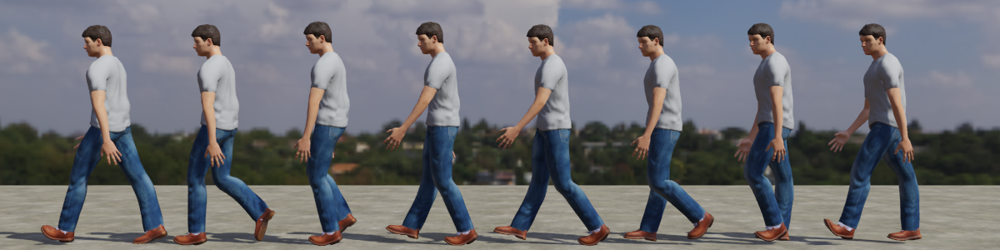
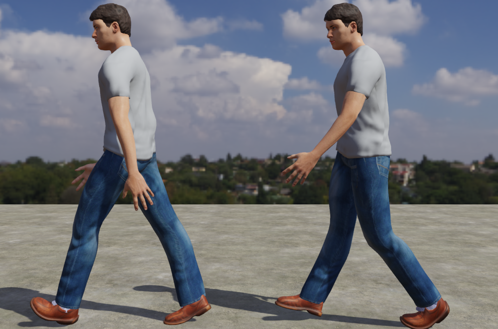
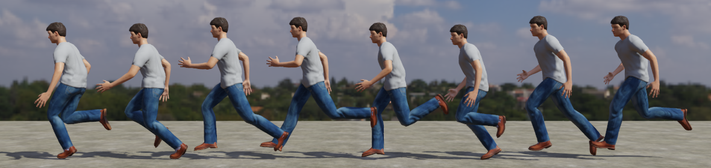
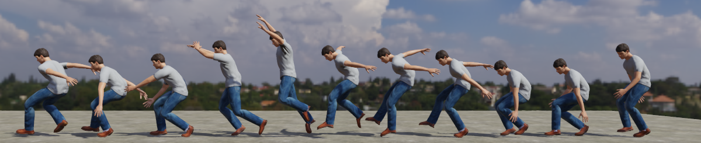
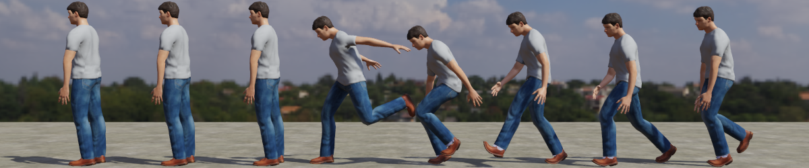
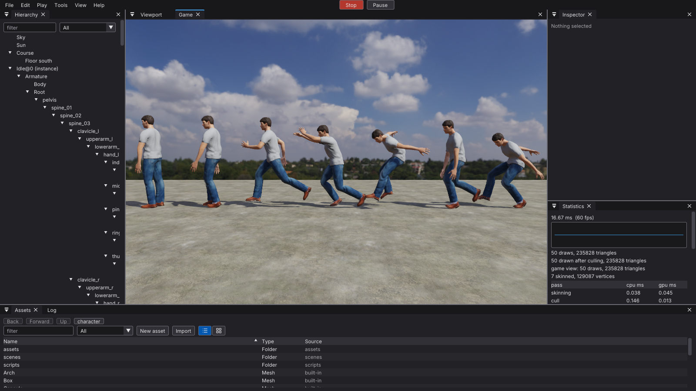

# Character sample: the locomotion clips

Issue [#505](https://github.com/Pacheco95/sonnet/issues/505), T7b of the Third-Person Character release: motion-captured idle, walk, run, jump take-off, fall and two landings on the humanoid of [#494](character-humanoid.md), with their foot contacts, footstep and landing events and stride lengths. The clips are in `apps/samples/character/assets/character/humanoid.glb` after `Stand`, their events in its sidecar. Sources, the CC BY 3.0 credit and every preparation step are in [the sample's LICENSES.md](../../apps/samples/character/LICENSES.md#locomotion-clips-issue-505); `tools/retarget_character_clips.py` repeats the retargeting from the download. The content is motion capture (ACCAD's Open Motion Project, subject Male 1), not the stylised fallback.

## The clips

| Clip | Length | Loops | Events (seconds) | Stride |
|---|---|---|---|---|
| `Idle` | 3.333 s | yes | | |
| `Walk` | 1.167 s | yes | `footstep` left 0, right 0.583 | 1.505 m a cycle, 1.29 m/s |
| `Run` | 0.667 s | yes | `footstep` left 0, right 0.333 | 3.235 m a cycle, 4.85 m/s |
| `JumpStart` | 0.567 s | no | | |
| `Fall` | 0.4 s | yes | | |
| `Land` | 0.8 s | no | `landing` 0.033, `footstep` left 0.6 | |
| `HardLand` | 0.733 s | no | `landing` (`hard`) 0.033, `footstep` left 0.333 | |

Every clip is in place: the capsule moves the character ([ADR-0038](../decisions/0038-character-controller.md)), so the clips keep the body's own sway and bob and drop the travel. Units are metres, the character faces -Z with its left on -X, and the shoes stand on y = 0 (no shoe goes more than 2 mm below it in any clip). Walk and run both put the left footstep at phase 0 and the right at 0.5, so a synchronised layer ([ADR-0038](../decisions/0038-character-controller.md#animation-weights-and-synchronisation)) keeps their feet together; T9's speed-matched playback divides the ground speed by the strides above. `landing` is the frame the first foot touches, one frame into the clip so the first update crosses it; `HardLand`'s carries the argument `hard`, and the footsteps after a landing are the other foot coming down. Keys are the capture's own, 30 a second, linear.

## Captures

The player under the course's lighting, RTX 4090, through temporary scenes (not committed) that place the model with its `Animator` stopped at the times given, turned to face -X so the camera sees its left side. Rows are left to right.

`Walk` at every eighth of the cycle from 0 (the left footstep):

The two footsteps, `Walk` at 0 (left heel down, left arm back) and 0.583 (right heel down):

`Run` at every eighth of the cycle:

`JumpStart` at 0, 0.133, 0.267, 0.4 and 0.533 (the feet off the ground), `Fall` at 0 and 0.2, then `HardLand` at 0.033 (its `landing` event, the left foot down), 0.2, 0.333 (its `footstep`) and 0.7:

`Idle` at 0, 1.1 and 2.2, then `Land` at 0.033 (its `landing` event, the right foot down), 0.2, 0.4, 0.6 (its `footstep`, the left foot down) and 0.8:

The editor in play mode (`sonnet_editor --scene <temporary> --play 1.5 --front game --screenshot-window`), every clip playing from 0 on its own instance: `Idle`, `Walk`, `Run`, `JumpStart`, `Fall`, `Land`, `HardLand`:

## Checks

- **Import**: the editor and the player open the project with no warning, the sidecar lists the seven new `Animation` sub-assets, and `Stand` keeps its identity, so the model's prefab still plays it first. The model's meshes, skin and textures are byte for byte those of #494.
- **Events**: a temporary script with `onAnimationEvent` on four instances logged, over 3 s of play, `Walk` right at 0.583 and left at each wrap, `Run` alternating left and right, and `landing`, `landing hard` and the two footsteps on `Land` and `HardLand`, at their times.
- **Cooked bundle**: `sonnet_cook` of a temporary scene placing every clip wrote a bundle the player ran with the clips playing, as above.
- **Two runs** of the script write the same `humanoid.glb` and sidecar.

## Not covered

- **A dedicated fall and landings from a standing jump.** ACCAD's Male 1 takes have none; the fall is the descent of a running jump, played forwards then back, and both landings come from moving jumps (`Land` from a hop on the walk, landing on the right foot; `HardLand` from a running two-footed jump), so they carry some forward lean.
- **The run's loop**: the take is two strides long and they differ, so closing the loop spreads up to 26.7° (the right toes) over the cycle; the walk's is at most 19.8°. Neither jumps, but the run is less regular than a long take would be.
- **Foot sliding in play** depends on T9's speed-matched playback; in the retargeted takes a planted heel or toe moves at most 1.5 cm over a contact. Foot IK on slopes and steps is [#500](https://github.com/Pacheco95/sonnet/issues/500).
- **Placement in the start scene** and the clip switching are T9's ([#496](https://github.com/Pacheco95/sonnet/issues/496)).
