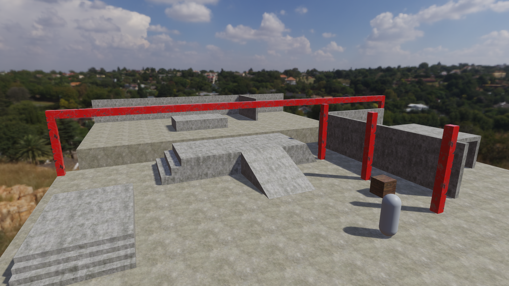
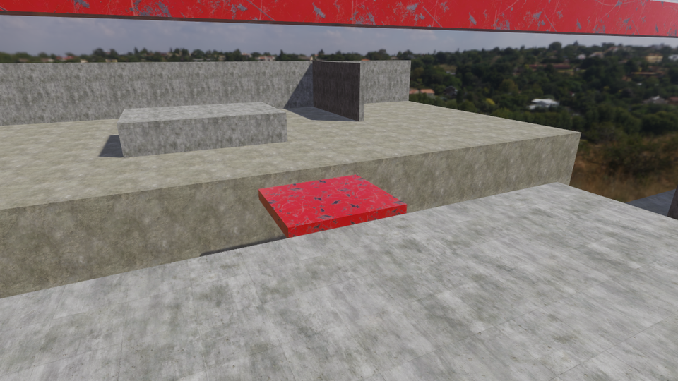
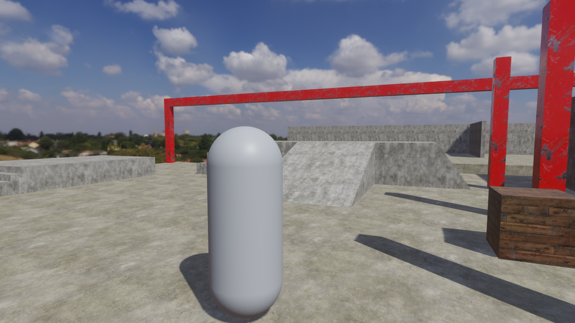
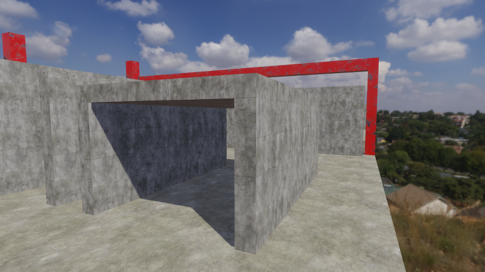
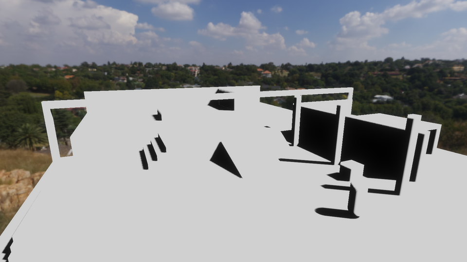

# Character sample: the obstacle course

Issue [#490](https://github.com/Pacheco95/sonnet/issues/490), the course of `apps/samples/character`, built before the humanoid with the engine's rigid bodies and scene facilities. Captured on Linux with an RTX 4090, the Debug player, TAA on (the default) and the renderer's default cascades, after three seconds of play.

```bash
python3 tools/generate_character_level.py level   # the course, its materials and the scene
./build/linux-debug/apps/player/sonnet_player apps/samples/character --play 3 --render-size 1600x900 --screenshot overview.png
```



The other views are the same scene through a temporary copy with the camera moved, removed afterwards: the pit and the platform from the deck, the start at a body's eye height, and the narrow passage beside the low ceiling's tunnel.

| | |
|---|---|
|  |  |
|  |  |

## What is there

Real-world scale, in metres, south (+Z) at the start:

- Four 0.2 m steps with 0.3 m treads onto a 0.8 m landing whose far edge drops back to the floor.
- A 1.5 m deck reached by three 0.5 m steps and a 20° ramp; its east side is a 55° ramp, too steep to walk, and its north edge is a ledge, a 1.5 m drop.
- Walls with an inside corner, a passage 0.8 m wide between two walls, a tunnel under a ceiling 2.0 m up, and beyond the pit a 1.2 m block and a corner of walls.
- Camera obstructions: three steel columns between the start and the course, and a beam along the pit's edge on two more columns.
- A dynamic crate, 0.9 m and 30 kg, and a dynamic capsule 1.8 m tall standing in for the body.
- A 6 m pit across the course. A kinematic platform, 3 m by 2.6 m, crosses it (`scripts/platform.lua`): it rests 1.5 s at each end and eases across 3.1 m in 2.5 s, moving in `fixedUpdate` so the body carries what stands on it. A trigger 10 m below the course (`scripts/kill_volume.lua`) puts a body that falls into it back above the `Respawn` marker at the start, at rest.

Every piece is a box or a wedge with a box collider; a ramp's collider is a box turned to the slope on a child entity, so collision is as simple as the shapes and lies on what is drawn. `runtime_tests` checks that, from the project and from its cooked bundle: rays land on each step, the deck, the ledge block and halfway up each ramp at the drawn heights and slopes, and across the passage and up to the ceiling at the drawn distances; the crate and the body come to rest on the floor; the platform holds still for its pause, then stands 3.1 m on at its far end; and a body dropped into the pit is back at the start.

## Lighting and materials

The sky is Poly Haven's Kloofendal 48d Partly Cloudy, an unclipped capture. `prepare` takes the sun's disc out of it and gives its energy to the scene's directional light, so the sun is where the map has it, 47.9° up, and the light it casts is what the disc held, with no double lighting through the image-based terms. Sun and sky put about 5 units of irradiance on the ground, about 2.4 parts sun to 1 part sky, as a partly cloudy midday gives; the camera's exposure of 0.5 puts sunlit concrete in the upper middle of the tone curve and keeps the clouds.

The materials are ambientCG's (concrete for the floors and the walls, a red primer for the steel, weathered planks for the crate), each with base colour, normal, and occlusion, roughness and metalness maps at 1024 texels per 2 m. Their colour maps are scaled to measured albedos, since ambientCG's are darker than the surfaces themselves. Sources, licences and every preparation step are in [the sample's LICENSES.md](../../apps/samples/character/LICENSES.md).

## Shadows

The course needs no shadow settings of its own: the renderer's defaults (four cascades over 80 m, `shadowBias` 0.0015) give the shadow factor above, with no acne on the floors, walls or ramps and every shadow meeting its caster, under the capsule and the crate and at the foot of each column and wall. Shadow settings are the renderer's, not the scene's, so a scene cannot carry tuning of its own.

## Not covered

- Ambient occlusion: the floors and walls meet with no darkening in the corners; it is [issue 501](https://github.com/Pacheco95/sonnet/issues/501).
- The background is a photograph taken at about 2 m above a hillside, so from the high camera the hill's rocks look large; at a body's eye height they sit as they should.
- The red primer is saturated, as the source's paint is; it marks the obstructions plainly.
