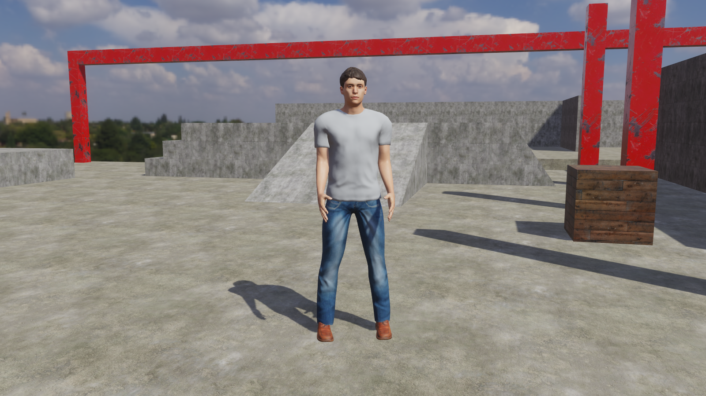
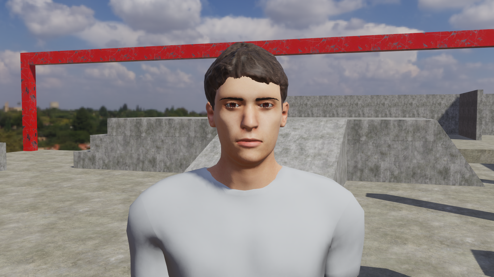
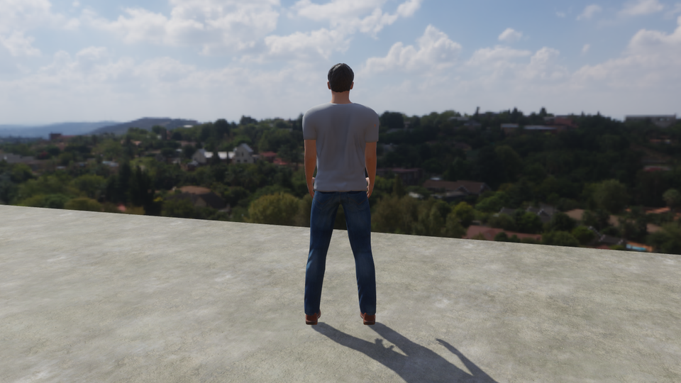
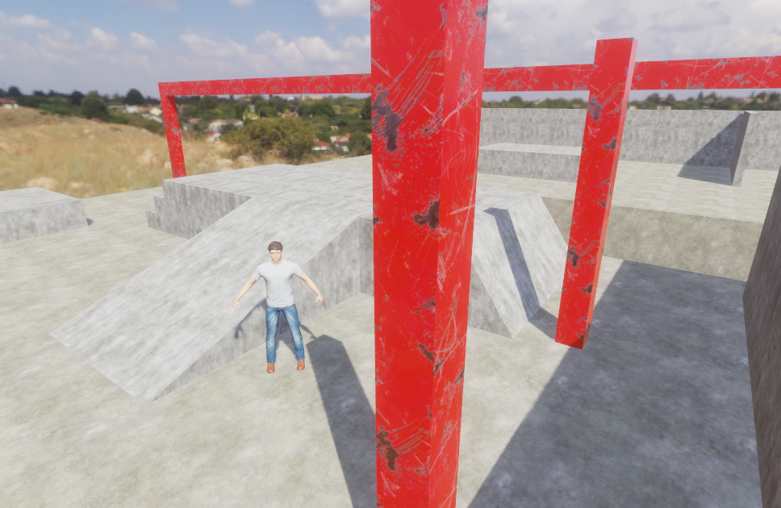

# Character sample: the humanoid

Issue [#494](https://github.com/Pacheco95/sonnet/issues/494), the rigged model of `apps/samples/character`: `assets/character/humanoid.glb`, a young adult man in a T-shirt, jeans and leather shoes, built from CC0 MakeHuman content with MPFB 2 in Blender and exported to glTF. Sources, licences and every preparation step are in [the sample's LICENSES.md](../../apps/samples/character/LICENSES.md); `tools/generate_character_humanoid.py` repeats the build from the downloads. The model is realistic content, not the stylised fallback.

## Captures

The player under the course's lighting (Poly Haven's Kloofendal sky and the sun taken out of it, [character-course.md](character-course.md)), TAA on, after one second of play, through a temporary copy of the start scene with the placeholder capsule replaced by the model and the camera moved, removed afterwards. The model plays its `Stand` clip, so the arms are lowered from the bind pose by the skinning pass. Captured on Lavapipe (Mesa 25, the device CI tests on), since the RTX 4090 hangs on this scene with any skinned mesh ([below](#not-covered)).

```bash
VK_DRIVER_FILES=/usr/share/vulkan/icd.d/lvp_icd.json ./build/linux-debug/apps/player/sonnet_player apps/samples/character \
  --scene scenes/<copy>.scene.json --play 1 --render-size 1600x900 --screenshot standing.png
```





| | |
|---|---|
|  |  |

The last is the editor's viewport (`sonnet_editor --scene <copy> --screenshot`, Lavapipe) in edit mode, where no clip plays: the bind pose, an A pose, skinned and textured.

## The model

| | |
|---|---|
| Size | 1.82 m to the top of the hair, 1.81 m to the top of the head; eyes at 1.69 m |
| Units and axes | metres, +Y up, facing -Z (the engine's forward, as cameras and the audio listener face); the character's left is -X |
| Origin | the `Root` bone, on the ground between the feet; the shoe soles rest on y = 0 |
| Mesh | one skinned node, `Body`, 18,441 vertices and 33,688 triangles in seven submeshes: Skin, Eyes, Eyelashes, Eyebrows, Hair, Clothes, Shoes; at most four joints per vertex |
| Skin | 53 joints, the whole rig |
| Clips | `Stand`, static: the arms lowered 40° from the A pose. The model's prefab plays it on placement, being its first clip |
| Textures | 2048 texels: skin base colour, normal and ORM (with its own baked ambient occlusion), clothes base colour, normal and ORM, hair base colour and normal. 1024: shoes base colour and normal, eyes. 512: brows and lashes |
| File | 6.4 MB, textures embedded |

### Skeleton

MPFB's `game_engine` rig: Unreal Engine mannequin names, which motion-capture retargeting tools and readers recognise. Every joint is a node under `Armature`, so a clip's channel or a script names it by its path, `Armature/Root/pelvis/spine_01/...`. Rest lengths are this body's.

| Chain | Joints, parent first |
|---|---|
| Root and spine | `Root` (ground, origin) → `pelvis` (0.98 m) → `spine_01` → `spine_02` → `spine_03` → `neck_01` → `head` |
| Arms, `_l` and `_r` | `spine_03` → `clavicle` → `upperarm` → `lowerarm` → `hand` |
| Fingers, `_l` and `_r` | `hand` → `thumb_01..03`, `index_01..03`, `middle_01..03`, `ring_01..03`, `pinky_01..03` |
| Legs, `_l` and `_r` | `pelvis` → `thigh` (0.98 m) → `calf` (0.53 m) → `foot` (ankle, 0.08 m) → `ball` (0.01 m, 0.13 m ahead of the ankle) |

For T7b ([#505](https://github.com/Pacheco95/sonnet/issues/505)): `Root` carries no weights and stays on the ground, so root motion can move it (or the `Animator`'s entity) while `pelvis` holds the hips' height. CMU's skeleton (its BVH and MPFB's `cmu_mb` rig) maps as `Hips` → `pelvis`, `LowerBack`/`Spine`/`Spine1` → `spine_01..03`, `Neck`/`Neck1` → `neck_01`, `Head` → `head`, `LeftShoulder`/`LeftArm`/`LeftForeArm`/`LeftHand` → `clavicle_l`/`upperarm_l`/`lowerarm_l`/`hand_l`, `LeftUpLeg`/`LeftLeg`/`LeftFoot`/`LeftToeBase` → `thigh_l`/`calf_l`/`foot_l`/`ball_l`, and the same for the right; `LHipJoint`/`RHipJoint` have no counterpart and fold into `pelvis`. Clips go into this file or beside it by rebuilding it with the clips added, so their node paths stay the model's.

## Content and the renderer

Without subsurface scattering ([#502](https://github.com/Pacheco95/sonnet/issues/502)) and an ambient-occlusion pass ([#501](https://github.com/Pacheco95/sonnet/issues/501)), the textures are chosen and prepared to hold up:

- The skin map is MakeHuman's own photographic one, evenly lit, so it carries no baked light that would fight the sun; its occlusion, baked from the body's own shape, darkens the ears, nostrils, eye sockets, fingers and armpits, which an AO pass would otherwise give.
- The normal map on the body is a sculpted one with body hair and muscle (Mindfront's Aksel skin, same UV layout). Its face and neck are replaced: they carry make-up injuries and deeper tendons than this body has, and showed as a swollen eye and ridges on the neck.
- The T-shirt's MakeHuman logo is removed, so the sample shows no third-party mark.

Gaps that remain visible in the captures:

- **Skin reads as matte paint.** No light passes through the ears, nostrils or the edges of the face, and the terminator is hard where skin would turn red and soft; this is what #502 is for.
- **No contact darkening between parts.** The collar, sleeves and hairline meet the skin with no shadow of their own at this scale (the sun's shadow maps are coarser), and the shirt shows only its large folds; #501 and contact shadows ([#509](https://github.com/Pacheco95/sonnet/issues/509)).
- **Hair cards have hard edges.** They are alpha-masked at 0.35, so the fringe is cut rather than wispy, and they shade as a surface, with no strand highlight (#502's hair half).
- **The shoes are 1024 texels**, the largest the source has, and the eyes have no wet cornea: the cornea's shell is masked out so the iris shows.

## Not covered

- **The RTX 4090 hangs with a skinned mesh in the course's scene.** The player loses the device after the first frames (`VK_ERROR_DEVICE_LOST`, kernel `Xid 109, CTX SWITCH TIMEOUT`) when the start scene holds this model, and also when it holds the basic sample's `walker.glb` instead, so it is not this asset. The same scene without the skinned mesh draws, the model with the skin stripped draws, the model with only the sky, sun, floors, columns, walls, ramps or steps around it draws, and Lavapipe draws it all; only the whole course together with a skinned mesh hangs. The editor in play mode did not hang, but its viewport did not see the model. Left for an issue of its own; the captures above are Lavapipe's. Fixed since by [#514](https://github.com/Pacheco95/sonnet/issues/514): the frame upload's `parallelFor` ran the model's asset publish, whose new materials were written past the frame's material array and over the motion pass's per-draw data ([core.md](../core.md#the-job-system)).
- **The editor's Game view capture times out on this project.** `sonnet_editor apps/samples/character --front game --screenshot-window ...` fails with "the assets were still loading after 120s", with or without the humanoid, so the editor capture is the viewport's.
- **Feet and hands in motion.** The bind pose and `Stand` are the only poses checked; clips, foot contacts and stride lengths are T7b ([#505](https://github.com/Pacheco95/sonnet/issues/505)). The weights are MPFB's, unedited.
- **Placement in the start scene** is T9's ([#496](https://github.com/Pacheco95/sonnet/issues/496)); the scene still has the placeholder capsule. No test cooks or draws the model: `runtime_tests` keeps playing the course from the project, which reads only the model's structure at open.
