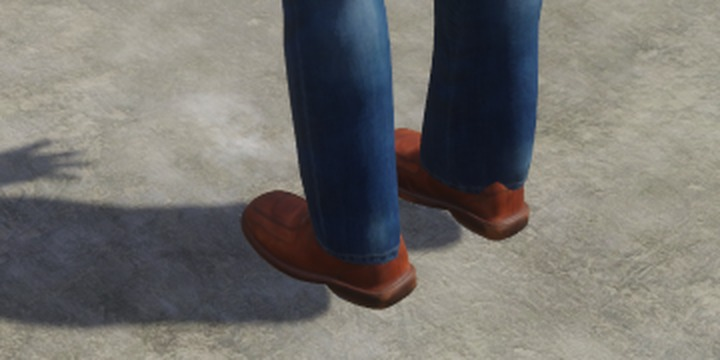
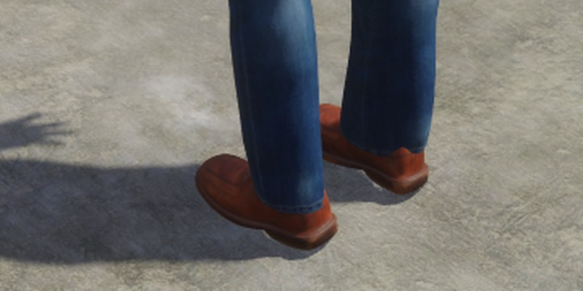
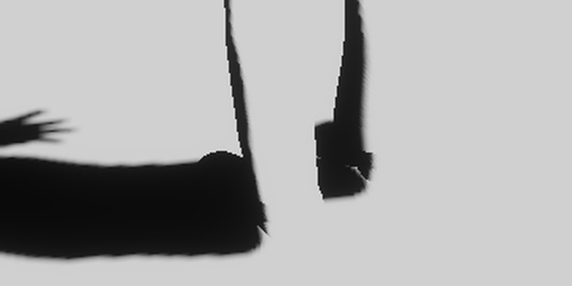
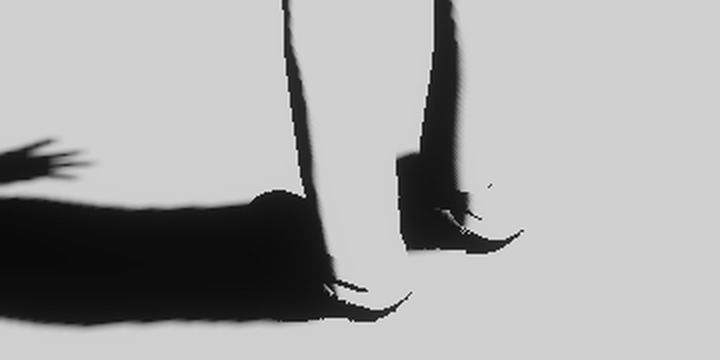

# Contact shadows on the RTX 4090

Measured 2026-11-09 for [#509](https://github.com/Pacheco95/sonnet/issues/509), the implementation of [ADR-0039](../decisions/0039-screen-space-ambient-occlusion-and-contact-shadows.md)'s sun contact shadows ([rendering.md](../rendering.md#contact-shadows)), with ambient occlusion (#501) not yet in the tree; the player runs at 1920×1080 and the sustained pair were added on 2026-11-16 for [#557](https://github.com/Pacheco95/sonnet/issues/557) ([Player runs at 1920×1080](#player-runs-at-19201080)). The phone measurement is [#540](https://github.com/Pacheco95/sonnet/issues/540); until it passes, the Android and iOS players keep the effect off.

## Setup

- Linux, NVIDIA GeForce RTX 4090, driver 595.71.05, Vulkan 1.4, power profile `performance`. Release build with Clang 20 of the branch at `87eb6e3` with the benchmark of `38a3073` (the GCC 14 Release build stops on a `-Werror=null-dereference` inside nlohmann/json in `world/src/Scene.cpp`, which this change does not touch).
- The standard quality, 16 steps, and the reduced one, 8 steps, both at full resolution. Renderer defaults otherwise: TAA, occlusion culling, four 2048-texel cascades over 80 m, bloom.
- GPU times are the render graph's per-pass timestamps. A whole frame is the sum of every pass of a frame whose every pass has its sample; the tables give the median and p95 of those frames.
- Raw logs and scripts are outside the repository.

## Headless, 1920×1080

`renderer_tests "[contact-cost]"` (Release): a ground that fills the lower half of the view under 400 boxes and a sky, the sun low enough that every box has a contact. It renders headless, so no present paces the GPU and its clock stays at 2760 MHz. Each run warms up for 120 frames and measures 300; three pairs alternate which goes first.

| Steps | Off, frame median / p95 | On, frame median / p95 | Added, median | Pass median / p95 |
|---|---|---|---|---|
| 16 | 0.328 / 0.332 ms | 0.407 / 0.411 ms | **+0.078 ms** | 0.078 / 0.078 ms |
| 8 | 0.329 / 0.332 ms | 0.381 / 0.386 ms | **+0.053 ms** | 0.051 / 0.051 ms |

The off column is pairs 1 and 2; the first off run of the 16-step session (0.356 ms) was still raising its clock and is left out. All 300 frames of every run were whole. The added time is the pass itself: the forward pass's one extra texel load per pixel does not show.

## Player runs at 1920×1080

Taken 2026-11-16 for [#557](https://github.com/Pacheco95/sonnet/issues/557), which redid the runs #509 had to discard: #509's 1080p player runs were taken while the desktop was locked, which paced the presents at one a second with the GPU at its idle clock, and its five indicative course runs at 1600×900 (+0.05 to 0.10 ms, pass 0.08 ms) were not under the lock. These replace them.

- `linux-release` (RelWithDebInfo) built with Clang 20 at `3020429`, which has ambient occlusion (#501) and the headless player of [#555](https://github.com/Pacheco95/sonnet/issues/555). NVIDIA driver 595.99.02, power profile `performance`.
- The Release `sonnet_player` with `--headless on --render-size 1920x1080 --contact-shadows on|off`, as [player.md](../player.md#headless-runs) prescribes for desktop timing runs. No window maps, so neither the desktop's lock nor the monitor's refresh paces the frames. Every run held the shared GPU timing lock, waited until at most one compiler process was running before taking it (none was, at every start), and logged the load average and the power profile before and after, and the GPU's clock, P-state, temperature and utilisation before, during (every second, every ten for the sustained runs) and after.
- The three scenes: the character course's `capture_contact_shadows` (`--play 3`, the character standing at the start, a still camera), the course's `route` scene (`--play 20`, the camera trailing the character over the deterministic traversal) and the showcase's main scene (`--play 3`). Only the first asks for contact shadows, so the route and the showcase ran from temporary copies whose sun asks for them (length 0.2 m, thickness 0.02 m), deleted afterwards. `--contact-shadows` is the only difference between on and off. The course and the route ask for ambient occlusion in both modes; the showcase does not.
- The GPU figure is the player's `capture frame times` line: the median and p95 of the last 100 complete GPU frames before the capture (all 100 complete in every run), and the contact pass's mean over them. Three pairs a scene alternate the order (on first, off first, on first). Each scene's three on screenshots were byte-identical, and so were its three off ones; on and off differ.

Cold pairs (milliseconds of whole GPU frame, median / p95):

| Scene | Pair | Off | On | Added median / p95 | Contact pass |
|---|---|---|---|---|---|
| Course, still | 1 | 0.590 / 0.599 | 0.694 / 0.699 | +0.104 / +0.100 | 0.102 |
| Course, still | 2 | 0.591 / 0.596 | 0.695 / 0.699 | +0.104 / +0.103 | 0.102 |
| Course, still | 3 | 0.590 / 0.593 | 0.696 / 0.703 | +0.106 / +0.110 | 0.102 |
| Route | 1 | 0.444 / 0.451 | 0.509 / 0.521 | +0.065 / +0.070 | 0.064 |
| Route | 2 | 0.441 / 0.449 | 0.509 / 0.517 | +0.068 / +0.068 | 0.064 |
| Route | 3 | 0.441 / 0.450 | 0.506 / 0.516 | +0.065 / +0.066 | 0.064 |
| Showcase | 1 | 0.666 / 0.676 | 0.749 / 0.755 | +0.083 / +0.079 | 0.082 |
| Showcase | 2 | 0.665 / 0.673 | 0.748 / 0.756 | +0.083 / +0.083 | 0.082 |
| Showcase | 3 | 0.666 / 0.673 | 0.748 / 0.755 | +0.082 / +0.082 | 0.082 |

The GPU ran at 2745 to 2760 MHz in P0 in every sample of every run. The first run started from the idle clock (210 MHz, P8) and was at 2760 MHz within its first second, well before its window; its figures match the later pairs'. A cold run takes one to two seconds, the frames 0.6 to 0.8 ms apart: headless, nothing but the GPU and the player's CPU time pace them.

The pass's cost follows what it traces: 0.10 ms on the course's start, where the view is mostly the near floor and the columns close by, 0.064 ms on the route's trailing view with more sky, and 0.082 ms on the showcase. The added whole frame is the pass to within 0.005 ms in every pair, as in the headless benchmark.

Sustained pair, the course's still view, about 600 s of wall-clock time each (`--play 13889` on, `--play 16129` off: the frames are as fast as the GPU allows, so the play time was chosen from the cold runs' frame intervals to give ten minutes of each), clocks, temperature and utilisation sampled every ten seconds:

| Run | Wall time | GPU during the run | Last 100 frames, median / p95 | Contact pass |
|---|---|---|---|---|
| on | 610 s | 2700 to 2730 MHz, P0, 78 to 79 °C, 98 to 99 % busy | 0.710 / 0.715 ms | 0.104 ms |
| off | 610 s | 2685 to 2745 MHz, P0, 77 to 79 °C, 95 to 99 % busy (one sample 62 %) | 0.598 / 0.602 ms | |
| **Added** | | | **+0.112 / +0.113 ms** | |

After ten minutes of full load the GPU holds within 2 % of its cold clock and the added time is 0.007 ms over the cold pairs', far inside the 0.5 ms budget; the pass itself is 0.104 ms against 0.102 cold. No throttling was seen. The off run of the pair ran first, at 11:23, and was discarded: halfway through, something else on the machine held the player back (the GPU fell to 50 to 60 % busy for minutes, one sample at 1695 MHz in P3, and ten minutes of play took 750 s), and the load was not being sampled then, so its conditions cannot be confirmed. Its last 100 frames (0.598 / 0.603 ms) agree with the rerun's anyway. The rerun, at 14:01 after the on run of 11:35, also logged the load average and the compilers running every ten seconds: none, load at most 3.8 on 16 threads.

## Against ADR-0039's desktop budget

The added whole-frame time is at most 0.5 ms for contact shadows: **met** at both qualities, median and p95, cold and sustained. The headless benchmark adds 0.08 ms (16 steps) and 0.05 ms (8 steps); the player at 1080p adds 0.065 to 0.106 ms to the median and 0.066 to 0.110 ms to the p95 over the three scenes, and 0.112 ms (median) and 0.113 ms (p95) after ten minutes of full load. Desktop renderers keep the standard 16 steps.

What remains unmeasured: the 8-step quality in the player, windowed runs (presentation and frame pacing included), and every phone figure (#540).

## Captures

The character course, `capture_contact_shadows` at `--play 3`, 1600×900, with the sun's contact shadows and without (`--contact-shadows off`). The effect is small by design: it adds the contact under the soles and at the columns' feet that the cascades' filter softens away, and leaves the rest of the frame alone.

| Without | With |
|---|---|
|  |  |
|  |  |

The whole frames: [without](contact-shadows/course-off.jpg) and [with](contact-shadows/course-on.jpg).
