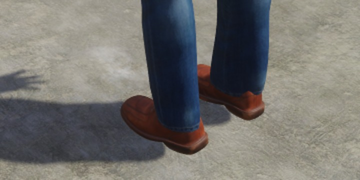
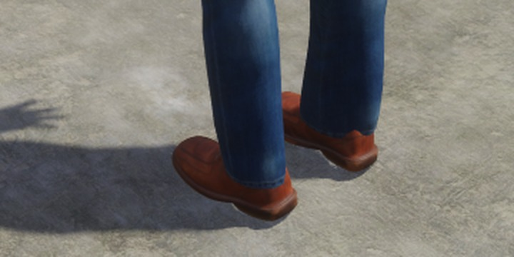
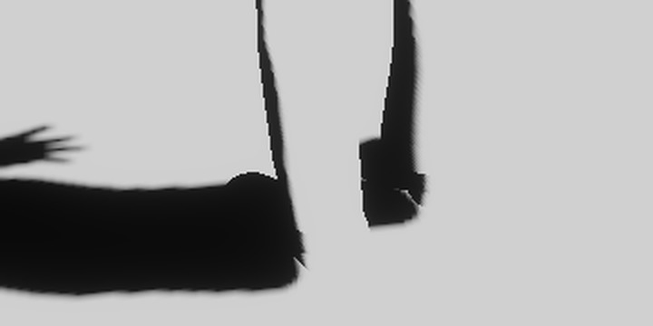
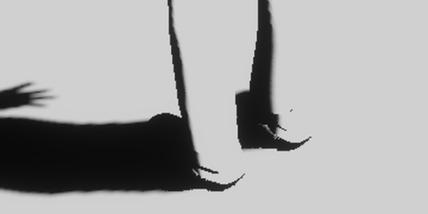

# Contact shadows on the RTX 4090

Measured 2026-11-09 for [#509](https://github.com/Pacheco95/sonnet/issues/509), the implementation of [ADR-0039](../decisions/0039-screen-space-ambient-occlusion-and-contact-shadows.md)'s sun contact shadows ([rendering.md](../rendering.md#contact-shadows)). Ambient occlusion (#501) was not in the tree. The phone measurement is [#540](https://github.com/Pacheco95/sonnet/issues/540); until it passes, the Android and iOS players keep the effect off.

## Setup

- Linux, NVIDIA GeForce RTX 4090, driver 595.71.05, Vulkan 1.4, power profile `performance`. Release build with Clang 20 of the branch at `87eb6e3` with the benchmark of `38a3073` (the GCC 14 Release build stops on a `-Werror=null-dereference` inside nlohmann/json in `world/src/Scene.cpp`, which this change does not touch).
- The standard quality, 16 steps, and the reduced one, 8 steps, both at full resolution. Renderer defaults otherwise: TAA, occlusion culling, four 2048-texel cascades over 80 m, bloom.
- GPU times are the render graph's per-pass timestamps. A whole frame is the sum of every pass of a frame whose every pass has its sample; the tables give the median and p95 of those frames.
- Raw logs and scripts are outside the repository.

## Headless, 1920×1080

`renderer_tests "[contact-cost]"` (Release): a ground that fills the lower half of the view under 400 boxes and a sky, the sun low enough that every box has a contact. It renders headless, so no present paces the GPU and its clock stays at 2760 MHz. Each run warms up for 120 frames and measures 300; three pairs alternate which goes first.

| Steps | Off, frame median / p95 | On, frame median / p95 | Added, median | Pass median / p95 |
|---|---|---|---|---|
| 16 | 0.328 / 0.332 ms | 0.407 / 0.411 ms | **+0.078 ms** | 0.078 / 0.078 ms |
| 8 | 0.329 / 0.332 ms | 0.381 / 0.386 ms | **+0.053 ms** | 0.051 / 0.051 ms |

The off column is pairs 1 and 2; the first off run of the 16-step session (0.356 ms) was still raising its clock and is left out. All 300 frames of every run were whole. The added time is the pass itself: the forward pass's one extra texel load per pixel does not show.

## The character course, 1600×900

`capture_contact_shadows` of `apps/samples/character` (the character standing at the start, stationary camera), the Release player with `--render-size 1600x900`, `--play 3`, a 100-frame window each:

| Run | Frame median / p95 | Contact pass | Interval median / p95 |
|---|---|---|---|
| on | 0.459 / 0.463 ms | 0.085 ms | 2.77 / 3.12 ms |
| on | 0.421 / 0.427 ms | 0.077 ms | 2.78 / 3.07 ms |
| on (`--contact-shadows on`) | 0.465 / 0.472 ms | 0.086 ms | 2.75 / 3.80 ms |
| off | 0.359 / 0.364 ms | | 2.79 / 3.30 ms |
| off | 0.372 / 0.397 ms | | 2.66 / 4.95 ms |

These five runs were not taken under the shared GPU timing lock and are not at 1080p, so they are indicative only: the course adds 0.05 to 0.10 ms, the pass is 0.08 ms. The paired runs at 1920×1080 of this scene, of a deterministic traversal (the route scene) and of the showcase, under the lock, could not be taken: the desktop was locked during the measurement window, which paces the player's presents at one a second with the GPU at its idle clock (210 MHz), and those runs were discarded. Nor was a sustained 600 s run made on the desktop GPU.

## Against ADR-0039's desktop budget

The added whole-frame time is at most 0.5 ms for contact shadows: **met** at both qualities, at +0.08 ms (16 steps) and +0.05 ms (8 steps), median and p95, at 1080p headless; the course's indicative runs agree. Desktop renderers keep the standard 16 steps.

What remains unmeasured: the course and showcase at 1080p under the lock, the sustained window on the desktop, and every phone figure (#540).

## Captures

The character course, `capture_contact_shadows` at `--play 3`, 1600×900, with the sun's contact shadows and without (`--contact-shadows off`). The effect is small by design: it adds the contact under the soles and at the columns' feet that the cascades' filter softens away, and leaves the rest of the frame alone.

| Without | With |
|---|---|
|  |  |
|  |  |

The whole frames: [without](contact-shadows/course-off.jpg) and [with](contact-shadows/course-on.jpg).
