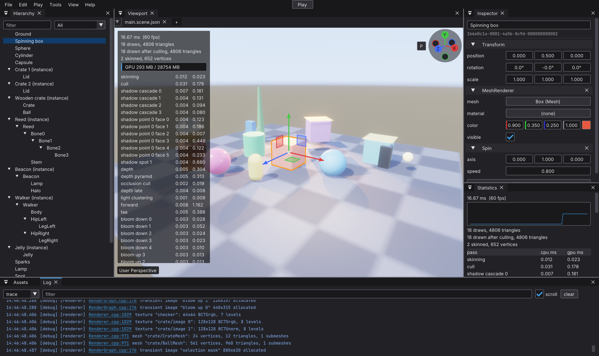
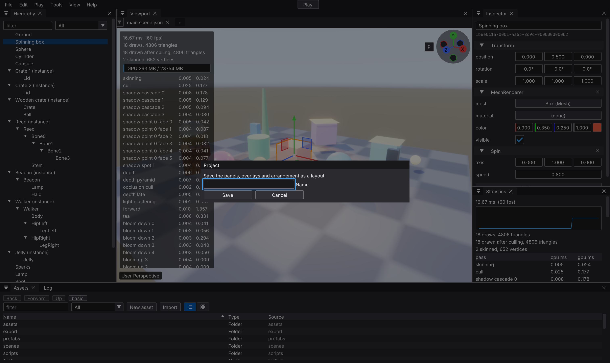
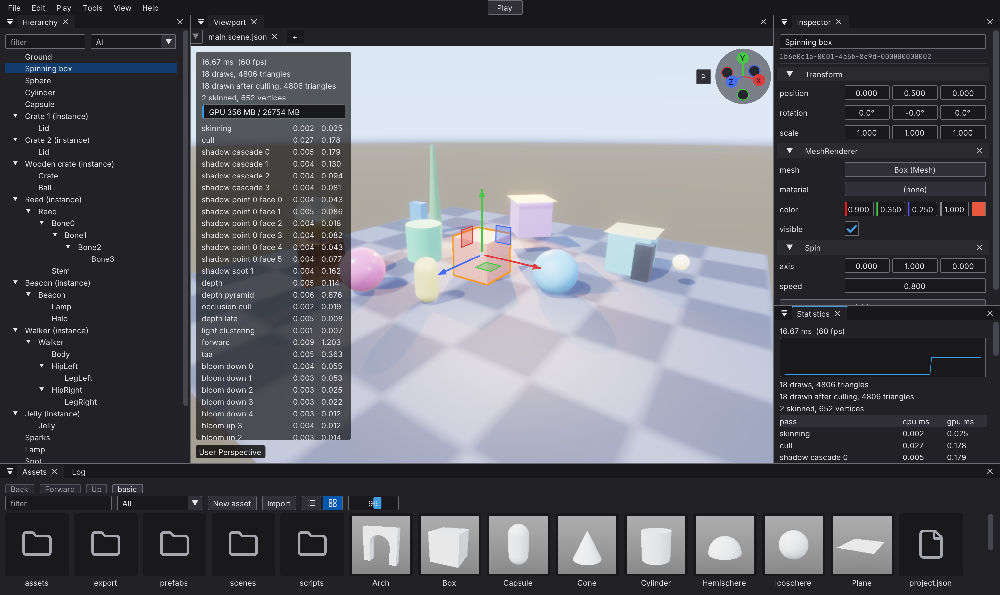
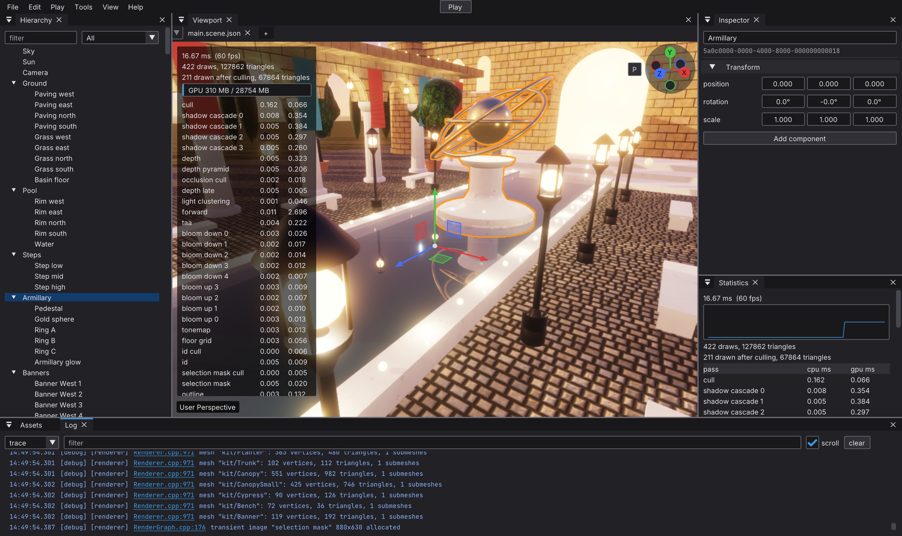
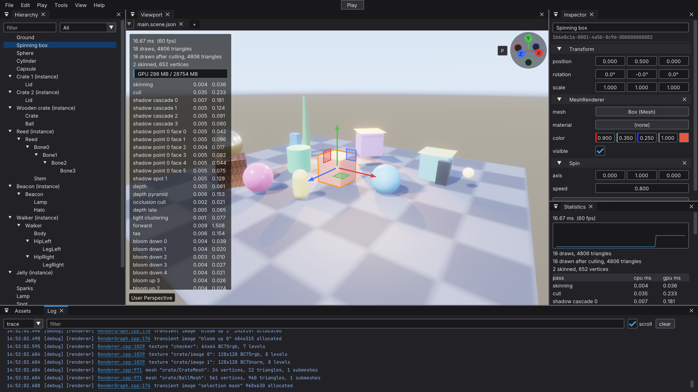
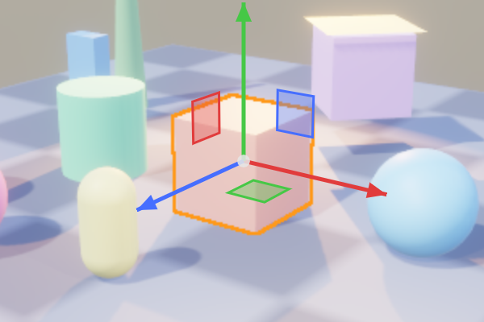

# The themed editor on macOS

[Issue 419](https://github.com/Pacheco95/sonnet/issues/419), checked on 2026-11-02.
Source: `b27beaf3e654a0d59eb72321f4ee533bc22d0929` from
`origin/docs/editor-theme-scales`, including the display-scale fix `cca95f2`
from PR #421. Validation branch: `mac-validation/editor-theme-scales`.

Setup: 14-inch MacBook Pro, Apple M4 Max, macOS 27.2 (26B123), built-in
Liquid Retina XDR display, native 3024 × 1964 pixels; no external display
connected (owner confirmed). The baseline capture implies 1512 points across
at density 2. The owner supplied the native resolution and confirmed restoring
the Default setting after the More Space capture.

Built with `cmake --preset macos-release`, explicitly selecting Xcode's Apple
Clang and its matching SDK. The Command Line Tools SDK selected by `xcrun`
was incompatible with Xcode's linker (`libSystem.tbd: unknown architecture`).
`cmake --build --preset macos-release --target sonnet_editor` built the module;
target `sonnet_editor_app` then built the executable and shaders. The linker
warned about duplicate SDL3 and meshoptimizer libraries; the build succeeded.
Capture runs needed access outside the sandbox: inside it SDL reported no
displays. No engine code was changed.

| Display | Capture size | Scale logged | Viewport target / panel pixels | Result |
|---|---|---|---|---|
| Retina, Default | All four: 3024 × 1800 | `display scale 1 -> 1` in every run | 880 × 630 / 1760 × 1260 | UI scale correct; half-resolution scene confirms #422. |
| Retina, More Space (owner selected) | 3200 × 1800 | `display scale 1 -> 1` | 968 × 630 / 1936 × 1260 | Same UI point sizes, more horizontal room; #422 persists. |
| Non-Retina | Not checked | Not checked | Not checked | No external display connected. |

All four baseline commands exited 0 and logged no `[warn]` or `[error]` lines.
Each basic run (Log, dialog and grid) and the showcase logged the same final
`render target "viewport" 880x630` line. The scene rectangle in the basic PNG
is x=578–2337, y=140–1399 inclusive: exactly twice the target in each dimension.
The window is 1512 × 900 points rather than the requested 1600 × 900: the
capture width matches the current display width, consistent with the window
being constrained to the display. It therefore differs from the expected
3200 × 1800 capture without doubling or halving the UI.

Compared with the Linux scale-1 `basic-after.png`, text and controls occupy the
same point sizes, with similar panel heights and visible hierarchy rows; the
narrower window reduces horizontal room. Close buttons and input/button
outlines remain visible, text and gizmos are sharp, toolbar icons are centred,
and the statistics overlay stops above “User Perspective.” The save-layout
dialog is centred and fully visible. Assets thumbnails are intact, although
their previews are softer than text. The scene and orange selection outline
show larger pixel steps, particularly in the 1:1 crop, as predicted by #422.
Every image was opened and checked for private text before inclusion; none
needed redaction.

The More Space basic capture also exited 0 with no `[warn]` or `[error]` lines.
It logged `display scale 1 -> 1` and `render target "viewport" 968x630`.
The scene rectangle is x=578–2513, y=140–1399 inclusive, retaining the density-2
ratio. The 1600 × 900 point window now fits. Text, close buttons, outlines,
icons and the overlay remain correct; the scene retains the half-resolution
selection-edge steps. The scaled “Looks like” resolution was not supplied.

- Moving between displays and detaching onto another display: **not checked**;
  only one display connected.
- Floating Log panel and restart on one display: **passed (owner observed)**;
  after dragging Log over the viewport, quitting with Cmd+Q and restarting
  the same scratch copy, it reopened at the same position and size, inside
  the main window and below the editor's menu bar. The agent did not capture
  the screen; the owner supplied the visual result. Both launches logged only
  the initial `display scale 1 -> 1`, with no `[warn]` or `[error]` lines.

The 600 × 400 crop below preserves source pixels at 1:1, from
`macos-basic-retina.png`, rectangle x=1156, y=570, width=600, height=400.

