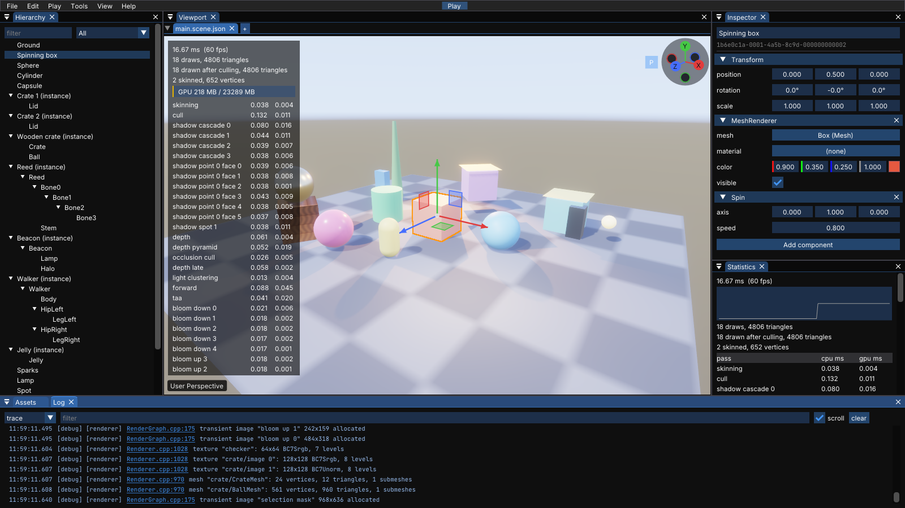
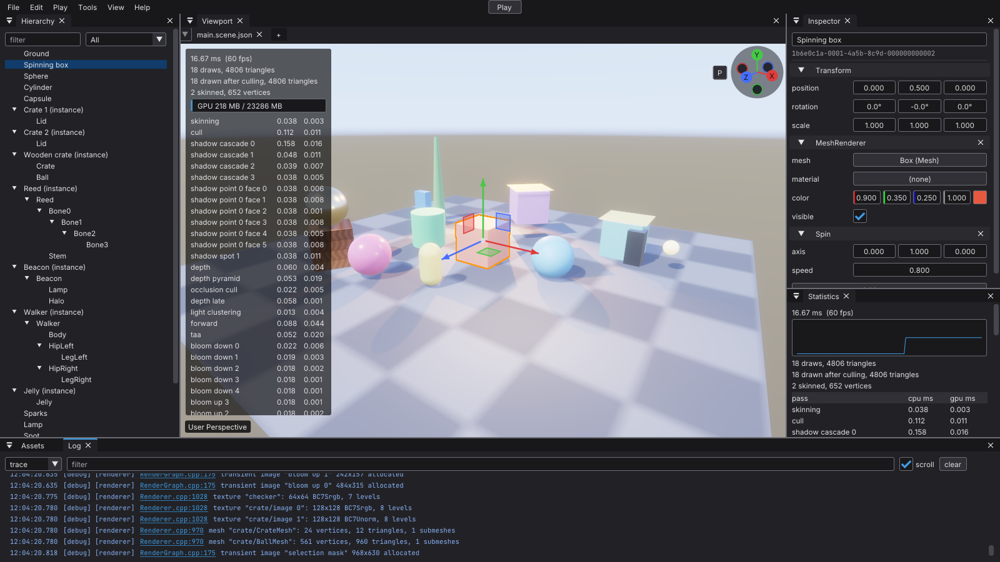
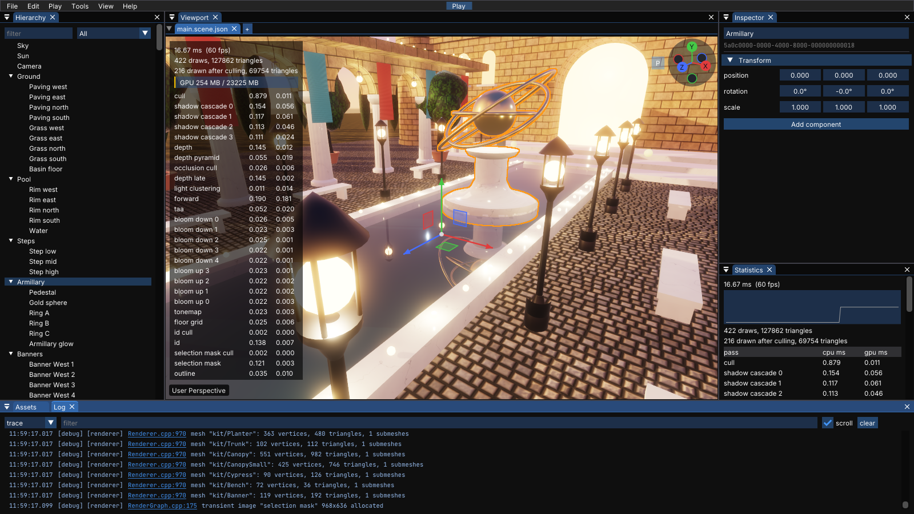
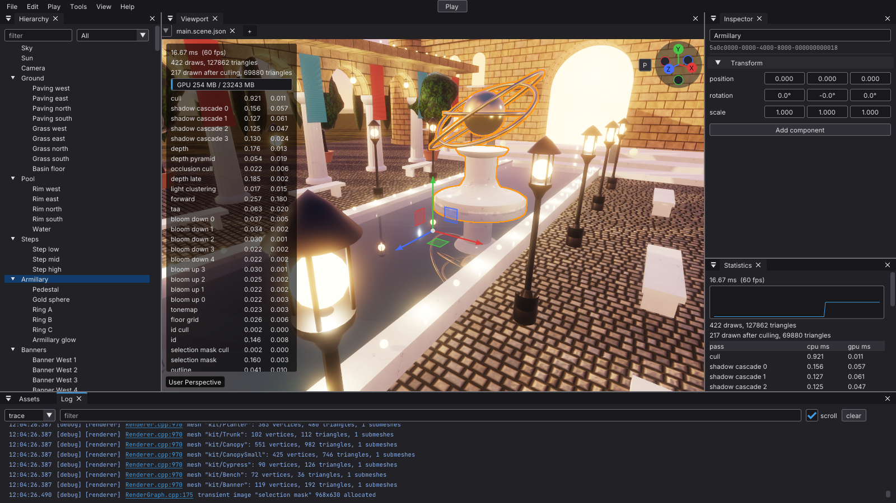
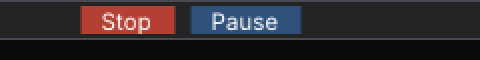
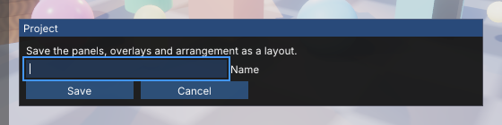
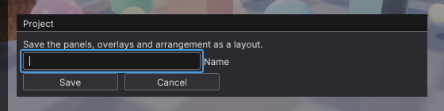
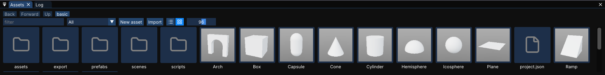
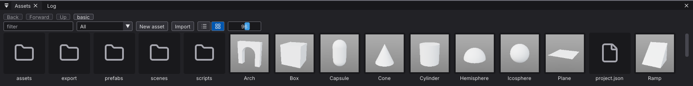

# The editor's look: before and after Graphite

[Issue 391](https://github.com/Pacheco95/sonnet/issues/391). Status: captured on 2026-11-02 on Linux (X11, scale 1, RTX 4090, `linux-debug`), before at d36674d and after on the branch that gives `ui::Theme` the Graphite values. The look itself, its roles and the contrast it is held to are in [editor.md](../editor.md#theme); the candidates and the choice are in the issue.

Every capture is a `--screenshot-window` run of the editor ([Screenshots](../editor.md#screenshots)), which starts from the built-in layout and default preferences, so before and after differ only by the theme. The dialog is `save-layout` because the other dialogs show the project's absolute path. A capture has no pointer, so the hovered and pressed states are covered by `ThemeTests`, not here.

## The basic sample

`sonnet_editor apps/samples/basic --select "Spinning box" --front log`

Before, Dear ImGui 1.92.9's dark style:

After, Graphite: neutral grey panels, recessed outlined fields, raised outlined buttons, grey inspector component headers, and the accent only on the selected row, the focused tab's line, the checkmarks and links. Controls are 22 px tall instead of 20 (`framePadding.y` 4), so the inspector now scrolls to reach "Add component" in this layout.

## The showcase

`sonnet_editor apps/samples/showcase --select Armillary --front log`

## Details, at 1:1

Stop and Pause while playing (`--front log --play 1`), at 2x. They are full buttons now, as tall as the menu bar, where they were small buttons before.

The save-layout dialog (`--dialog save-layout`):

The Assets grid (`--select "Spinning box" --assets grid`; the Log and Assets panels share a tab bar, so this is its own capture):

## Contrast

`ThemeTests` measures every pair [editor.md](../editor.md#theme) lists, blending translucent colours over the surface under them in sRGB. Before, 11 pairs were below their threshold ([the issue's comparison](https://github.com/Pacheco95/sonnet/issues/391#issuecomment-6580112821): text on a hovered button and on Resume at 3.0:1, hint text in a field at 3.4:1, and no control boundary at 3:1). With Graphite none is; the tightest are the control outlines at 3.05:1 (threshold 3), disabled text on a selected row at 4.61:1, Resume at 4.67:1 and Stop at 4.73:1 (threshold 4.5).
