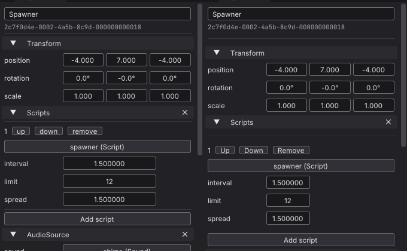
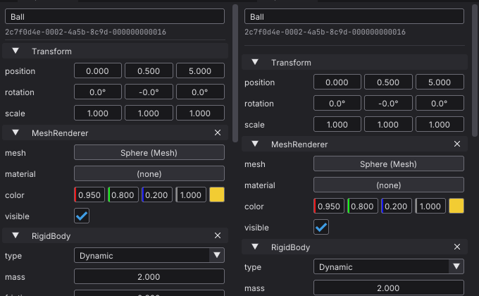
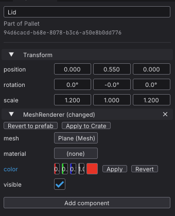
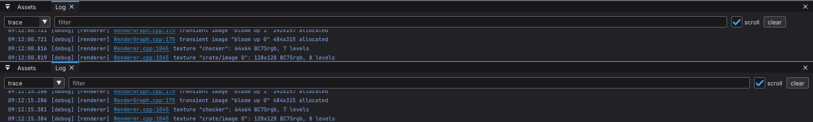
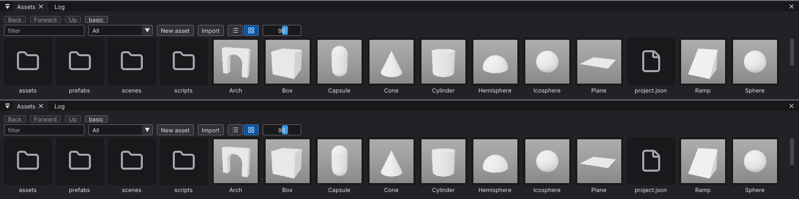

# The editor's panels on the ui widgets: before and after

[Issue 485](https://github.com/Pacheco95/sonnet/issues/485). Status: captured on 2026-11-06 on Linux (X11, scale 1, RTX 4090, `linux-debug`), before at 49cf96e and after on the branch that moves the panels onto the widgets of `sonnet/ui/Widgets.h`. Recaptured on 2026-11-16 at d0cc300 ([issue 572](https://github.com/Pacheco95/sonnet/issues/572)), after [PR 566](https://github.com/Pacheco95/sonnet/pull/566) gave the property tables a column for the Apply and Revert buttons: the script's after half is new, and so is the capture of a changed prefab instance. The other captures were taken again and had not changed (the Log differed only in its timestamps and source lines). The widgets and their tokens are in [editor.md](../editor.md#widgets).

Every capture is a `--screenshot-window` run of the editor ([Screenshots](../editor.md#screenshots)) on `apps/samples/basic --scene scenes/playground.scene.json`, cropped to the panel that changed. Before is on the left or on top. [Recapturing](#recapturing) has the script that takes them. The colours and sizes of the theme did not change; what moved is listed under each capture, and each change is intended.

## Inspector, an entity with a script

`--select Spawner`



- The breaks between the entity's header and its components, and between script slots, are `ui::sectionBreak`: the theme's `sectionGap` (4 px) above and below the separator, where the separator had only the item spacing.
- The slot's row actions are `ui::rowButton` with sentence-case labels: Up, Down, Remove.
- "Add script" sits `groupGap` (4 px) below the last slot (`ui::groupBreak`) instead of under a separator.
- Since PR 566 the script's property table ends in an action column, `propertyActionWidth` (9.5 em) wide, for a row's Apply and Revert buttons, so the value fields are narrower than they were at #485. The column is there whether or not a row has buttons.

## Inspector, components

`--select Ball`



The component headers are `ui::sectionHeader`, drawn as before; only the break above the first one moved, as above.

## Inspector, a changed prefab instance

`--select "Pallet/Crate A/Lid"`



The playground's pallet instance changes the colour of one crate's lid. The lid's MeshRenderer is therefore marked changed, and its colour row has the Apply and Revert pair in the action column (PR 566): Apply writes the value into the crate prefab, and Revert restores the prefab's value. The component's own "Revert to prefab" and "Apply to Crate" stay under its header. This capture has no before, because the pair is new.

In the default 340 px inspector, the action column leaves the colour's four channels too narrow to show their values. The mesh and material pickers are also narrower than on the rows of a component with no override.

## Log

`--select Ball --front log`



- The level combo is the theme's standard field width (8.5 em) instead of 6.5 em.
- The filter fills the row up to the scroll checkbox and the clear button, measured from them, so the row ends at the panel's padding instead of about 45 px short of it.

## Assets

`--assets grid`



No visible change: the filter (wide, 11.5 em) and the tile size (narrow, 5.5 em) already had the token values.

## Not captured

The Hierarchy's dimmed ancestors show only while filtering, which a capture run cannot type, and a model's Animations tab and the rename and delete modals need a selection or a dialog the capture flags do not offer. Those paths are covered by `ui_tests` (the widgets) and `editor_tests` (the inspector driver's clip and event rows).

## Recapturing

`tools/capture_editor_panels.py` runs every capture above at the default 1600x900 window of a capture run, and crops it. The inspector crop is 340 by 420 px at (1260, 40); the Log and Assets crops are the bottom 200 px of the window. The script needs a desktop, since `--screenshot-window` opens a real window. On this machine that is X11 on `DISPLAY=:1`, under the desktop lock:

```bash
flock ~/sonnet-measurements/.desktop.lock python3 tools/capture_editor_panels.py \
  --out ~/sonnet-measurements/572-inspector-captures/after \
  --before ~/sonnet-measurements/485-ui-widgets/before
```

`--before` takes the window captures of an earlier run and puts each crop beside (or above) the new one, as the report shows them. `--only` takes a subset of the capture names, and `--editor` another build. The run writes the windows, their logs and a `crops/` directory; copy the crops into this folder by hand.
