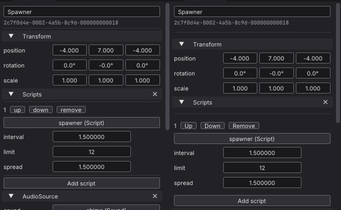
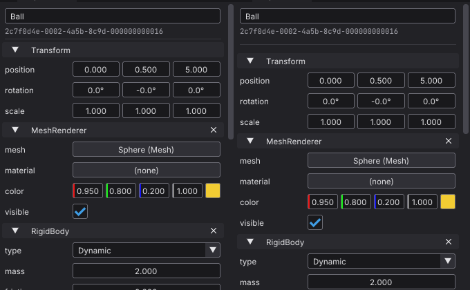
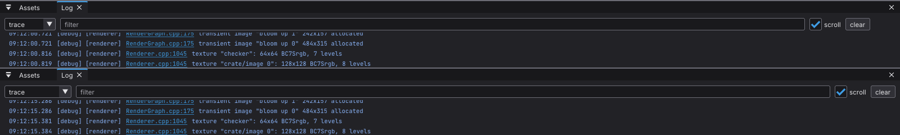
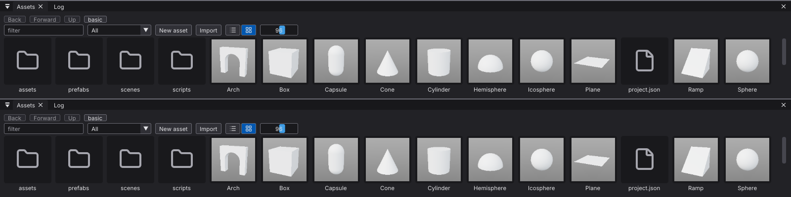

# The editor's panels on the ui widgets: before and after

[Issue 485](https://github.com/Pacheco95/sonnet/issues/485). Status: captured on 2026-11-06 on Linux (X11, scale 1, RTX 4090, `linux-debug`), before at 49cf96e and after on the branch that moves the panels onto the widgets of `sonnet/ui/Widgets.h`. The widgets and their tokens are in [editor.md](../editor.md#widgets).

Every capture is a `--screenshot-window` run of the editor ([Screenshots](../editor.md#screenshots)) on `apps/samples/basic --scene scenes/playground.scene.json`, cropped to the panel that changed. Before is on the left or on top. The colours and sizes of the theme did not change; what moved is listed under each capture, and each change is intended.

## Inspector, an entity with a script

`--select Spawner`

- The breaks between the entity's header and its components, and between script slots, are `ui::sectionBreak`: the theme's `sectionGap` (4 px) above and below the separator, where the separator had only the item spacing.
- The slot's row actions are `ui::rowButton` with sentence-case labels: Up, Down, Remove.
- "Add script" sits `groupGap` (4 px) below the last slot (`ui::groupBreak`) instead of under a separator.

## Inspector, components

`--select Ball`

The component headers are `ui::sectionHeader`, drawn as before; only the break above the first one moved, as above.

## Log

`--select Ball --front log`

- The level combo is the theme's standard field width (8.5 em) instead of 6.5 em.
- The filter fills the row up to the scroll checkbox and the clear button, measured from them, so the row ends at the panel's padding instead of about 45 px short of it.

## Assets

`--assets grid`

No visible change: the filter (wide, 11.5 em) and the tile size (narrow, 5.5 em) already had the token values.

## Not captured

The Hierarchy's dimmed ancestors show only while filtering, which a capture run cannot type, and a model's Animations tab and the rename and delete modals need a selection or a dialog the capture flags do not offer. Those paths are covered by `ui_tests` (the widgets) and `editor_tests` (the inspector driver's clip and event rows).
