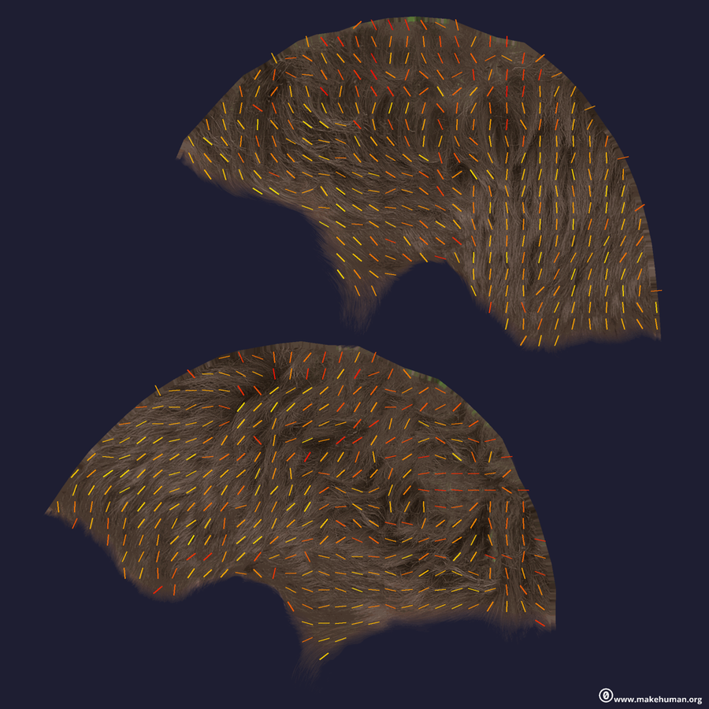
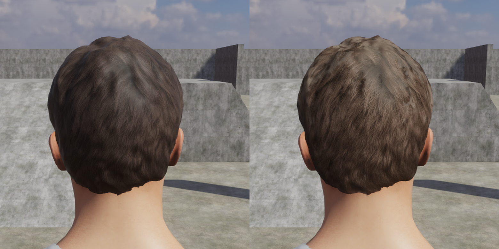
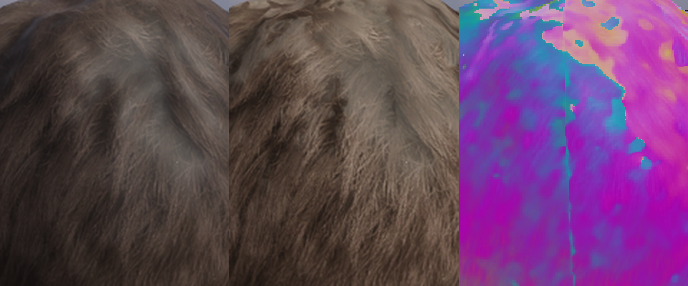
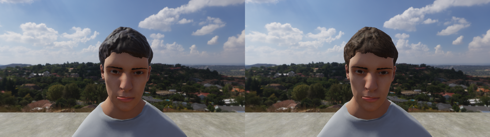
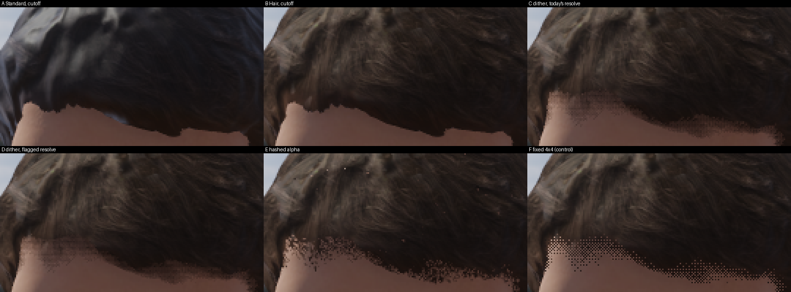
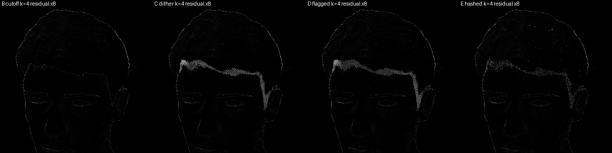

# Hair strand shading and coverage: the ADR-0046 spike

Measured 2026-11-24 for [#591](https://github.com/Pacheco95/sonnet/issues/591), on [ADR-0046](../decisions/0046-hair-strand-shading-and-coverage.md)'s "Open until the spike". The code is the branch `spike/hair-flow-map` off `main` (98a1365), not for merge: a production-shaped `Hair` model (a compile-time fragment entry and its own forward pipelines, as Skin has) with its material data and flow map taken through shortcuts the build cards replace (below). The phone numbers are in [skin-shading-s25](skin-shading-s25.md), taken in the session that also measured [#609](https://github.com/Pacheco95/sonnet/issues/609)'s gates.

**Verdict.** The strand model works and is cheap: with a flow map baked from the painted texture the strands' direction follows the painted strands (mean |cos| 0.86 on screen against 0.66 for the opposite convention), the constant-axis facets of the earlier spike are gone, and it costs nothing measurable on the RTX 4090. **No stochastic coverage passes the cutoff-relative gates**, so the plain cutoff stays: the strand model ships alone, the resolve exception and its flag are not built. The best candidate, the flagged-resolve dither, gives the softest hairline but has three times the cutoff's p99 temporal noise at rest in both poses measured and, in the first, about three times its trail four frames after a stop. On the Galaxy S25 Ultra ([skin-shading-s25](skin-shading-s25.md)) the strand pipelines add 0.00 to 0.09 ms to the forward pass over skin alone, cold at 1920×1080 and at the phone's own size, and 0.06 ms in a 600 s run, against ADR-0046's 0.3 ms; the whole frame cannot resolve that on the phone (its GPU clock changes level between runs by about 0.4 ms), so the budget is read on the forward pass, the only pass the model changes. The iPad is not measured.

## What was built

- **Strand model.** `ShadingModel::Hair` (flag bits 11 and 12, value 2), `hairFragmentMain` as a second entry of `shadeFragment<Model>`, and `forward hair` and `forward hair double sided` pipelines built with the skin slots, while `characterShading` is on. The shading is ADR-0046's: two Kajiya-Kay lobes, the secondary tinted by the base colour and wider, each shifted along the normal by the flow map's shift, a wrapped diffuse, and the image-based specular read off the normal across the strand, 0.25 rougher. The lobes are normalised with `(sqrt(e) + 1) / (2π)`.
- **Flow map.** `tools/hair_flow_bake.py` (below), written to `apps/samples/character/assets/character/Hair_Flow.png`, a linear data texture with its own sidecar (`srgb: false`, mipmaps, compressed). `Hair.material.json` (`"shading": "Hair"`, the glTF Hair material's values) is assigned to the humanoid's hair submesh, slot 4, in the character prefab through ADR-0045's positional slot override.
- **Coverage candidates**, chosen at run time by `--hair-coverage cutoff|dither|flagged|hashed|ordered|hashed-texel`, in the pre-pass (`depth.slang`), with the forward pass drawing exactly the pre-pass's pixels (its depth test is Equal) and not testing the alpha itself. `flagged` also makes `hairFragmentMain` write 0.75 in the scene's alpha for a pixel whose coverage is stochastic and `taa.slang` give a pixel with such a neighbour a wider clip box and a shorter or longer age cap (`--hair-box`, `--hair-age`).
- **Switches.** `--character-shading on|skin|hair|off`: `skin` and `hair` draw one model alone, so the phone can isolate each.

**Shortcuts** the build cards replace. The flow map sits in the material's *emissive* slot (factor 0, so Standard shading of the same material is unchanged) instead of a `strand` slot, and the hair's lobe parameters are constants in the shader and the material row instead of `.material.json` fields: no format changed. The pre-pass tests the model with a per-material branch in `prePassTest` instead of hair entries of its own, so a Standard scene's pre-pass carries one more flag test than `main`'s, in both columns of every on/off pair below; its cost was not separated. The combed-field fallback is the per-island crown fit described below, not a rasterisation of a combed field through each triangle's tangent frame.

## The flow map

`tools/hair_flow_bake.py`, a throwaway: the structure tensor of the base colour's luminance on a lightly smoothed image, accumulated over a window of radius 6 (three box passes, about 5 texels of Gaussian), weighted by alpha. The strand axis runs across the dominant gradient and is stored as its doubled angle, `(cos 2a, sin 2a)` in R and G; B holds a shift from the painted brightness against its local mean (lighter strands one way, darker the other); A holds the coherence for inspection. Where the coherence is below 0.18 the field is the combed one, and it blends in by smoothstep up to 0.45. The combed field here: per fan-shaped UV island, the point where the coherent strands' lines cross most nearly is the crown (a weighted least-squares fit), and a texel's direction is away from it. The field is bled outwards twelve times past the island's edge, so filtering and mips never read empty texels.

- **Content.** The two islands are mirrored fans in a 2048² texture. 72 % of the solid texels have a coherence of at least 0.45 and 4 % are below 0.18; the median is 0.58, as ADR-0046 measured (0.55 to 0.61 over windows of 4 to 16 texels). The fitted crowns are at (1434, 793) and (845, 1385) texels, from about 38 000 and 37 000 coherent samples.
- **Cost of the bake.** 29 s with NumPy on one core.



### Does the shader's direction follow the painted strands?

`tools/hair_strand_alignment.py` takes three captures of the head from behind at 1920×1080 (`--shading-term albedo`, `normal`, `curvature`, which shows a Hair draw's strand direction as colour), the orientation of the painted strands on the screen (a structure tensor of the albedo's luminance over a window of 5 pixels) and the strand direction the shader derived, projected on the screen.

| Convention | Mean abs cos between the two axes | Pixels within 30° | Pixels |
|---|---|---|---|
| Image y runs against the bitangent (the shader's) | **0.861** (0.867 where coherence > 0.5) | 65 % | 71 824 |
| The opposite sign | 0.658 | 32 % | 71 782 |

Unrelated axes give about 0.64. The convention the shader uses (the image's x along the tangent, its y, which runs down in v, against the bitangent) is therefore the right one, and the direction follows what is painted.

### The mirror seam



The earlier spike's highlight changed at the mirror line and lit flat patches evenly up to their triangle edges ([the spike](skin-hair-spike.md#hair)). With the flow map the lit capture shows neither: the highlight follows the strands over both halves and across the mirror line. The strand term itself still has a discontinuity there, which `tools/hair_seam_profile.py` measures: the mean angle between a pixel and its neighbour four pixels to the right is 11.3° over the head (p95 20.3°) and 28° to 32° in a band of about five columns on the mirror line (the white line in the right panel below). It is not visible in the lit frame at 1080p. Its cause was not isolated; the vertices along the seam carry different tangent frames, which is the likeliest.





## Coverage under TAA

**Setup.** `tools/hair_taa_metrics.py` drives the player once per frame wanted, each a fresh process whose history is cut at the start (`SceneView::resetHistory`), so frame *n* of a configuration is the same image whenever it is taken. The scene is `spike_orbit_stop` of the character sample: the follow camera orbits the head at 90°/s for 0.5 s and stops, at 1280×720, with the pose frozen from 0.25 s so a still capture is the same pose. The camera reaches its final pose at frame 28 (frames 24 to 39 against a converged frame, the 27th still 9.9 levels off and the 28th 0.66). The *hairline band* is where a converged dithered frame differs from a converged cutoff frame of the same pose by more than 12 levels, grown by two pixels: 3 592 pixels along the fringe and the sideburn. Every number is in 8-bit sRGB levels over that band.

- **Stability at rest:** the per-pixel temporal standard deviation over eight consecutive TAA phases (frames 200 to 207), mean / 99th percentile.
- **Trail:** frames 28 + *k* against the converged frame (320) of the same pose, the per-pixel difference's mean / 99th percentile.
- **Floor:** eight converged frames (328 to 335), one per phase, against the same reference, mean of the means and of the p99s, with the worst phase's.

Stable and trailing frames of the plain cutoff (A and B) against the dithered candidates, in `--character-shading on` unless noted. A is the Standard model with the cutoff (`off`, what `main` draws); B the Hair model with the cutoff.

**Pose 1** (`spike_orbit_stop`, 3 592-pixel band):

| Candidate | At rest, mean / p99 | Frame 0 | Frame 4 | Frame 8 | Floor, 8 converged phases (worst phase p99) |
|---|---|---|---|---|---|
| A Standard model, cutoff (`off`) | 0.17 / 2.1 | 1.36 / 18.0 | 0.48 / 6.3 | 0.30 / 3.7 | 0.18 / 2.6 (4.0) |
| B Hair model, cutoff | 0.16 / 1.9 | 1.29 / 19.4 | 0.48 / 6.0 | 0.29 / 3.3 | 0.16 / 2.5 (4.0) |
| C dither under today's resolve | 1.70 / 7.0 | 11.29 / 42.0 | 4.66 / 20.7 | 2.52 / 13.7 | 1.79 / 10.7 (15.0) |
| D flagged resolve, box 2.5, age 8 | 2.75 / 8.7 | 11.10 / 41.3 | 3.34 / 14.3 | 3.72 / 14.7 | 2.97 / 13.2 (18.3) |
| D flagged resolve, box 8, age 32 | 0.93 / 5.3 | 10.25 / 39.0 | 4.37 / 19.4 | 2.21 / 11.0 | 0.96 / 7.1 (10.0) |
| E hashed alpha, pixel-sized cells | 1.33 / 10.5 | 6.70 / 39.0 | 1.92 / 11.0 | 1.83 / 19.3 | 1.35 / 16.1 (20.0) |
| E0 hashed alpha on mip-0 texels | 1.85 / 10.6 | 8.89 / 43.7 | 2.55 / 15.3 | 2.70 / 20.4 | 1.92 / 17.1 (21.0) |
| F fixed 4×4 threshold (control) | 0.54 / 11.4 | 3.60 / 32.0 | 0.90 / 8.3 | 0.93 / 15.4 | 0.53 / 11.2 (16.8) |

**Pose 2** (`spike_orbit_stop_side`, the camera 90° round to the head's right side, 3 291-pixel band, E0 not run):

| Candidate | At rest, mean / p99 | Frame 0 | Frame 4 | Frame 8 | Floor, 8 converged phases (worst phase p99) |
|---|---|---|---|---|---|
| A Standard model, cutoff (`off`) | 0.29 / 2.9 | 2.23 / 28.3 | 1.13 / 15.7 | 0.72 / 9.7 | 0.34 / 4.9 (7.3) |
| B Hair model, cutoff | 0.29 / 2.7 | 2.38 / 24.7 | 1.17 / 14.3 | 0.75 / 8.7 | 0.34 / 4.6 (6.3) |
| C dither under today's resolve | 2.23 / 12.8 | 9.52 / 46.4 | 3.72 / 19.0 | 3.90 / 21.3 | 2.38 / 17.6 (22.4) |
| D flagged resolve, box 2.5, age 8 | 3.56 / 12.1 | 10.35 / 49.0 | 3.36 / 17.7 | 5.78 / 25.0 | 3.87 / 19.0 (26.4) |
| D flagged resolve, box 8, age 32 | 1.16 / 8.0 | 9.26 / 43.8 | 4.26 / 20.3 | 3.34 / 17.0 | 1.24 / 10.6 (13.4) |
| E hashed alpha, pixel-sized cells | 1.66 / 17.3 | 6.31 / 41.0 | 2.40 / 17.3 | 2.77 / 31.4 | 1.72 / 23.9 (32.7) |
| F fixed 4×4 threshold (control) | 0.90 / 19.0 | 8.99 / 57.4 | 3.59 / 28.0 | 2.94 / 27.7 | 0.92 / 19.1 (33.4) |





- **A and B are the same.** The Hair model with the cutoff has the cutoff's stability and trail (1.9 against 2.1 at rest; 6.0 against 6.3 four frames after the stop), so strand shading does not touch the temporal behaviour.
- **C, today's resolve, is the baseline to beat:** 7.0 at rest (the earlier spike's 12.3 was over a box of the forehead that held less of the fringe's worst pixels and a different pose), 20.7 four frames after the stop, a floor that never reaches the cutoff's: a converged dithered hairline still has a deviation of 1.8 on average.
- **D, the flagged-resolve dither, helps stability and the floor once the history is held long, and not the trail.** With the age cap at 8 it is worse than C at rest. The exception drops the clip to the neighbourhood's extremes and widens the box (`--hair-box`), and holds the pixel's history for longer (`--hair-age`, the age that goes forward is raised past the resolve's 16). The sweep:

| Clip box (deviations) | History age cap | At rest, mean / p99 | Frame 4 | Frame 8 | Floor |
|---|---|---|---|---|---|
| 2.5 | 8 | 2.75 / 8.7 | 3.34 / 14.3 | 3.72 / 14.7 | 2.97 / 13.2 |
| 2.5 | 16 | 1.64 / 6.7 | 3.94 / 17.3 | 2.61 / 13.0 | 1.74 / 10.4 |
| 4 | 16 | 1.57 / 5.6 | 3.94 / 17.4 | 2.61 / 12.7 | 1.68 / 9.6 |
| 8 | 16 | 1.46 / 5.3 | 4.01 / 17.0 | 2.55 / 11.3 | 1.58 / 8.0 |
| 4 | 8 | 2.70 / 8.5 | 3.33 / 14.3 | 3.75 / 15.3 | 2.94 / 12.7 |
| 8 | 8 | 2.63 / 8.4 | 3.37 / 14.0 | 3.73 / 14.7 | 2.88 / 12.1 |
| 4 | 32 | 1.06 / 5.5 | 4.28 / 19.7 | 2.28 / 12.7 | 1.09 / 9.5 |
| 8 | 32 | 0.93 / 5.3 | 4.37 / 19.4 | 2.21 / 11.0 | 0.96 / 7.1 |
| 8 | 64 | 0.68 / 5.3 | 4.56 / 20.7 | 2.11 / 10.7 | 0.67 / 7.1 |

  A wider box helps a little (2.5 to 8 deviations: 6.7 to 5.3 at rest with a cap of 16). A longer age helps more in the mean (1.64 to 0.68) and not in the tail, which stays at 5.3: the pixels that make up the p99 are on the fringe's silhouette, where a pixel flips between hair and what is behind it from one jitter to the next. The trail goes the other way: a longer age leaves more history to clear after the stop (frame 4: 14.3 with a cap of 8, 19.4 to 20.7 with 32 and 64). No setting passes the gates below. The softest hairline of the five is D's (figure, bottom left), which is its argument for being fitted further, not a pass.
- **E, hashed alpha,** with a cell the size of the pixel's footprint in texels, hashed per cell, so the grain sticks to the surface: better than C in the mean everywhere (1.33 against 1.70 at rest, 1.92 against 4.66 four frames after the stop) and worse in the tail (10.5 against 7.0, 19.3 against 13.7 at frame 8), because a jitter that moves a pixel's sample across a cell's edge changes its coverage outright. On the texture's own texels (E0, the first version) it is worse in both.
- **F, the fixed 4×4 threshold,** is the control: it is the best of the stochastic ones in the mean (0.54 at rest) and has the worst tail (11.4): a pixel is either always in or always out except where the jitter's sub-pixel move changes its alpha sample, and then it flips whole. It is also the same threshold as the fade's (`fadedOut`), so a faded hair draw would keep the minimum of the two coverages rather than their product, which the invariants of ADR-0046 rule out; the other candidates' noise does not repeat the fade's.

### The gates

ADR-0034 fitted its budgets to what the content allows. Here the plain cutoff of the same pose, band and harness is what the content allows, and a stochastic coverage cannot beat it at rest, so the gate is a ratio: **a coverage technique's p99 at rest, four frames after a stop and eight frames after a stop is at most twice the Hair model's cutoff's (B) in the same pose.** Absolute levels move with the pose (the cutoff's own p99 four frames after the stop is 6.0 in pose 1 and 14.3 in pose 2, where the head's dark silhouette is against the sky), which a level gate would hide. Ratios against B, pose 1 / pose 2:

| Candidate | At rest, pose 1 / 2 | Frame 4, pose 1 / 2 | Frame 8, pose 1 / 2 | Passes |
|---|---|---|---|---|
| C | 3.8× ✗ / 4.8× ✗ | 3.4× ✗ / 1.3× ✓ | 4.1× ✗ / 2.5× ✗ | **no** |
| D (2.5, 8) | 4.6× ✗ / 4.5× ✗ | 2.4× ✗ / 1.2× ✓ | 4.4× ✗ / 2.9× ✗ | **no** |
| D (8, 32) | 2.9× ✗ / 3.0× ✗ | 3.2× ✗ / 1.4× ✓ | 3.3× ✗ / 2.0× ✓ | **no** |
| E | 5.6× ✗ / 6.5× ✗ | 1.8× ✓ / 1.2× ✓ | 5.8× ✗ / 3.6× ✗ | **no** |
| F | 6.1× ✗ / 7.1× ✗ | 1.4× ✓ / 2.0× ✓ | 4.6× ✗ / 3.2× ✗ | **no** |
| *cutoff's own p99 (the gate is twice these)* | 1.9 / 2.7 | 6.0 / 14.3 | 3.3 / 8.7 | |

No candidate passes, in either pose, and none passes the stability gate in any pose: the best, D with a box of 8 deviations and an age cap of 32, has three times the cutoff's p99 at rest. Four frames after the stop E and F pass in both poses, C and D only in pose 2; every candidate fails the frame-8 recovery in pose 1 and all but one in pose 2. **The plain cutoff stays.** The numbers above are the bar a later coverage decision has to clear, over the same band, scene and ratio.

## The ADR-0034 gate and the golden frame are unchanged

The exception is confined by construction: a pixel with no flagged neighbour takes the resolve's expressions as they were. Checked two ways, on the RTX 4090 in Release, with the exception live (`hairCoverage` defaulted to `flagged` for the run, so the resolve's branch is taken on every pixel):

- **The four required glass cases** of `apps/taa_harness` (`rough-pane`, `masked-pane`, `watch`, `transmission-test`): with the exception on, `metrics.csv` of every case is byte-identical to the same build with it off. Against `main`'s own build the two runs differ in two diagnostic columns by at most 0.001 of a level (`covered_mean` of `masked-pane`, `uncovered_mean` of `transmission-test`), from the forward shader's reassociated terms; every gate column and every pass is identical (worst frames: `rough-pane` 0.21 / 1, `masked-pane` 1.87 / 13, `watch` 1.51 / 22, `transmission-test` 12.37 / 67, all four passing, as on `main`).
- **`runtime_tests "[golden]"`** on Lavapipe, which compares the showcase under TAA with `modules/runtime/tests/golden/showcase_taa.png`: passes, with the exception live (206 assertions).

## Cost on the RTX 4090

At 1920×1080 on `capture_face`, headless, three rounds in a rotated order, `--play 3`:

| Mode | forward, per round (ms) | GPU frame median, per round (ms) |
|---|---|---|
| off | 0.062, 0.061, 0.062 | 0.381, 0.376, 0.376 |
| skin | 0.064, 0.063, 0.064 | 0.384, 0.380, 0.386 |
| hair | 0.063, 0.062, 0.061 | 0.382, 0.376, 0.377 |
| on | 0.065, 0.064, 0.065 | 0.382, 0.378, 0.378 |

Skin adds 0.002, hair 0.000 to 0.001 and both 0.003 ms to the forward pass, within the runs' own spread of the frame (0.376 to 0.386). A desktop number says nothing about a phone's budget ([the phone report](skin-shading-s25.md)).

## What was not done

- **The iPad.** It needs the Mac. [#609](https://github.com/Pacheco95/sonnet/issues/609) and the hair's iPad gate stay open.
- **The hair isolated on the iPad and the production material fields**, a `strand` slot, `MaterialFileVersion` 8 and the bundle number: the build cards.
- **A combed field rasterised through the tangent frames.** The per-island crown fit stands in for it and is only checked against the painted strands, which it follows to 0.86.
- **Hair entries of the pre-pass.** The spike branches on the model in the shared entry.
- **The seam's cause**, and eyebrows and eyelashes, which keep the cutoff.

## Proposed text for ADR-0046's "Open until the spike"

To replace that section when the owner accepts the ADR, in place of the candidates and the open gates:

> ### Settled by the spike
>
> The spike ([hair-strand-spike](../reports/hair-strand-spike.md), `spike/hair-flow-map`) measured the three coverage candidates and the control on the in-repo harness over the hairline band, against the plain cutoff, on the RTX 4090, and the strand model on the Galaxy S25 Ultra.
>
> - **Coverage: the plain cutoff.** Hair keeps `alphaCutoff`. None of the flagged-resolve dither, the hashed alpha and the fixed ordered threshold passes the gates below; the best of them (the flagged-resolve dither) has 2.9 and 3.0 times the cutoff's p99 temporal deviation at rest in the two poses measured, and 3.2 times its p99 four frames after a stop in the first. The resolve exception and the flag in the scene's alpha are **not built**, `taa.slang` and the constants of ADR-0034 stay as they are, and the hair pipelines write alpha 1 like every opaque and masked draw. A later decision on soft hair edges starts from the gates below.
> - **Strand direction: the baked flow map, as decided.** The bake follows the painted strands to a mean |cos| of 0.86 on screen. Its window is a radius of 6 texels, the combed field takes over below a coherence of 0.18 and is out above 0.45, and the combed field is the per-island crown fit; the bake tool in the content build card reproduces these.
> - **Gates for a coverage technique** (hairline band: where a converged stochastic frame differs from a converged cutoff frame by more than 12 levels, grown by two pixels; 1280×720; the player's captures of the character sample's `spike_orbit_stop` views, `tools/hair_taa_metrics.py`): the p99 of the per-pixel temporal deviation at rest, of the difference from the converged frame four frames after a stop, and of the same eight frames after a stop are each **at most twice the same measure of the Hair model with the cutoff** in the same view. The cutoff's own are 1.9 / 6.0 / 3.3 in the front view and 2.7 / 14.3 / 8.7 in the side view. A ratio, since a level gate moves with the view.
> - **Hair's phone budget:** the 0.3 ms over skin alone, median and p95, holds on the Galaxy S25 Ultra: the forward pass, the only one the model changes, adds 0.00 to 0.09 ms over skin at 1920×1080 and at the native size, cold, and 0.06 ms in a 600 s run, with the head at about half of the frame (`capture_face`); hair alone adds 0.02 to 0.05 ms over `off`. The whole frame resolves no better than about ±0.4 ms there, because the phone's GPU clock changes level between runs, so the budget is read on the forward pass and on the plain frame difference. The iPad is not measured, and the phones keep hair off until each platform passes its own gate.

## Reproducing

```bash
python3 tools/hair_flow_bake.py Hair_BaseColor.png Hair_Flow.png            # the base colour is the humanoid's image 6
cmake --build --preset linux-release --target sonnet_player
python3 tools/hair_taa_metrics.py capture OUT/B-hair-cutoff --character-shading on --hair-coverage cutoff
python3 tools/hair_taa_metrics.py capture OUT/C-dither-today --character-shading on --hair-coverage dither
python3 tools/hair_taa_metrics.py analyze OUT/C-dither-today OUT/B-hair-cutoff OUT/C-dither-today   # band from B and C
```

Run from the repository root. The raw frames, the metric files and the phone logs are kept with the other measurement logs, outside the repository.
