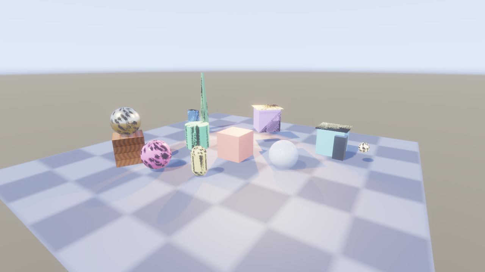
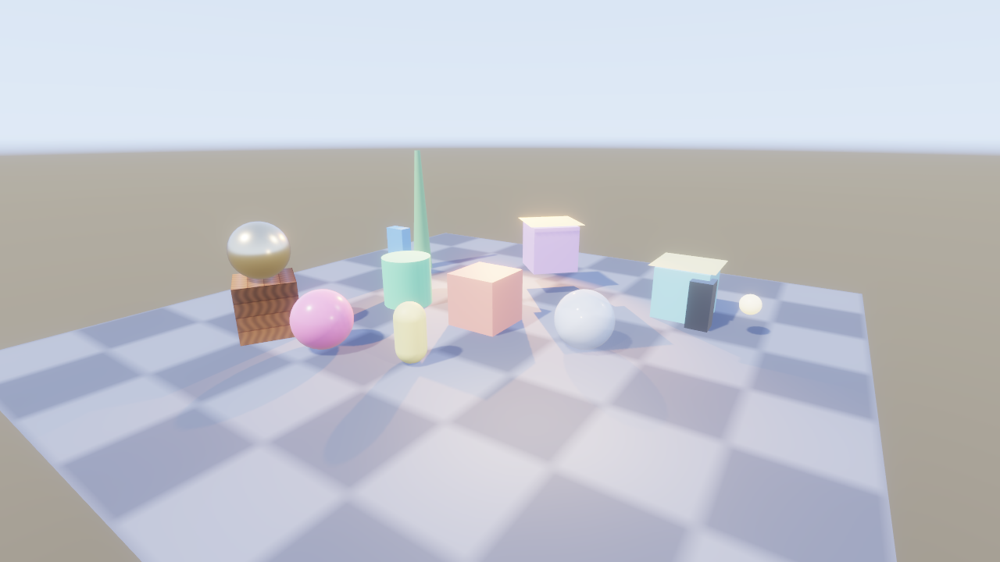

# KosmicKrisp macOS trial

[Issue 368](https://github.com/Pacheco95/sonnet/issues/368), measured on
2026-10-22 at `f2fdf75`. **Keep shipping pinned MoltenVK 1.4.2 on macOS and
iOS.** KosmicKrisp loads and passes the small GPU regressions, but the basic
sample has visible rendering defects, GPU timing results are invalid, and the
measured Release workload is slower. This is a trial report, not a driver
migration or a change to an accepted ADR.

## Machine and driver selection

Apple M4 Max, arm64, macOS 26.7.1 (25G241), Apple Clang 17 through the local
presets. Debug and Release targets were rebuilt from the same source. Release
was explicitly configured with `-DCMAKE_BUILD_TYPE=Release`.

The existing SDK 1.4.341.1 contains KosmicKrisp 26.0.99, Vulkan 1.3.340.
Sonnet rejects it for missing `VK_KHR_dynamic_rendering_local_read`,
`VK_KHR_maintenance5` and `VK_KHR_maintenance6`. Its initial RHI run passed
11 CPU cases and skipped 37; that is **not** a compatibility pass.

Downloaded LunarG SDK **1.4.363.0** from its official download endpoint and
installed with `copy_only=1` into `/tmp/sonnet-368/sdk`, leaving the system SDK
alone. The tested driver reports Vulkan **1.4.363**, KosmicKrisp **26.2.99**,
`vulkan-sdk-1.4.363 (git-269a955c89)`. Sonnet logs loader 1.4.363 and the
KosmicKrisp driver name in every trial run. Set these for the commands below:

```sh
export TRIAL_SDK=/tmp/sonnet-368/sdk/macOS
export SDL_VULKAN_LIBRARY="$TRIAL_SDK/lib/libvulkan.1.dylib"
export VK_DRIVER_FILES="$TRIAL_SDK/share/vulkan/icd.d/libkosmickrisp_icd.json"
export VK_LAYER_PATH="$TRIAL_SDK/share/vulkan/explicit_layer.d"
```

The correctness suite used `VK_ADD_LAYER_PATH` instead of `VK_LAYER_PATH`;
its Debug logs identify the new validation layer and synchronization validation.
For `vulkaninfo` itself, also set `DYLD_LIBRARY_PATH="$TRIAL_SDK/lib"` to avoid
its resolving the older system loader. `current-info.txt` in the archive uses
the matching loader; `current-summary.txt` is the earlier probe with the old
loader and the new ICD.

`SDL_VULKAN_LIBRARY` explicitly overrides SDL's process-symbol lookup, so the
player uses the loader and KosmicKrisp despite still containing static MoltenVK.
No relink or engine change was needed for the trial. The editor, which does not
link static MoltenVK, reproduces the visible defect too.

## Correctness and presentation

The checks follow [M13 macOS validation](macos-m13-validation.md), using today's
larger suite. Commands name binaries under `build/macos-{debug,release}-local`:

| Check | Debug, validation on | Release |
|---|---:|---:|
| `modules/rhi/rhi_tests` | 4,561 assertions; 42 passed, 6 skipped | Same |
| `modules/renderer/renderer_tests '[gpu]~[benchmark]'` | 22,581 assertions; 63 passed | Same |
| `modules/assets/assets_tests '[hdr]'` | 39 assertions; 2 passed | Same |

All six RHI skips are swapchain cases: KosmicKrisp does not expose
`VK_EXT_headless_surface`. No device-selection skips occurred with the new SDK.
The tests count Vulkan validation warnings/errors as failures; none were
counted. Expected negative-test allocator/handle diagnostics are in the logs.
The driver exposes BC, ASTC and ASTC HDR; the HDR upload/sampling and native
versus fallback environment checks ran.

The hidden Release `[benchmark]` filter also passed for each of
`SONNET_BENCH_AA=none`, `fxaa` and `taa`: 26 assertions in four cases per run
(draws, glass motion, particles and multiple views). The regular GPU suite
covers motion, TAA convergence/trails, independent histories and occlusion.
The old report's temporary six-case AA harness was not reconstructed; the
current tests and three-mode benchmarks are the coverage here.

Five Debug player captures (source/cooked final, clear/half/solid shadows)
exited 0 with `exit ok`, as did four Release diagnostic captures. An editor
viewport and whole-window capture also succeeded. These exercise real Metal
surface presentation, but do not replace the skipped resize/suspend tests.
No validation warning/error or MoltenVK integer-attachment warning appeared in
the KosmicKrisp captures. That only establishes the absence of
[issue 59](https://github.com/Pacheco95/sonnet/issues/59)'s warning on this driver;
iOS and the pinned MoltenVK build remain affected.

## Scene reproduction and visual failure

Use [prepare.py](kosmickrisp-macos/prepare.py) from the repository root to copy
the basic project into a new temporary directory and create the three alpha
variants. It preserves the tracked sample. Then, with the environment above:

```sh
python3 docs/reports/kosmickrisp-macos/prepare.py /tmp/sonnet-kosmic-basic
build/macos-release-local/apps/cook/sonnet_cook /tmp/sonnet-kosmic-basic --platform macos --out /tmp/sonnet-kosmic-cook
build/macos-debug-local/apps/player/sonnet_player /tmp/sonnet-kosmic-cook/game.sbundle --scene scenes/glass.scene.json --settle-frames 24 --screenshot /tmp/kosmic-final.png
```

Repeat against the source project; repeat with `--shading-term shadow-factor`
for `clear`, `glass` and `solid`. For the pinned MoltenVK baseline, unset
`SDL_VULKAN_LIBRARY`, `VK_DRIVER_FILES` and the layer variables before running
the same player and cooked scene. Diagnostic Release runs use `final`,
`albedo`, `normal` and `shadow-factor`.

KosmicKrisp's cooked capture:



The same scene with the player's pinned MoltenVK 1.4.2:



The defect survives Debug/Release and source/cooked changes. It also appears
in [albedo](kosmickrisp-macos/release-albedo.png),
[normal](kosmickrisp-macos/release-normal.png),
[shadow factor](kosmickrisp-macos/release-shadow-factor.png), and the
[editor without static MoltenVK](kosmickrisp-macos/editor.png).
Those shading-term views bypass TAA. Thus final lighting, cooking, TAA and the
player's static link do not individually explain it. The responsible engine or
driver mechanism is **unproven**; the small passing tests do not establish
full-scene correctness. Investigation and a regression reproducer are
[issue 373](https://github.com/Pacheco95/sonnet/issues/373).

Other capture checks still behaved as expected:

- Source versus cooked final mean absolute RGB differences: **0.102 / 0.072 /
  0.061** levels of 255; maxima **20 / 22 / 21**. Similar images can share the
  same rendering defect, so this is a cooking comparison only.
- At the earlier report's shadow region scaled to these 1280×720 captures
  (`x=[787,795)`, `y=[444,451)`), clear/half/solid mean brightness is
  **235 / 214.411 / 87.161**. Partial alpha produces a partial ground shadow.

## Performance and timestamp failure

Three sequential rounds, each running KosmicKrisp None/FXAA/TAA then SDK
MoltenVK 1.4.1 None/FXAA/TAA. Same rebuilt Release binary, default worker pool,
no concurrent Sonnet build or GPU run. Background GPU work, display topology
and power state were not controlled. Each case warms 30 frames and times 120
back-to-back frames including the final wait/readback. Run:

```sh
SONNET_BENCH_AA=none build/macos-release-local/modules/renderer/renderer_tests 'ten thousand draws and a hundred lights at 1080p'
```

Repeat with `fxaa`/`taa`, and with the old SDK's loader and MoltenVK manifest.
These benchmark controls use SDK MoltenVK **1.4.1**, not the static player 1.4.2.
All 18 invocations passed 16 assertions each. Median [min, max] wall-clock ms:

| Driver / AA | Culling off, no wall | On, no wall | Off, wall | On, wall |
|---|---:|---:|---:|---:|
| Kosmic / None | 4.709 [4.650, 4.853] | 4.957 [4.924, 5.009] | 3.844 [3.795, 3.903] | 3.852 [3.674, 3.895] |
| Molten / None | 2.610 [2.606, 2.626] | 2.750 [2.742, 2.751] | 1.705 [1.700, 1.711] | 1.514 [1.507, 1.519] |
| Kosmic / FXAA | 4.844 [4.812, 4.958] | 5.073 [5.069, 5.140] | 3.948 [3.883, 3.966] | 4.028 [3.880, 4.053] |
| Molten / FXAA | 2.653 [2.643, 2.677] | 2.809 [2.777, 2.858] | 1.738 [1.737, 1.831] | 1.546 [1.540, 1.546] |
| Kosmic / TAA | 5.219 [5.197, 5.250] | 5.459 [5.426, 5.516] | 4.382 [4.304, 4.403] | 4.289 [4.288, 4.423] |
| Molten / TAA | 2.991 [2.986, 2.998] | 3.123 [3.120, 3.126] | 2.044 [2.036, 2.078] | 1.833 [1.832, 1.838] |

KosmicKrisp takes **1.74–2.61×** the wall time in these cases. This is not a
cross-application driver ranking. [Raw measurements](kosmickrisp-macos/benchmarks.csv)
retain each round.

Do not interpret the KosmicKrisp GPU pass sums. One Debug player run reports
**447,613,952 ms** for shadow cascade 0 and depth late while the whole frame
interval is 20.43 ms. Release reproduces similarly impossible values; some
compute passes report zero and occlusion cull has no available samples.
The driver reports `timestampPeriod=41.6667` and `timestampValidBits=64`.
A successful RHI timestamp test does not prove these mixed render/compute
measurements valid. Raw query diagnosis belongs to
[issue 374](https://github.com/Pacheco95/sonnet/issues/374); no driver-only root
cause is asserted here.

## Portability, shading rules and shipping decision

The new driver advertises no `VK_KHR_portability_subset`. The loader advertises
`VK_KHR_portability_enumeration`; vk-bootstrap enables enumeration when present
and the subset only when available. Sonnet already uses these conditional
paths, so no Apple-specific extension assumption needed changing. The driver
meets the native 1.4 feature path; its API version is not an obstacle now.

Retain both existing shading rules: the bindless vertex-buffer representation
of [ADR-0015](../decisions/0015-bindless-vertex-buffers.md) and the separate depth
array of [ADR-0017](../decisions/0017-depth-images-in-their-own-bindless-array.md).
The latter's green-albedo and BRDF-scale/bias tests pass on KosmicKrisp. This
trial did not revert either rule and therefore does not prove their removal
safe on KosmicKrisp. MoltenVK remains necessary for iOS and supported older Macs,
which is independently sufficient reason to keep them. ADR-0017 already removed
the earlier manual shadow-comparison workaround; it is not a second active toggle.

[LunarG's SDK guide](https://vulkan.lunarg.com/doc/view/1.4.363.0/mac/getting_started.html)
describes KosmicKrisp as Apple Silicon/macOS 26+ only, requiring a Vulkan loader;
iOS is not delivered. Shipping it would require bundling that loader and ICD,
and deciding how to preserve Intel/older-macOS coverage. Merely changing
`VK_DRIVER_FILES` does not turn the existing static export into such a package.

**Decision: keep the existing static MoltenVK shipping path and iOS pin.**
Revisit after issues 373 and 374 are resolved and the same capture, correctness
and wall-clock gates are repeated on a newer SDK. A shipping change needs its
own packaging decision/ADR and SDK-free exported-app validation; this trial
does not justify that migration. The separate upstream-deprecation note is
[issue 369](https://github.com/Pacheco95/sonnet/issues/369).

[Archived logs](kosmickrisp-macos/logs.tar.gz) contain driver capabilities,
correctness summaries, benchmark output and capture diagnostics, including the
initial rejected SDK trial. No engine code, shader, dependency pin or accepted
ADR changed for this report. iOS, Intel Macs and an SDK-free KosmicKrisp export
were not tested.
