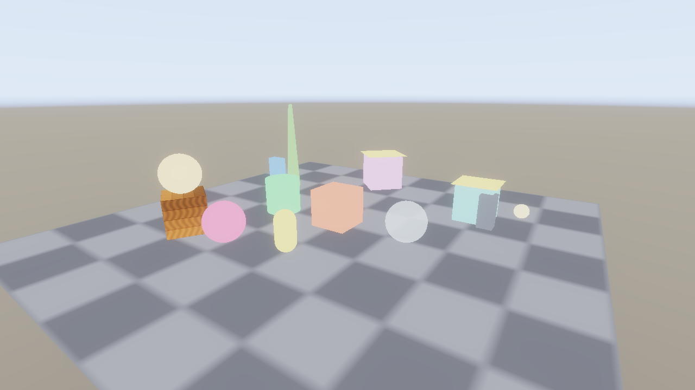
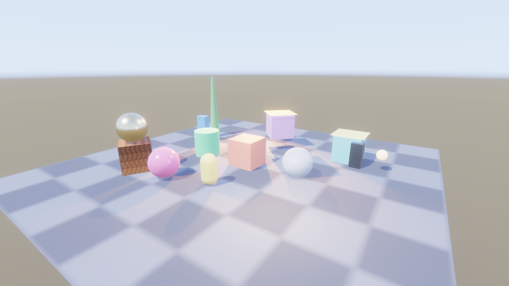

# KosmicKrisp position invariance

[Issue 373](https://github.com/Pacheco95/sonnet/issues/373), measured on
2026-10-22 on the original trial's Apple M4 Max, macOS 26.7.1 and SDK
1.4.363.0, KosmicKrisp 26.2.99 (`git-269a955c89`). The control is the player's
statically linked **MoltenVK 1.4.2**. Shipping remains pinned to it.

## Cause and responsibility

This is an engine correctness defect exposed by KosmicKrisp. Opaque forward
shading tests `Equal` against the depth pre-pass, but the separate vertex
programs did not request invariant clip positions. Both compute
`viewProjection * (model * position)`; forward also exports world position for
lighting. Equivalent expressions in separate programs do not by themselves
establish the required bitwise agreement. The Vulkan
[invariance rules](https://docs.vulkan.org/spec/latest/appendices/invariance.html)
and [shader invariance requirements](https://docs.vulkan.org/spec/latest/chapters/shaders.html#shaders-invariance)
describe the guarantee. There is no evidence here of a driver violating that
requested guarantee.

The decisive control adds only SPIR-V `Invariant` to the actual `BuiltIn
Position` output variables of depth and forward. The same albedo capture
becomes clean. No depth comparison, fragment shader, shadow sampling, asset,
scene or driver changes. This also explains the albedo/normal/shadow-factor
failures: those fragments never survive the exact depth comparison.
The specific backend arithmetic optimization was not disassembled; missing
cross-program invariance is the engine's responsibility regardless.

Slang 2026.7.1's direct SPIR-V backend emits no `Invariant` for a `precise`
position field. A control with `precise` local world/clip variables also
leaves the capture stippled. Source syntax alone was therefore insufficient.
The fix decorates positions when Vulkan creates a shader module, covering
both built shaders and editor hot reload. It handles standalone and
block-member positions, preserves existing decorations, inserts annotations
before types, and rejects truncated instruction streams. Compute modules
without positions are unchanged. This is a Vulkan shader contract, with no
driver-name branch or relaxed depth comparison.

## Minimal regression

Run `renderer_tests '[depth-invariance]'`. The fixture contains just one white
unlit sphere (561 vertices, 960 triangles), no lights or shadows, a 320×180
black target and the basic scene's off-axis camera. An analytic sphere with a
smaller radius selects 177 interior pixels, excluding silhouette coverage and
temporal edge filtering. Every selected pixel must be bright. The two cases
exercise ordinary depth and TAA motion depth respectively.

| KosmicKrisp | Ordinary depth | Motion depth / TAA |
|---|---:|---:|
| Before fix: dark interior pixels | 50 / 177 | 31 / 177 |
| After fix | 0 / 177 | 0 / 177 |

The failing-before log and passing-after log are in the
[evidence archive](kosmickrisp-position-invariance/logs.tar.gz). RHI CPU tests
also cover standalone/member decorations, idempotence, unchanged modules with
no position, and malformed headers/instructions.

## Full-scene comparison

Use the [original preparation script](kosmickrisp-macos/prepare.py) and its
`glass.scene.json` variant. Run each source project and cooked bundle with
`--settle-frames 24`, for both `--shading-term albedo` and `final`:

```sh
python3 docs/reports/kosmickrisp-macos/prepare.py /tmp/sonnet-373-basic
build/macos-debug-local/apps/cook/sonnet_cook /tmp/sonnet-373-basic --platform macos --out /tmp/sonnet-373-cook
export SDL_VULKAN_LIBRARY=/tmp/sonnet-368/sdk/macOS/lib/libvulkan.1.dylib
export VK_DRIVER_FILES=/tmp/sonnet-368/sdk/macOS/share/vulkan/icd.d/libkosmickrisp_icd.json
export VK_ADD_LAYER_PATH=/tmp/sonnet-368/sdk/macOS/share/vulkan/explicit_layer.d
build/macos-debug-local/apps/player/sonnet_player /tmp/sonnet-373-cook/game.sbundle --scene scenes/glass.scene.json --settle-frames 24 --shading-term albedo --screenshot /tmp/sonnet-373-albedo.png
```

Repeat with the source directory, `final`, and the Release player. For pinned
MoltenVK, unset the three driver/layer variables (and any `VK_LAYER_PATH` or
`DYLD_LIBRARY_PATH` overrides). The SDK path above is the original trial's
private install; substitute a local SDK 1.4.363.0 path on another machine.

All sixteen Debug/Release, source/cooked, albedo/final, driver combinations
exited 0. The retained source and bundle are those of the original trial;
the tracked sample was not edited. Logs identify the actual selected driver.
Debug comparisons, in RGB levels out of 255:

| Comparison | Largest channel mean absolute difference | Largest pixel difference |
|---|---:|---:|
| Kosmic source versus cooked, albedo | 0.091 | 1 |
| Molten source versus cooked, albedo | 0.091 | 1 |
| Kosmic versus Molten, source or cooked, albedo | 0.0012 | 2 |
| Kosmic source versus cooked, final | 0.103 | 8 |
| Molten source versus cooked, final | 0.100 | 8 |
| Kosmic versus Molten, source or cooked, final | 0.0127 | 3 |

[Per-channel comparisons](kosmickrisp-position-invariance/comparisons.txt)
retain the full numbers. The pre-fix
[albedo capture](kosmickrisp-macos/release-albedo.png) documents the failure.
The fixed cooked albedo:



Fixed KosmicKrisp final:



Pinned MoltenVK final of the same bundle:


## Validation and limits

KosmicKrisp Debug with SDK validation: all **64 renderer GPU cases / 22,587
assertions** pass (`'[gpu]~[benchmark]'`), including the new regression. Release
passes the same gate. Debug RHI: **43 passed, six skipped / 4,567 assertions**;
the skips require the unavailable `VK_EXT_headless_surface`. No Vulkan
validation warning/error accompanies the fixed captures or passing suites.
The archive retains the test summaries and capture logs.

These correctness runs do not measure performance or resolve the independent
[timestamp defect](kosmickrisp-timestamps.md). They do not establish iOS,
older-Mac or SDK-free KosmicKrisp packaging support. Keep the shipping MoltenVK
pin and the original migration gates.
