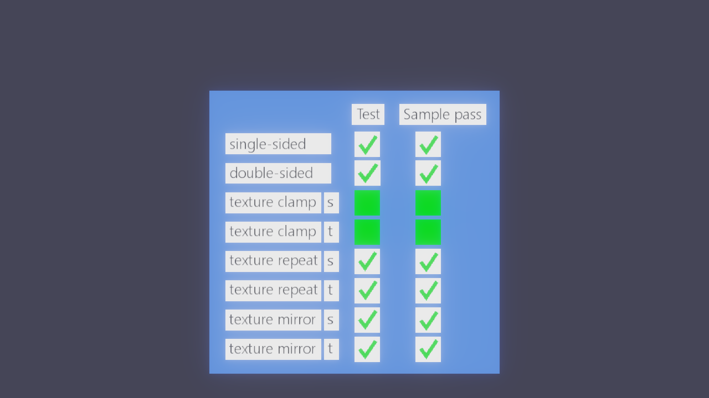

# Per-slot material samplers

Issue [282](https://github.com/Pacheco95/sonnet/issues/282) imports the sampler of
each glTF texture independently. Material files are version 5, bundles version 15.

## Reference model

The [Khronos TextureSettingsTest](https://github.com/KhronosGroup/glTF-Sample-Assets/tree/main/Models/TextureSettingsTest)
was imported from its GLB into a temporary project and captured with the player
on Linux using Lavapipe, SDL's offscreen driver, and `--shading-term albedo`.
The test column matches the sample column: six checkmarks and two solid green
clamp boxes. In particular, clamping, repeating and mirroring on T work alongside S.
Tone mapping and display encoding account for the colours differing from the
reference screenshot.

Model and textures: Ed Mackey / Analytical Graphics, Inc., copyright 2017,
[CC BY 4.0](https://creativecommons.org/licenses/by/4.0/).

## Automated coverage

- `assets_tests "[sampler]"`: all six glTF min filters and undefined, both mag
  filters and undefined, different S/T wraps, independent slots, material version
  5 round trip and migration of version 1–4 wraps to every slot's two axes.
- `renderer_tests "[sampler]"`: cache reuse and capacity; an in-memory quad with an
  8×8 checker remains black or white with nearest filtering, while linear
  filtering produces intermediate values. The same test exercises the emissive
  slot independently and samples through the default after exhausting the cache
  on a real GPU device. Unit white is approximately 231 after ACES and display
  encoding, rather than 255.
- `rhi_tests`: sampling an explicit nonzero LOD with `mipmaps = false` still reads
  level zero, while the same image with mipmaps enabled reads its grey mip.

The Vulkan checks run on Lavapipe; Windows, MoltenVK and mobile drivers were not
run locally.
