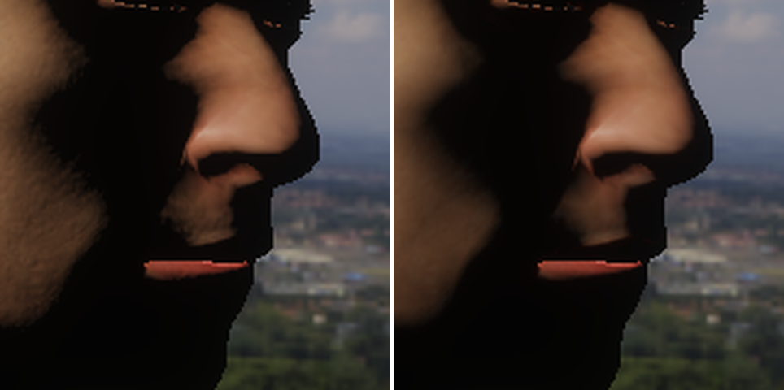
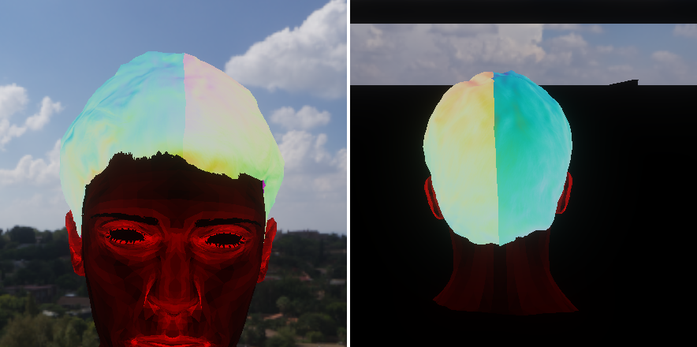
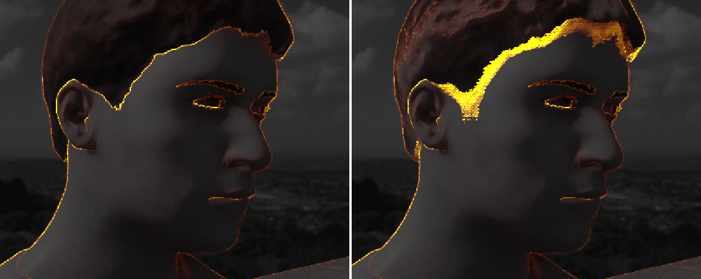
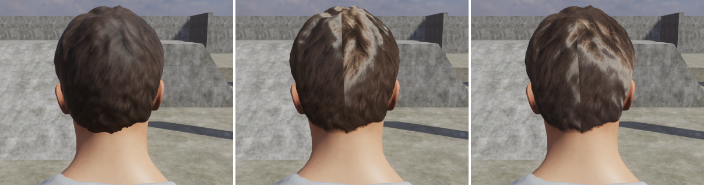
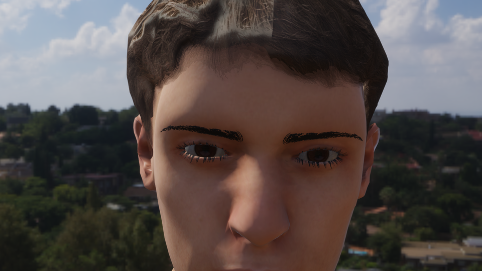
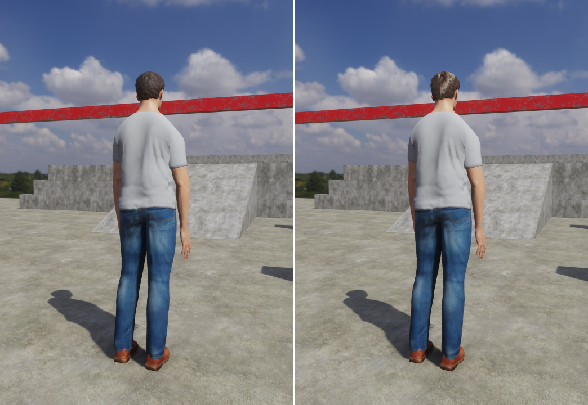
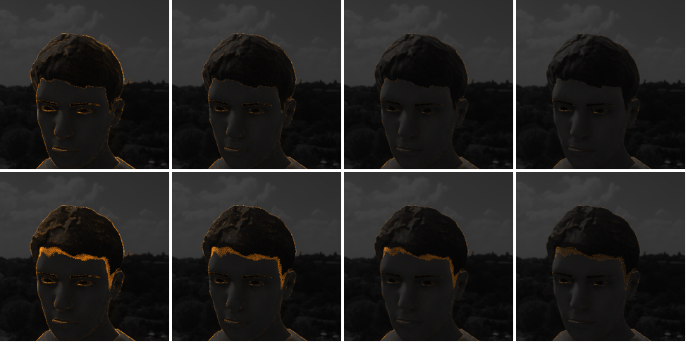
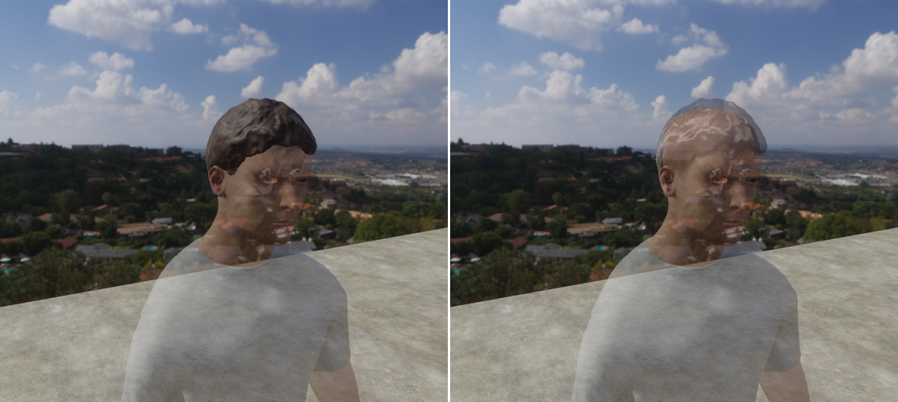
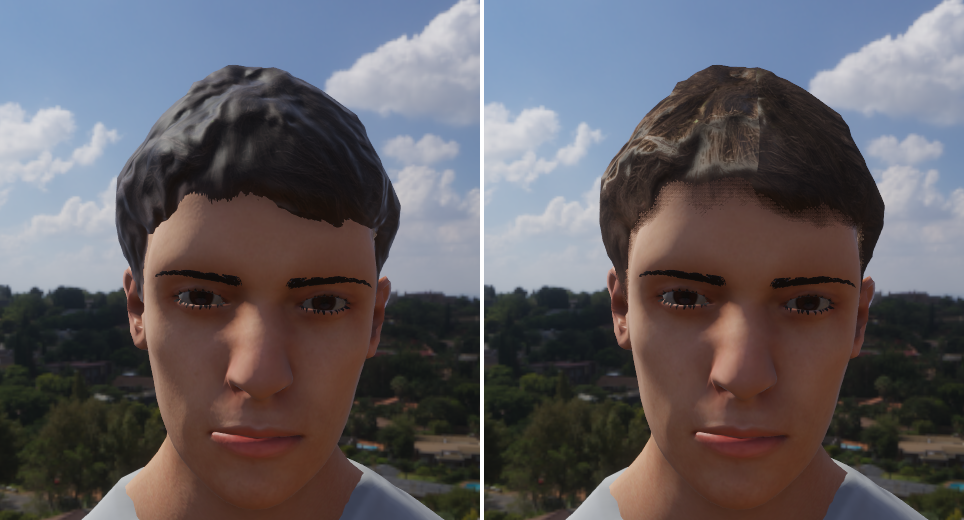
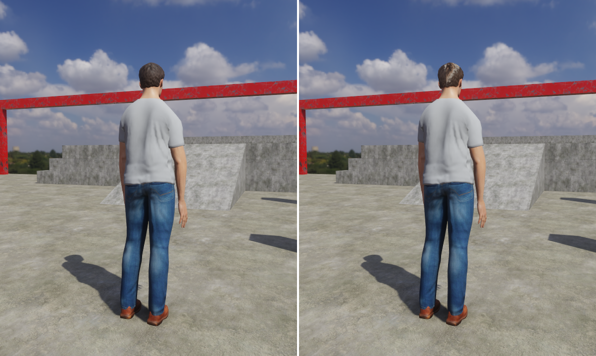

# Skin and hair shading spike

Measured 2026-11-16 for [#502](https://github.com/Pacheco95/sonnet/issues/502), the spike behind [ADR-0041](../decisions/0041-skin-shading.md). The prototype is the unmerged branch `spike/skin-hair-shading` (`b0f8ff8`, on `main` at `8174469`). These are desktop results only. The Galaxy S25 and iPad were not measured, and nothing here stands in for their gates.

## The prototype

`--character-shading on|hair-u|off` (player capture flag, spike only) makes the humanoid's glTF materials named `Skin` and `Hair` take the prototype models, picked by the material's debug name instead of a material field. Off, every material renders as on `main`.

- **Representation.** `GpuMaterial` grows from 240 to 256 bytes with one `shading` row. Flag bits 11–12 hold the model, bit 13 the dithered mask and bit 14 the hair axis U. `FrameConstants` gains the skin LUT index and the dither phase (1000 to 1008 bytes).
- **Skin.**
  - A 128×128 `R16G16B16A16Sfloat` LUT, built once by a compute entry in `ibl.slang` (`skinLut`) beside `brdfLut`. x is n·l from −1 to 1; y is (1 profile mm) / (surface radius) from 0 to 0.5. Each texel integrates the clamped cosine around a ring of that radius, weighted per channel by d'Eon and Luebke's six-Gaussian skin profile. The arc is limited to three deviations of the widest Gaussian so the narrow ones are not undersampled.
  - The curvature is `length(fwidth(N)) / length(fwidth(P))` of the interpolated vertex normal, times the scatter radius (1 mm).
  - The diffuse normals blend per channel from the mapped towards the smooth normal, by 0.9, 0.6 and 0.3 of the subsurface weight. Each channel takes its own LUT sample for every light, three samples a light. Irradiance is also sampled once per channel at that channel's normal. Specular is GGX on the mapped normal.
- **Hair.**
  - Two shifted Kajiya-Kay lobes (Scheuermann) along V: shifts −0.08 and 0.12, secondary width 0.5. Hair roughness is fixed at 0.35 for the spike; the glTF's 0.62 is a GGX value.
  - The lobe is normalised by (√e + 1) / 2π. The 2D (e + 2) / 2π, with or without Schlick's Fresnel, turned the cap white.
  - The primary takes the constant F0; the secondary is tinted by the base colour and at half weight.
  - The base colour's luminance stands in for a shift texture, offsetting each strand by up to ±0.3.
  - A wrapped diffuse. IBL specular reflects off the normal across the strand that faces the viewer, at roughness + 0.25.
- **Coverage.**
  - Under TAA the `Hair` mask is dithered. Alpha below 0.05 is cut. Above it, alpha is tested against the 4×4 ordered threshold shifted by an eighth for each of the eight TAA phases.
  - The pre-pass decides alone. The forward pass skips its alpha test and relies on the equal depth test, because its biased texture sample could disagree with the pre-pass's.
  - Without TAA, or in a debug view, it is the plain cutoff. Shadows keep the cutoff.
- **Branch.** `forward.slang` branches on the model per draw, which is uniform within a draw.

The capture scenes are copies of `capture_idle` with the follow camera's properties changed (`spike_*.scene.json`, written by a script outside the repository). On the branch, the character holds its pose from 0.25 s and the camera can stop orbiting, so motion runs can be compared against a still frame.

## Setup

- Linux, NVIDIA GeForce RTX 4090, driver 595.99.02, Vulkan 1.4.329, power profile `performance`. Lavapipe is llvmpipe (LLVM 20.1.2), Vulkan 1.4.318.
- Release (`linux-release`, RelWithDebInfo) player, headless, renderer defaults: TAA, occlusion culling, four cascades, bloom, AO as the scene asks.
- Captures are 1280×720 (`--render-size`) after `--play 1`. Timings are at 1920×1080 after `--play 3`, from the capture line's "GPU frames median / p95" over the last 100 frames, in which every frame was complete. Each figure is the median of three paired runs in alternating order.
- Raw logs, the scene generator and the analysis scripts are outside the repository.

## Skin

- **Falloff.** The terminator turns redder. On a row through the cheek at a quarter of the lit level, red over green goes from 1.59 to 1.75. The normal map's pores and stubble soften on the diffuse while the specular keeps them.
- **Shadow edges.** The hard edges on the cheek are the cascades' cast shadow. Pre-integration does not soften them: on that row the 10–90 % transition is 22 pixels both off and on. Penner's shadow-penumbra LUT is outside this spike.
- **Curvature.** The derivative curvature is faceted (debug view, left below). An interpolated normal changes linearly across a triangle, so `fwidth` is constant within each triangle and jumps at its edges, and the face's triangles show. The final image does not show the facets, because the 1 mm radius keeps the LUT rows low (most of the face is below 0.3).
- **Stability.** Final images at eight consecutive settle counts (32 to 39, so after more than 32 settling frames, one whole TAA cycle), terminator view. The per-pixel standard deviation over the eight on the cheek and nose is 0.167 sRGB levels (p99 1.90) off and 0.194 (p99 3.48) on. The extra variation is on the silhouette edges of the nose and jaw, not inside the face (heat map below, right half of each pair).

## Hair

- **The asset.** `Hair` is a painted scalp cap: one mesh, its texture two fan-shaped UV islands mirrored left and right, not strand cards. Alpha is nearly binary: 58 % of texels are below 0.05, 39 % above 0.95 and 3 % in between, all in the fringe at the hairline.
- **Strand axis.** V follows the painted strands near the hairline. It turns up to about 45° from them towards each fan's edges, and its sign flips at the mirror line (debug view, right). U is worse everywhere. **V is the better constant axis, but no constant UV axis is right on this asset**, so the highlight changes at the mirror seam.
- **Highlights.** With a narrow lobe, a flat patch of the cap with a constant strand direction lights up evenly and stops at its triangle edges; the half-frame capture below shows rectangles. The base-colour shift noise breaks the band into strands, but the facets remain. At body distance the highlight reads as bleached patches.
- **Conclusion.** The two-lobe model is cheap and works, but the result depends on the content. It needs a per-texel strand direction (a flow map) and a shift texture, or strand cards authored along one UV axis. With neither, this humanoid's hair is not an improvement worth enabling.

### Dithered coverage

- **Fringe.** The fringe and sideburns gain partial coverage instead of a hard cut (the hairline in the face capture).
- **Shimmer.** Under the current TAA resolve the dither does not converge. The clip box is the 3×3 mean ± 1.25 σ of the current frame, so where coverage is low a neighbourhood holds few hair samples and the history is clipped back to skin; a dot pattern remains. Over one TAA cycle the hairline box deviates by 0.81 levels on average (p99 12.3) on, against 0.25 (p99 2.5) off.
- **Trails.** The camera orbits at 90°/s, stops, and each frame after the stop is compared with a converged frame of the same pose (the head, a 400×400 box; mean / p99 of the per-pixel difference in sRGB levels). The floor is the same comparison over eight converged frames, one per phase.

| Frames after the stop | 0 | 1 | 2 | 3 | 4 | 6 | 8 | 12 | Floor |
|---|---|---|---|---|---|---|---|---|---|
| Cutoff (off) | 0.43 / 6.3 | 0.38 / 6.0 | 0.24 / 3.7 | 0.16 / 2.3 | 0.14 / 2.0 | 0.13 / 1.7 | 0.10 / 1.3 | 0.06 / 1.0 | 0.04 / 0.8 |
| Dithered (on) | 0.68 / 16.3 | 0.60 / 14.0 | 0.41 / 10.3 | 0.31 / 8.7 | 0.24 / 6.0 | 0.19 / 3.7 | 0.16 / 3.3 | 0.08 / 1.7 | 0.08 / 2.1 |

  Four frames after the stop, the cutoff is at 2.5 times its floor's p99 and the dither at about 3 times. The dither is about four frames behind the cutoff: its frame 4 matches the cutoff's frame 0. Both reach their floor's worst phase (1.3 and 3.3) by frame 8. Neither passes a "recovered within four frames" check without a tolerance. The residual is the dithered band (below, top row cutoff, bottom row dithered, frames 0, 2, 4 and 8).

- **Fade.** With the camera at 0.8 m the character is half faded (#529). The masked hair stays solid on `main`. Dithered, it fades with the body, because its alpha already includes the tint's. The eyebrows and eyelashes are masked but not dithered in the spike, so they still do not fade. A masked material needs the tint's screen door whether or not its alpha is dithered.

## Lavapipe

The same face and body captures on Lavapipe differ from the RTX 4090's by 0.8 to 1.7 sRGB levels on average, with the same look.

## Timings, RTX 4090, 1920×1080

Milliseconds. Each cell is the median over three paired runs of the run's GPU-frame median / p95, with the pass's mean.

| Scene | Off | On | Added |
|---|---|---|---|
| Head at about half the frame (`spike_half`: skin 26 % of the pixels, hair most of the rest) | 0.386 / 0.392, forward 0.076, depth 0.015 | 0.392 / 0.397, forward 0.081, depth 0.016 | +0.006 / +0.005 |
| Full body (`spike_body`) | 0.509 / 0.516, forward 0.109 | 0.509 / 0.515, forward 0.109 | 0.000 |

**Standard materials.** The spike's per-draw branch is compiled into every draw, so the regression budget compares `main`'s player with the spike's on scenes with no skin or hair. The "no branch" column is the spike's build with the model fixed to Standard at compile time: the 256-byte record and the larger frame constants are kept and the branches are compiled away, which is what a Standard pipeline specialised by a constant would run.

| Scene | `main` | Spike | Spike, no branch |
|---|---|---|---|
| Showcase (`showcase/scenes/main`) | 0.664 / 0.673, forward 0.333 | 0.704 / 0.713, forward 0.373 | 0.666 / 0.675, forward 0.335 |
| Stress (`basic/scenes/stress`) | 0.804 / 0.825, forward 0.267 | 0.825 / 0.847, forward 0.289 | 0.802 / 0.824, forward 0.266 |
| Course (`capture_idle`) | 0.421 / 0.427, forward 0.077 | 0.427 / 0.433, forward 0.083 | not run |

- **The branch costs standard draws.** It adds 0.040 ms on the showcase and 0.022 ms on the stress scene, 12 % and 8 % of `forward`, with no skin or hair in either scene. Specialising the model away removes all of it; the material and frame growth cost nothing measurable. The same fraction of the S25's forward pass would be well over the 0.1 ms standard-scene gate, so the per-draw branch fails here, before any phone measurement.
- **Skin and hair cost.** On the RTX 4090 they add 0.006 ms with the head at about half the frame. This says nothing about the S25's 0.5 ms and 0.3 ms budgets, which remain unmeasured.

## Not measured

- **Galaxy S25 Ultra.** No phone was connected. The skin (≤ 0.5 ms) and hair (≤ 0.3 ms) budgets, the 33 ms sustained interval, the thermal comparison and the standard-scene gate on the phone are all unmeasured. So are the cooldown rule and the sustained runs.
- **iPad.** Not measured.
- **Without TAA.** Hair coverage with None or FXAA was not captured (in the code it is the plain cutoff); the spike's dither applies only under TAA.
- **Separate costs.** Skin and hair were not timed apart (the RTX figure is both), and the `hair-u` variant was not timed.
