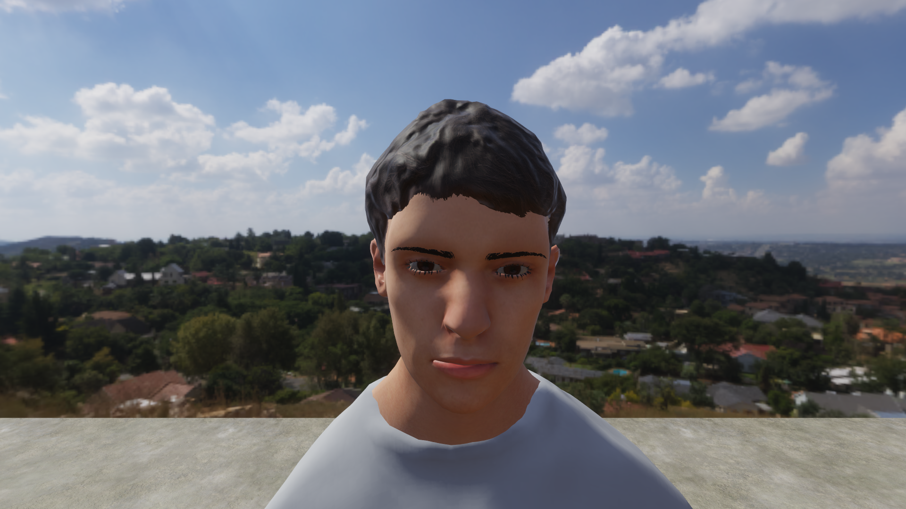
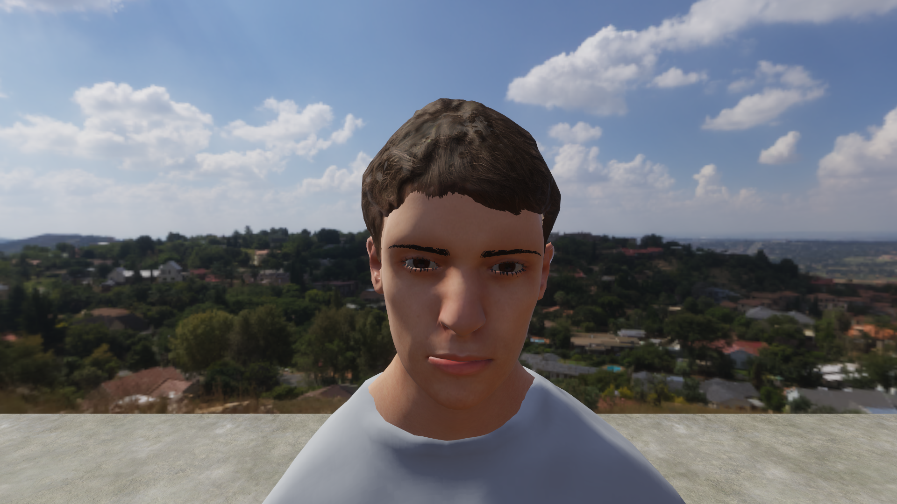

# Skin and hair shading on the iPad (A16)

Measured 2026-11-24 for [#637](https://github.com/Pacheco95/sonnet/issues/637), the iPad halves of [#609](https://github.com/Pacheco95/sonnet/issues/609) and [#591](https://github.com/Pacheco95/sonnet/issues/591), against [ADR-0041](../decisions/0041-skin-shading.md) and [ADR-0046](../decisions/0046-hair-strand-shading-and-coverage.md). The matching Android session is [skin-shading-s25](skin-shading-s25.md).

**Verdict. Skin passes the measured 1080p cold and sustained cost checks, and Skin and Hair compile and draw correctly on Apple A16. Hair does not pass every observed 0.3 ms cost window. Native-resolution and standard-scene GPU cost gates remain unmeasured reliably because their timestamp windows are sparse.**

Production Skin's 1080p cold frame median/p95 increments are −0.138/−0.029 ms corrected (−0.019/+0.094 raw), and sustained Skin's are −0.185/−0.049 (−0.022/+0.123 raw), within 0.5 ms. Hair over Skin reaches +0.433 ms corrected cold frame p95 in one round (+0.672 raw); sustained, its corrected frame median is +0.364 ms (+0.210 raw), with forward +0.384 corrected (+0.346 raw). All four long runs last over 600 wall seconds, stay nominal throughout, and finish with frame-interval p95 between 16.72 and 17.15 ms, below 33 ms. No renderer default, ADR, issue or project-board entry is changed.

## Setup and method

- **Device and tools.** iPad (A16), iPadOS 27.2; the player's device log reports **Apple A16 GPU**, MoltenVK 1.4.2 and Vulkan 1.4.357; MoltenVK lists **GPU Family Apple 8** and **GPU Family Metal 4**. Xcode 26.3 (17C529), iPhoneOS SDK 26.2, Apple Clang 17. Native window and swapchain **1640×2360**, portrait, three `B8G8R8A8Unorm` images, FIFO. The forced render extent is **1920×1080**; screenshots at that extent are 1920×1080 even though presentation scales to the native window. Native captures are 1640×2360. The portrait aspect changes the framing; no camera or shading parameter was tuned.
- **Builds.** The spike checkout is `4c9e4e9` (code `eabaa1f`, based on `98a1365`); production is `98a1365`. Both players use `ios-release`, **RelWithDebInfo**, automatic development signing, the same matching `arm64-ios` dependencies and Apple compiler. The host cook tools were built from their respective checkouts with `macos-release-local` (RelWithDebInfo), then each cooked the character, showcase and basic projects with `--platform ios`. [Build and bundle SHA-256s](skin-shading-ipad/builds.txt) identify the binaries and inputs. Existing older iOS dependencies were insufficient (Jolt lacked `CreateJobs`), so the manifest's matching dependencies were installed in the isolated spike build.
- **Local build adjustments.** The spike's floating-point `std::from_chars` is unavailable at the preset's iOS 16.3 deployment target. Both measurement builds used **26.0**, machine-locally, on this iPadOS 27.2 device. Temporary local triplets selected Xcode's macOS and iPhoneOS SDKs explicitly, avoiding the inherited Command Line Tools SDK mismatch. This does not prove the spike builds at 16.3. The team and these settings remain uncommitted; engine code and shared presets are unchanged. The signed app verifies with `codesign --verify --deep --strict`, its unexpired provisioning profile includes the iPad, and the owner trusted the developer profile before the first successful launch.
- **Bundle loading.** The existing player accepts an **absolute `.sbundle` path on iOS** (`contentPath` in `apps/player/main.cpp`). `devicectl device copy to --domain-type appDataContainer --domain-identifier io.github.pacheco95.sonnet` placed each bundle in `Documents/character.sbundle`, `Documents/showcase.sbundle` or `Documents/basic.sbundle`; the copy result supplied the container's absolute path. Launches passed that path followed by capture flags. One installed app per build therefore ran all three bundles; `SONNET_IOS_BUNDLE` was unnecessary. Every launch used `--console --terminate-existing`, with one device command at a time, outside the sandbox.
- **Renderer settings.** Shipped iOS settings were retained: far shadow cascade 1024, caster LOD on cascade 3, environment limit 1024; transmission, ambient occlusion and contact shadows off. TAA, occlusion culling, four shadow cascades and bloom are present in the measured pass lists. The S25 uses a 512 far cascade, so equal render extents do not make all platform settings identical. No unrelated capture override was supplied.
- **Modes and views.** The spike runs `off`, `skin`, `hair`, `on`, with the plain cutoff (`--hair-coverage` unset); `on` over `skin` is hair's cost over skin alone. Production supports `off` and `on` (Skin only). Both builds run `scenes/capture_face.scene.json` at 1080p and native size, the showcase start scene (`scenes/main.scene.json`) and the basic sample's `scenes/stress.scene.json` at 1080p. Three short rounds rotate mode order: the spike face uses off/skin/hair/on, skin/hair/on/off, hair/on/off/skin; pairs use off/on, on/off, off/on. All **60 cold runs** produced their own screenshot, timing summary and `exit ok`, and reported nominal → nominal (worst nominal).
- **Operator and power.** The owner confirmed the iPad was unlocked, awake with Auto-Lock off, charging by cable, available without other use, and able to open Sonnet after trusting the developer. Runs were launched into the foreground; between captures the player exited. **The iPad remained charging over the USB cable**, as in the S25 session. There is no iOS skin-temperature HAL reading. Cold rounds were short sequential runs, not a claim of a measured chip temperature.
- **Sustained cooldown.** Each 1080p `--play 600` run follows at least **15 minutes with the player stopped**, then a short fresh-process `--play 0` capture whose thermal summary must be nominal → nominal (worst nominal). A non-nominal check restarts the cooldown. The sustained run must also report nominal as its first thermal sample. This follows [iphone-m14-thermal](iphone-m14-thermal.md); no S25 temperature threshold is substituted. Host start/end timestamps retain actual wall duration, since simulation seconds alone do not prove a ten-minute load.
- **Clock correction.** As in the S25 report, let `U` be the sum of the available per-pass means of **all listed passes except forward**. A run's scale is `U(off, same round) / U(run)`. Corrected forward and complete-frame median/p95 are multiplied by that scale; a comparison subtracts the two runs after both have been normalized to that round's `off`. Sustained uses its one `off` baseline. Raw differences remain beside corrected ones. If any normalization pass has no sample, correction is **n/a**, not a partial sum. This is a clock-normalization heuristic, not a measured GPU clock; it cannot remove sample-selection bias or establish that every difference in an unchanged pass was caused by clock changes.
- **Timestamp limits.** [#355](https://github.com/Pacheco95/sonnet/issues/355) and [iphone-m14-timestamps](iphone-m14-timestamps.md) describe MoltenVK's nonblocking availability loss. Every pass's mean and **`n/100 samples`** are retained in [pass-samples.csv](skin-shading-ipad/pass-samples.csv); [runs.csv](skin-shading-ipad/runs.csv) keeps the complete-frame counts, whole-frame percentiles, intervals and thermal summaries. [differences.csv](skin-shading-ipad/differences.csv) keeps every paired cold difference and scale. No missing sample is zero-filled or clamped. Near-complete 1080p face windows can support their observed budget comparison; the native and standard-scene windows often have only a handful of samples, so their p95s cannot establish a 100-frame tail or a sub-millisecond gate. Forward diagnostics do not replace a required whole-frame median/p95 gate.

Redacted full build and device logs, the engine-written PNGs and preparation evidence are retained in `~/sonnet-measurements/ipad-609/`. Discovery identifiers, device names, signing team, account email and personal home paths are excluded from the committed evidence.

## Cold rounds

All times are milliseconds. Each run used `--play 5` and the last 100 frames. Comma-separated entries are rounds 1–3; `n/a` remains missing. Forward is the mean over available samples, **not a per-frame median or p95**: the player does not print those per-pass percentiles. Complete GPU-frame medians and p95s use only frames with every pass available.

Every difference cell gives **minimum / median / p95 / maximum across the three rounds** (nearest-rank p95 equals maximum for three rounds). These are round statistics, not per-frame extrema. A missing pair is omitted from that statistic and the surviving pair count is printed; this is not a three-round result. Sparse native and standard-scene samples are diagnostic, not proof of their cost gates.

### Spike build, 4c9e4e9 (code eabaa1f)

#### capture_face, 1920×1080

| Mode | GPU frame median, rounds | GPU frame p95, rounds | Forward mean, rounds | Forward samples / 100, rounds | Complete frames / 100, rounds | Interval p95, rounds |
|---|---|---|---|---|---|---|
| off | 14.372, 14.405, 13.861 | 15.026, 15.088, 15.003 | 3.395, 3.400, 3.389 | 99/100, 100/100, 95/100 | 99/100, 100/100, 95/100 | 17.030, 17.130, 17.890 |
| skin | 14.364, 14.503, 13.842 | 15.036, 15.020, 14.380 | 3.515, 3.579, 3.498 | 100/100, 100/100, 97/100 | 100/100, 100/100, 97/100 | 16.960, 17.000, 17.960 |
| hair | 14.405, 14.421, 14.061 | 14.958, 15.164, 14.982 | 3.582, 3.542, 3.483 | 96/100, 99/100, 100/100 | 96/100, 99/100, 100/100 | 17.140, 17.040, 16.730 |
| on | 14.367, 14.404, 14.562 | 15.174, 15.129, 15.052 | 3.627, 3.638, 3.719 | 97/100, 100/100, 100/100 | 97/100, 100/100, 100/100 | 17.510, 17.010, 16.960 |

Added cost; each cell is min / median / p95 / max across rounds.

| Run over base | Forward corrected | Frame median corrected | Frame p95 corrected | Forward raw | Frame median raw | Frame p95 raw |
|---|---|---|---|---|---|---|
| skin over off | +0.148 / +0.190 / +0.201 / +0.201 | +0.137 / +0.187 / +0.277 / +0.277 | -0.461 / +0.024 / +0.308 / +0.308 | +0.109 / +0.120 / +0.179 / +0.179 | -0.019 / -0.008 / +0.098 / +0.098 | -0.623 / -0.068 / +0.010 / +0.010 |
| hair over off | +0.109 / +0.146 / +0.296 / +0.296 | +0.031 / +0.259 / +0.472 / +0.472 | +0.042 / +0.091 / +0.388 / +0.388 | +0.094 / +0.142 / +0.187 / +0.187 | +0.016 / +0.033 / +0.200 / +0.200 | -0.068 / -0.021 / +0.076 / +0.076 |
| on over off | +0.263 / +0.292 / +0.374 / +0.374 | +0.214 / +0.440 / +0.557 / +0.557 | -0.220 / +0.266 / +0.741 / +0.741 | +0.232 / +0.238 / +0.330 / +0.330 | -0.005 / -0.001 / +0.701 / +0.701 | +0.041 / +0.049 / +0.148 / +0.148 |
| on over skin | +0.091 / +0.115 / +0.184 / +0.184 | +0.027 / +0.280 / +0.303 / +0.303 | +0.241 / +0.242 / +0.433 / +0.433 | +0.059 / +0.112 / +0.221 / +0.221 | -0.099 / +0.003 / +0.720 / +0.720 | +0.109 / +0.138 / +0.672 / +0.672 |

#### capture_face, native 1640×2360

| Mode | GPU frame median, rounds | GPU frame p95, rounds | Forward mean, rounds | Forward samples / 100, rounds | Complete frames / 100, rounds | Interval p95, rounds |
|---|---|---|---|---|---|---|
| off | 21.337, 23.167, 24.027 | 21.425, 23.492, 24.234 | 6.723, 7.260, 7.749 | 12/100, 12/100, 13/100 | 12/100, 12/100, 13/100 | 33.380, 33.470, 33.520 |
| skin | 21.637, 21.603, 24.415 | 21.798, 21.660, 25.250 | 6.973, 6.918, 8.101 | 14/100, 7/100, 23/100 | 14/100, 7/100, 23/100 | 33.220, 33.430, 45.040 |
| hair | 21.755, 22.315, 23.237 | 21.994, 22.700, 23.976 | 7.126, 7.310, 7.757 | 19/100, 28/100, 8/100 | 19/100, 28/100, 8/100 | 33.450, 45.350, 33.480 |
| on | 21.859, 23.776, 24.440 | 22.148, 24.164, 24.713 | 7.307, 7.856, 8.116 | 10/100, 29/100, 5/100 | 10/100, 29/100, 5/100 | 33.330, 45.360, 33.440 |

Added cost; each cell is min / median / p95 / max across rounds.

| Run over base | Forward corrected | Frame median corrected | Frame p95 corrected | Forward raw | Frame median raw | Frame p95 raw |
|---|---|---|---|---|---|---|
| skin over off | +0.243 / +0.271 / +0.300 / +0.300 | +0.231 / +0.278 / +0.349 / +0.349 | +0.086 / +0.351 / +0.854 / +0.854 | -0.342 / +0.250 / +0.352 / +0.352 | -1.564 / +0.300 / +0.388 / +0.388 | -1.832 / +0.373 / +1.016 / +1.016 |
| hair over off | +0.312 / +0.393 / +0.511 / +0.511 | +0.121 / +0.388 / +0.555 / +0.555 | +0.539 / +0.640 / +0.682 / +0.682 | +0.008 / +0.050 / +0.403 / +0.403 | -0.852 / -0.790 / +0.418 / +0.418 | -0.792 / -0.258 / +0.569 / +0.569 |
| on over off | +0.397 / +0.596 / +0.639 / +0.639 | +0.502 / +0.556 / +0.738 / +0.738 | +0.569 / +0.758 / +0.803 / +0.803 | +0.367 / +0.584 / +0.596 / +0.596 | +0.413 / +0.522 / +0.609 / +0.609 | +0.479 / +0.672 / +0.723 / +0.723 |
| on over skin | +0.096 / +0.353 / +0.368 / +0.368 | +0.271 / +0.279 / +0.389 / +0.389 | -0.285 / +0.407 / +0.717 / +0.717 | +0.015 / +0.334 / +0.938 / +0.938 | +0.025 / +0.222 / +2.173 / +2.173 | -0.537 / +0.350 / +2.504 / +2.504 |

#### Showcase, 1920×1080

| Mode | GPU frame median, rounds | GPU frame p95, rounds | Forward mean, rounds | Forward samples / 100, rounds | Complete frames / 100, rounds | Interval p95, rounds |
|---|---|---|---|---|---|---|
| off | n/a, 52.654, 53.526 | n/a, 52.776, 53.839 | n/a, 41.167, 42.023 | 0/100, 3/100, 8/100 | 0/100, 3/100, 8/100 | 62.100, 66.790, 78.710 |
| on | 52.019, 52.633, 53.334 | 52.231, 52.788, 53.334 | 40.665, 41.073, 41.347 | 4/100, 4/100, 1/100 | 4/100, 4/100, 1/100 | 66.740, 66.870, 78.330 |

Added cost; each cell is min / median / p95 / max across rounds.

| Run over base | Forward corrected | Frame median corrected | Frame p95 corrected | Forward raw | Frame median raw | Frame p95 raw |
|---|---|---|---|---|---|---|
| on over off | -2.059 / -1.212 / -0.364 / -0.364 (2/3) | -1.976 / -1.171 / -0.367 / -0.367 (2/3) | -2.289 / -1.312 / -0.335 / -0.335 (2/3) | -0.676 / -0.385 / -0.094 / -0.094 (2/3) | -0.192 / -0.107 / -0.021 / -0.021 (2/3) | -0.505 / -0.247 / +0.012 / +0.012 (2/3) |

#### Stress, 1920×1080

| Mode | GPU frame median, rounds | GPU frame p95, rounds | Forward mean, rounds | Forward samples / 100, rounds | Complete frames / 100, rounds | Interval p95, rounds |
|---|---|---|---|---|---|---|
| off | 43.651, 44.712, 44.771 | 43.832, 45.110, 45.222 | 28.011, 28.743, 28.722 | 8/100, 12/100, 4/100 | 8/100, 12/100, 4/100 | 60.140, 56.720, 50.260 |
| on | 43.802, 44.152, 44.372 | 44.295, 44.584, 44.658 | 28.420, 28.469, 28.632 | 4/100, 13/100, 3/100 | 4/100, 13/100, 3/100 | 50.320, 50.310, 50.290 |

Added cost; each cell is min / median / p95 / max across rounds.

| Run over base | Forward corrected | Frame median corrected | Frame p95 corrected | Forward raw | Frame median raw | Frame p95 raw |
|---|---|---|---|---|---|---|
| on over off | +0.304 / +0.539 / +0.651 / +0.651 | +0.336 / +0.524 / +0.576 / +0.576 | +0.379 / +0.418 / +0.840 / +0.840 | -0.274 / -0.090 / +0.409 / +0.409 | -0.560 / -0.399 / +0.151 / +0.151 | -0.564 / -0.526 / +0.463 / +0.463 |

### Production build, 98a1365

#### capture_face, 1920×1080

| Mode | GPU frame median, rounds | GPU frame p95, rounds | Forward mean, rounds | Forward samples / 100, rounds | Complete frames / 100, rounds | Interval p95, rounds |
|---|---|---|---|---|---|---|
| off | 14.182, 13.702, 14.100 | 14.897, 14.770, 14.817 | 3.663, 3.475, 3.631 | 98/100, 98/100, 98/100 | 98/100, 98/100, 98/100 | 17.380, 17.790, 17.210 |
| on | 14.083, 14.048, 14.081 | 14.991, 15.056, 14.865 | 3.673, 3.627, 3.703 | 99/100, 99/100, 98/100 | 99/100, 99/100, 98/100 | 17.200, 17.260, 17.270 |

Added cost; each cell is min / median / p95 / max across rounds.

| Run over base | Forward corrected | Frame median corrected | Frame p95 corrected | Forward raw | Frame median raw | Frame p95 raw |
|---|---|---|---|---|---|---|
| on over off | -0.000 / +0.007 / +0.076 / +0.076 | -0.264 / -0.138 / +0.052 / +0.052 | -0.211 / -0.029 / +0.053 / +0.053 | +0.010 / +0.072 / +0.152 / +0.152 | -0.099 / -0.019 / +0.346 / +0.346 | +0.048 / +0.094 / +0.286 / +0.286 |

#### capture_face, native 1640×2360

| Mode | GPU frame median, rounds | GPU frame p95, rounds | Forward mean, rounds | Forward samples / 100, rounds | Complete frames / 100, rounds | Interval p95, rounds |
|---|---|---|---|---|---|---|
| off | 20.867, 25.870, 26.529 | 21.065, 26.363, 26.846 | 6.711, 8.373, 8.757 | 12/100, 24/100, 26/100 | 12/100, 24/100, 26/100 | 33.330, 45.300, 45.300 |
| on | 21.173, 26.577, 26.922 | 21.326, 27.339, 27.233 | 6.962, 8.756, 9.065 | 13/100, 27/100, 28/100 | 13/100, 27/100, 28/100 | 33.360, 45.400, 45.330 |

Added cost; each cell is min / median / p95 / max across rounds.

| Run over base | Forward corrected | Frame median corrected | Frame p95 corrected | Forward raw | Frame median raw | Frame p95 raw |
|---|---|---|---|---|---|---|
| on over off | +0.246 / +0.288 / +0.312 / +0.312 | +0.291 / +0.334 / +0.491 / +0.491 | +0.246 / +0.327 / +0.754 / +0.754 | +0.251 / +0.308 / +0.383 / +0.383 | +0.306 / +0.393 / +0.707 / +0.707 | +0.261 / +0.387 / +0.976 / +0.976 |

#### Showcase, 1920×1080

| Mode | GPU frame median, rounds | GPU frame p95, rounds | Forward mean, rounds | Forward samples / 100, rounds | Complete frames / 100, rounds | Interval p95, rounds |
|---|---|---|---|---|---|---|
| off | 55.765, 56.863, 56.436 | 56.033, 58.028, 56.834 | 43.569, 44.847, 44.322 | 3/100, 8/100, 7/100 | 3/100, 8/100, 7/100 | 78.610, 78.700, 78.720 |
| on | 57.294, 56.949, n/a | 57.625, 57.197, n/a | 45.091, 44.587, n/a | 5/100, 7/100, 0/100 | 5/100, 7/100, 0/100 | 78.670, 78.680, 78.620 |

Added cost; each cell is min / median / p95 / max across rounds.

| Run over base | Forward corrected | Frame median corrected | Frame p95 corrected | Forward raw | Frame median raw | Frame p95 raw |
|---|---|---|---|---|---|---|
| on over off | -0.097 / +0.633 / +1.364 / +1.364 (2/3) | +0.294 / +0.811 / +1.328 / +1.328 (2/3) | -0.622 / +0.384 / +1.390 / +1.390 (2/3) | -0.260 / +0.631 / +1.522 / +1.522 (2/3) | +0.086 / +0.807 / +1.529 / +1.529 (2/3) | -0.831 / +0.381 / +1.592 / +1.592 (2/3) |

#### Stress, 1920×1080

| Mode | GPU frame median, rounds | GPU frame p95, rounds | Forward mean, rounds | Forward samples / 100, rounds | Complete frames / 100, rounds | Interval p95, rounds |
|---|---|---|---|---|---|---|
| off | 51.263, 49.098, 49.166 | 51.456, 49.244, 49.562 | 33.475, 31.862, 32.018 | 5/100, 8/100, 8/100 | 5/100, 8/100, 8/100 | 61.840, 62.090, 54.600 |
| on | 48.824, 49.454, 49.284 | 49.194, 49.830, 49.511 | 31.827, 32.188, 32.139 | 6/100, 9/100, 10/100 | 6/100, 9/100, 10/100 | 61.920, 61.950, 61.960 |

Added cost; each cell is min / median / p95 / max across rounds.

| Run over base | Forward corrected | Frame median corrected | Frame p95 corrected | Forward raw | Frame median raw | Frame p95 raw |
|---|---|---|---|---|---|---|
| on over off | -0.555 / +0.080 / +0.208 / +0.208 | -0.762 / +0.055 / +0.175 / +0.175 | -0.572 / -0.114 / +0.404 / +0.404 | -1.648 / +0.121 / +0.326 / +0.326 | -2.439 / +0.118 / +0.356 / +0.356 | -2.262 / -0.051 / +0.586 / +0.586 |

## Sustained, 600 s

One spike run per mode, `capture_face` at 1920×1080, preceded by at least 15 minutes idle and a nominal short thermal check. Means and distributions below are from the final 100 frames; thermal first/last/worst cover the run. Host wall time includes launch and initialization. A complete-frame p95 based on a sparse subset remains a diagnostic, not the full-window p95.

| Mode | GPU frame median / p95 (ms) | Forward mean (ms), samples | Complete GPU frames | Interval median / p95 (ms) | Thermal first → last → worst | Host wall duration |
|---|---|---|---|---|---|---|
| off | 14.169 / 14.750 | 3.611, 99/100 samples | 99/100 | 16.69 / 17.15 | nominal → nominal → nominal | 601.4 s |
| skin | 14.147 / 14.873 | 3.520, 100/100 samples | 100/100 | 16.66 / 16.72 | nominal → nominal → nominal | 601.9 s |
| hair | 14.139 / 14.908 | 3.652, 98/100 samples | 98/100 | 16.67 / 17.13 | nominal → nominal → nominal | 601.4 s |
| on | 14.357 / 14.855 | 3.866, 100/100 samples | 100/100 | 16.67 / 17.00 | nominal → nominal → nominal | 601.8 s |

Added cost, milliseconds; both halves are normalized to the sustained `off` baseline for corrected differences.

| Run over base | Forward corrected | Frame median corrected | Frame p95 corrected | Forward raw | Frame median raw | Frame p95 raw |
|---|---|---|---|---|---|---|
| skin over off | -0.132 | -0.185 | -0.049 | -0.091 | -0.022 | +0.123 |
| hair over off | +0.047 | -0.008 | +0.181 | +0.041 | -0.030 | +0.158 |
| on over off | +0.252 | +0.178 | +0.095 | +0.255 | +0.188 | +0.105 |
| on over skin | +0.384 | +0.364 | +0.144 | +0.346 | +0.210 | -0.018 |

### Cooldown evidence

| Following mode | Idle before thermal check | Check thermal first → last → worst | Check result |
|---|---|---|---|
| off | 912.7 s | nominal → nominal → nominal | nominal |
| skin | 900.0 s | nominal → nominal → nominal | nominal |
| hair | 900.0 s | nominal → nominal → nominal | nominal |
| on | 900.0 s | nominal → nominal → nominal | nominal |

## The gates

Times are added milliseconds. Unless a maximum is named, cold differences are medians of the paired-round differences. Corrected and raw readings are both shown; the tables above retain the range and every round. A sparse sample percentile is printed but does not establish a reliable 100-frame tail. **Pass** means the observed windows support the budget; **fail in an observed window** records a measured threshold exceedance without attributing all of it to the shading model; **unmeasured reliably** means the available samples do not establish the required cost gate.

| Gate | Source | Measured | Verdict |
|---|---|---|---|
| **Skin ≤ 0.5 ms, median and p95, cold** (ADR-0041) | production, 1080p | frame median −0.138 corrected / −0.019 raw; p95 −0.029 / +0.094; corrected round maxima +0.052 / +0.053, raw maxima +0.346 / +0.286; forward +0.007 corrected; 98–99/100 complete frames | **pass**, all three observed paired windows |
| | production, native 1640×2360 | frame median +0.334 / +0.393; p95 +0.327 / +0.387; p95 round maxima +0.754 / +0.976; forward +0.288 corrected; 12–28/100 complete frames | **unmeasured reliably**; sparse tails include above-budget readings |
| | spike, 1080p | frame median +0.187 / −0.008; p95 +0.024 / −0.068; corrected maxima +0.277 / +0.308; forward +0.190 corrected; 95–100/100 complete frames | **pass**, all three observed paired windows |
| | spike, native | frame median +0.278 / +0.300; p95 +0.351 / +0.373; p95 maxima +0.854 / +1.016; forward +0.271 corrected; 7–23/100 complete frames in skin/off | **unmeasured reliably** |
| **Skin ≤ 0.5 ms, sustained** | spike, 1080p, 600 s | frame median −0.185 corrected / −0.022 raw; p95 −0.049 / +0.123; forward −0.132 / −0.091; 99/100 baseline and 100/100 Skin complete frames | **pass** in this paired final window |
| **Sustained p95 frame interval < 33 ms** | spike, 1080p, 600 s | off 17.15; skin 16.72; hair 17.13; on 17.00 | **pass**, all four final windows |
| **Thermal state no worse than with it off** | 600 s runs | nominal → nominal (worst nominal) in all four; no observed thermal elevation over 601.4–601.9 wall seconds per run | **pass** for the sampled states and duration; no throttling transition observed |
| **Showcase ≤ 0.1 ms** | production, 1080p | frame median +0.811 corrected / +0.807 raw; p95 +0.384 / +0.381, only 2/3 usable pairs; forward +0.633 corrected; 0–8/100 complete frames | **unmeasured reliably**; sampled differences exceed the budget and one pair is missing |
| **Stress scene ≤ 0.1 ms** | production, 1080p | frame median +0.055 corrected / +0.118 raw; p95 −0.114 / −0.051; forward +0.080 corrected; 5–10/100 complete frames | **unmeasured reliably**; a small corrected forward mean does not establish the whole-frame gate |
| Showcase, stress | spike, 1080p | corrected frame median −1.171 / +0.524 respectively (raw −0.107 / −0.399); 0–13/100 complete frames | **unmeasured reliably** |
| **Skin and Hair pipelines compile and draw on Apple GPUs** | Apple A16, off/skin/hair/on captures and logs | four spike model pipelines and two production Skin pipelines built; captures show their expected shading; no engine/MoltenVK error | **pass** on this Apple A16 |
| **Hair ≤ 0.3 ms over skin alone, cold** (ADR-0046) | spike, 1080p, on over skin | frame median +0.280 corrected / +0.003 raw; p95 +0.242 / +0.138; round maxima +0.303 / +0.433 corrected and +0.720 / +0.672 raw; forward +0.115 corrected, maximum +0.184; 95–100/100 complete frames | **fail in one observed whole-frame p95 window**; the three-round median and forward mean are below 0.3, but do not erase that exceedance |
| | native size | frame median +0.279 / +0.222; p95 +0.407 / +0.350; forward +0.353 corrected; 5–29/100 complete frames | **unmeasured reliably**; these sampled diagnostics do not demonstrate the native budget |
| **Hair ≤ 0.3 ms over skin alone, sustained** | spike, on over skin, 1080p | frame median +0.364 corrected / +0.210 raw; p95 +0.144 / −0.018; forward +0.384 / +0.346; both windows 100/100 complete | **fail in the corrected median window**; raw whole-frame figures pass, while forward also exceeds 0.3; this does not establish the unmeasured native sustained gate |
| Hair alone over off | hair mode, cold | forward +0.146 corrected at 1080p, +0.393 native (sparse); sustained +0.047 corrected / +0.041 raw, frame median −0.008 / −0.030 and p95 +0.181 / +0.158 | diagnostic; ADR-0046's enabling comparison is on over skin |
| **The iPad** | this session | 60 cold runs and four sustained runs, each over 600 wall seconds; Apple A16 captures; sample counts retained | **session complete**; native and standard-scene cost gates remain unresolved |

These results supply evidence for the owner. No `characterShading` default or ADR is changed.

## Captures and pipeline validation

All images below are the iPad's own engine-written PNGs, copied from the app data container. At 1920×1080, Standard (`off`), Skin only and Skin + Hair:

[Native 1640×2360 Skin + Hair capture](skin-shading-ipad/face-native-on.png).

**Skin and Hair compile and draw correctly on Apple A16.** The spike's enabled runs log `built the skin pipelines from forward: 4 pipelines` (the two Skin and two Hair variants); production logs two Skin pipelines. Compared by eye with [the RTX 4090 Skin captures](skin-shading-rtx4090/face-hands.png) and [the strand spike's desktop face](hair-strand-spike/face-off-on.png), the iPad shows the same warmer, softer skin terminator and normal-map diffuse detail, and the strand highlight instead of the Standard material's broad grey highlight. The inspected frames show no missing material or clear-colour coverage holes. This is visual validation, not pixel equality across GPUs and texture formats. The native capture confirms the head fills roughly half the frame's width. Retrieved showcase and stress PNGs also confirm the intended courtyard and box/sphere grid; their originals remain with the measurement logs.

**Log findings.** All **64 measurement runs** complete with their own screenshot, timing summary and `exit ok`, with no engine error, MoltenVK error or background transition. MoltenVK prints the known `R32_UINT` attachment-blending warning ([#59](https://github.com/Pacheco95/sonnet/issues/59)), also forwarded through the engine logger. UIKit additionally prints `Unbalanced calls to begin/end appearance transitions for <SDL_uikitviewcontroller…>` around foreground/scene initialization; this is a separate observed platform warning, not suppressed or fixed here. The initial preflight launch was denied before developer-profile trust; after the owner trusted it, captures succeeded. Missing timestamp samples remain a measurement finding, not evidence of zero GPU cost.

## Comparison with the S25

The S25 report's production Skin forward increment is +0.015 ms at 1080p and +0.125 ms native (medians of clock-corrected paired rounds). Here those diagnostics are +0.007 and +0.288 ms; the native iPad reading is sparsely sampled. Hair over skin in the forward pass is +0.115 ms at 1080p and +0.353 ms native here, versus +0.069 and +0.004 ms on the S25; the native iPad difference again cannot establish the budget. The iPad's native frame is 1640×2360 rather than the S25's 1080×2340, about 1.53 times as many pixels, with a different portrait aspect and head footprint. Both have the exact 1920×1080 forced render extent in that comparison. The S25 report accepts its noisy whole-frame comparisons alongside forward diagnostics; this report keeps the iPad's sparse or above-budget whole-frame windows unresolved rather than treating a small forward mean as proof of a total-frame p95 gate. No settings, assets or camera were adjusted to make the platforms match.

The sustained forward increment for hair over Skin is +0.384 ms corrected (+0.346 raw), compared with the S25's +0.058 ms. Here the corrected whole-frame median also exceeds 0.3 (+0.364), although its raw median is +0.210 and both p95 differences are below 0.3 (+0.144 corrected, −0.018 raw). These are separate observed final windows, not a fitted equivalence between GPUs. As on the S25, all four modes remain nominal over the long runs; this iPad's final interval p95s are 16.72–17.15 ms, compared with the S25's 16.91–17.43 ms. Charging and the unmeasured native sustained case remain limits.

## Not covered

- **No default or design decision.** `apps/player/main.cpp`, ADRs, issues and the project board are unchanged. This report supplies evidence; the owner decides what follows.
- **No timestamp workaround.** No blocking query read, forced availability, zero substitution, clamping or renderer tuning was added. Native and standard-scene windows cannot establish reliable sub-millisecond whole-frame gates with these sample counts. Their reported sample percentiles remain diagnostics.
- **Per-pass distributions.** Forward has a mean over its available samples, not per-frame median/p95 or individual-frame minimum/maximum. The report's round minimum/median/p95/maximum summarize those means and the printed whole-frame percentiles; they do not invent unavailable per-frame distributions.
- **One charging device and one session.** Ambient/chip temperature, GPU clock, power and battery-only behavior were not measured. Nominal thermal state is not a temperature measurement or proof of equal clock speed. A first/last/worst thermal summary does not locate the exact time of a transition.
- **The hair is the spike.** The [spike report](hair-strand-spike.md#what-was-built)'s material/flow-map and shared-pre-pass shortcuts remain. This does not validate future production material fields or formats, stochastic coverage, a reduced hair model, or a different iPad.
- **Production sustained.** The four long runs use the spike, as requested; production is measured cold only. No separate sustained production binary or sustained native-resolution run is claimed.
- **Older iOS targets.** The machine-local iOS 26.0 target allows this validation on iPadOS 27.2; compatibility of the spike's floating parser with the shared preset's 16.3 target remains unproven and failed in this preparation.
