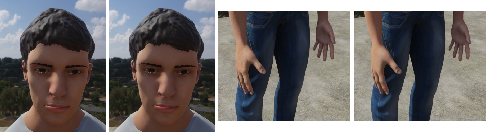

# Skin shading, production pipelines

Measured 2026-11-17 for [#543](https://github.com/Pacheco95/sonnet/issues/543), the production build of [ADR-0041](../decisions/0041-skin-shading.md)'s Skin model: the `skinFragmentMain` entry point, the four forward pipelines and the model in the opaque batch key ([rendering.md](../rendering.md#skin-shading)). The [spike](skin-hair-spike.md) measured the same shading behind a per-draw branch. This report covers the RTX 4090 and Lavapipe only; **the Galaxy S25 Ultra and the iPad were not measured**, so the Android and iOS players keep `characterShading` off.

## Setup

- Linux, NVIDIA GeForce RTX 4090, Vulkan 1.4.329, power profile `performance`. Lavapipe is llvmpipe (LLVM 20.1.2).
- Two `linux-release` (RelWithDebInfo) players: `main` at `153df93`, and the #543 branch. Headless, renderer defaults (TAA, occlusion culling, four cascades, bloom, AO as the scene asks), `--render-size 1920x1080 --play 3`.
- Each cell is the median over three rounds of the run's GPU-frame median / p95 over its last 100 frames (every frame complete), with `forward`'s mean. The two halves of a pair ran back to back, in alternating order from round to round.
- Other builds were running on the machine's CPU during the runs (load average 4 to 6). The GPU was otherwise idle; the CPU-side load can still move these sub-millisecond figures by a few microseconds, and the stress scene's second round moved by 0.08 ms in one half alone.
- The scripts and raw logs are outside the repository.

## Skin

`capture_face` (the character sample's head at about half of the frame, the view ADR-0041's phone budget names) with `--character-shading off` and `on`, on the #543 build. Skin covers 13 % of the pixels (the Curvature term's non-black pixels).

| | Off | On | Added |
|---|---|---|---|
| GPU frame median / p95 | 0.371 / 0.379 | 0.377 / 0.382 | **+0.006 / +0.003** |
| `forward` | 0.061 | 0.064 | +0.003 |

The spike measured skin and hair together at +0.006 ms in the same view on this GPU.

## Standard scenes

`main` against the #543 build, with no Skin material in the showcase or the stress scene. ADR-0041 allows them 0.1 ms.

| Scene | `main` | #543 | Added |
|---|---|---|---|
| Showcase (`showcase/scenes/main`) | 0.665 / 0.673, forward 0.334 | 0.664 / 0.673, forward 0.332 | −0.001 / 0.000 |
| Stress (`basic/scenes/stress`) | 0.887 / 0.913, forward 0.293 | 0.885 / 0.911, forward 0.291 | −0.002 / −0.002 |
| Course (`character/scenes/capture_idle`, the character's skin now Skin) | 0.422 / 0.427, forward 0.078 | 0.423 / 0.429, forward 0.079 | +0.001 / +0.002 |

- **The per-draw branch's cost is gone.** The spike's branch added 0.040 ms (12 %) to the showcase's `forward` and 0.022 ms (8 %) to the stress scene's; the production build is within the noise of `main` on both.
- **Pixels.** The showcase and the basic sample's playground render pixel for pixel the same as `main` on the RTX 4090 and on Lavapipe, and the character's `capture_idle` with `--character-shading off` is pixel for pixel `main`'s (its Skin material carries the glTF material's values).

## Captures

`capture_face` and `capture_hands` at 1280×720 after `--play 3`, `main` (Standard) and the #543 build (Skin). The terminator on the cheek, the nose and the fingers turns warmer and softer, and the normal map's pores soften on the diffuse while the specular keeps them, as the spike's did. The cast shadow's edge is unchanged: pre-integration does not soften it (ADR-0041).

## ADR-0041's gates

| Gate | RTX 4090 | Galaxy S25 Ultra | iPad |
|---|---|---|---|
| Skin ≤ 0.5 ms, head at about half a native frame, median and p95, cold | +0.006 / +0.003 (1080p) | **not measured** (the spike's branch: +0.126 / +0.129 at 1080p) | **not measured** |
| Same, sustained | not run | **not measured** (the spike's branch: +0.146 / +0.134 over 600 s) | **not measured** |
| Sustained p95 interval < 33 ms, thermal no worse than off | not applicable | **not measured** (the spike's: 17.4 ms, status 0) | **not measured** |
| Showcase and stress scene ≤ 0.1 ms | −0.001 and −0.002 | **not measured** | **not measured** |

The phone runs follow ADR-0039's method and the repository's temperature-based S25 cooldown rule: cook the character sample for Android, then pairs of `--scene scenes/capture_face.scene.json --play 5` (cold) and `--play 600` (sustained) with `--character-shading on` and `off`, at the phone's native resolution as well as `--render-size 1920x1080`, and the showcase and stress scene from a `main` build and this one. Android changes its default only when they pass; the iPad is measured separately before iOS changes its own.
