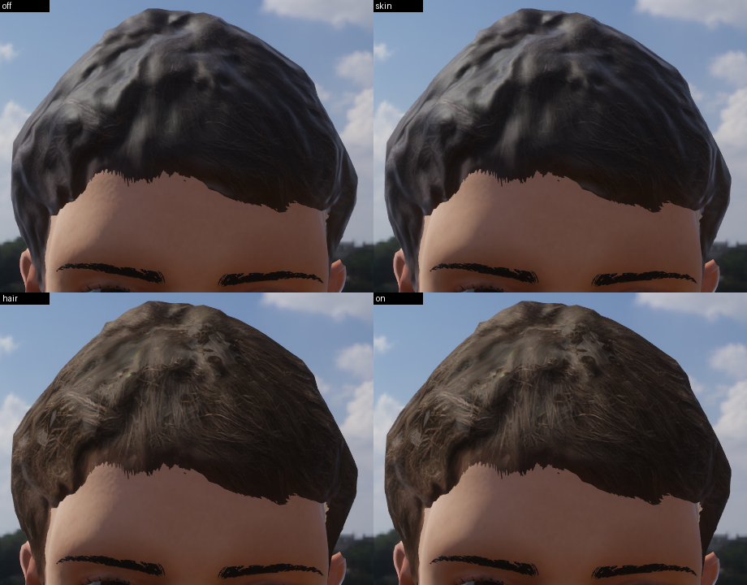
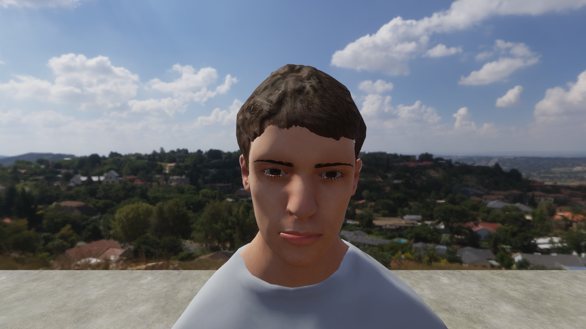

# Skin and hair shading on the Galaxy S25 Ultra

Measured 2026-11-24 for [#609](https://github.com/Pacheco95/sonnet/issues/609) (the S25 half of ADR-0041's phone gates) and for [#591](https://github.com/Pacheco95/sonnet/issues/591) ([ADR-0046](../decisions/0046-hair-strand-shading-and-coverage.md)'s hair runs), in one session of the Galaxy S25 Ultra (Adreno, Android 16). The iPad is not covered: it needs the Mac, and its half of both issues stays open (below).

**Verdict.** **ADR-0041's S25 gates pass, and so does ADR-0046's 0.3 ms for hair over skin, on the forward pass and on the plain frame; the whole frame cannot show a difference smaller than about 0.4 ms on this phone.** Skin adds at most +0.13 ms to the forward pass on the production build (native size; +0.02 ms at 1080p), the strand model +0.00 to +0.09 ms over skin and +0.02 to +0.05 ms alone, the showcase and the stress scene at most +0.04 ms at the median, the sustained p95 frame interval is 16.9 to 17.4 ms (the gate: below 33 ms) and the thermal status stays nominal in every run. Two limits: the iPad is not measured, and the 600 s runs were taken on the spike build with the phone on USB power (below). No default was changed.

## Setup and method

- **Builds.** The hair runs are the spike branch `spike/hair-flow-map` (`android-release`, RelWithDebInfo, the character sample cooked for Android by `sonnet_cook --platform android`), whose Skin pipelines are `main`'s and whose Hair pipelines are the [spike's](hair-strand-spike.md). The Skin gates of #609 ask for the production build, so the cold rounds were repeated with `main` at the spike's base commit (98a1365), cooked and built the same way (its tables follow the spike's; no 600 s run was taken of it).
- **Modes.** `--character-shading off|skin|hair|on`: `off` draws every material as Standard, `skin` only the Skin pipelines, `hair` only the Hair ones, `on` both. `hair` isolates the hair from the skin; `on` over `skin` is hair's cost over skin alone, which is what ADR-0046's budget names. The hair draws with the plain cutoff (`--hair-coverage` unset), which the spike's [coverage results](hair-strand-spike.md#the-gates) keep.
- **Views.** `capture_face` (the head at about half of a frame), at 1920×1080 (`--render-size`) and at the phone's own size, 1080×2340; the showcase's start scene and the basic sample's `stress` scene at 1920×1080. Cold runs are `--play 5` (the last 100 frames); sustained runs are `--play 600` (600 s of 60 fps steps), reading the last 100 frames. ADR-0039's method: three rounds, the modes' order rotated between rounds, the pass the models change (`forward`) beside the frame, and the thermal state in the log.
- **Cooldown.** The repository's rule starts a run once the HAL's skin reading is at most 31 °C with thermal status 0. **The phone was on USB power** (the session ran over USB `adb`, so the cable stayed attached), which holds the skin sensor near 31.7 to 31.9 °C at rest, so every run waited for at most 32.0 °C and status 0 instead, re-read every 20 s, the same bar for every mode. Charging heat makes the sustained runs' absolute thermal numbers pessimistic; the modes are compared under the same condition.
- **Clock correction.** The phone's GPU clock changes level between runs (the passes that no mode touches, summed, differ by up to 10 % between runs of the same mode), so a run's totals are scaled by the ratio of those passes to `off`'s of the same round ("corrected"), as the ambient-occlusion report did. The plain differences ("raw") are beside them. The player reports a median and a 95th percentile of the last 100 GPU frames per run; the minimum and maximum below are **across the three rounds**, since a run prints no per-frame extremes.

## Cold rounds

### Spike build (`on` is skin and hair)

#### capture_face, cold, 1920×1080

| Mode | GPU frame median per round (ms) | GPU frame p95 per round (ms) | Forward per round (ms) | Frame interval p95 per round (ms) | Rounds |
|---|---|---|---|---|---|
| off | 14.669, 13.625, 13.649 | 14.726, 14.713, 14.715 | 4.389, 4.098, 4.183 | 16.80, 17.70, 16.86 | 3 |
| skin | 13.609, 13.649, 13.651 | 14.755, 14.748, 14.721 | 4.055, 4.108, 4.101 | 17.67, 17.15, 17.10 | 3 |
| hair | 13.337, 13.696, 13.986 | 14.830, 14.790, 14.791 | 4.003, 4.148, 4.261 | 17.86, 17.04, 17.08 | 3 |
| on | 13.777, 14.745, 13.670 | 14.763, 14.813, 14.749 | 4.187, 4.363, 4.214 | 17.09, 17.00, 17.10 | 3 |

Added cost, median [min, max] of the rounds, in ms. *Corrected* scales a run by the ratio of the passes the models do not change (the phone's GPU clock changes level between runs); *raw* is the plain difference.

| Run over base | Forward, corrected | GPU median, corrected | GPU p95, corrected | Forward, raw | GPU median, raw | GPU p95, raw |
|---|---|---|---|---|---|---|
| skin over off | -0.003 [-0.053, +0.029] | +0.086 [-0.116, +0.266] | +0.290 [+0.102, +1.053] | -0.082 [-0.334, +0.010] | +0.002 [-1.060, +0.024] | +0.029 [+0.006, +0.035] |
| hair over off | +0.018 [+0.017, +0.044] | +0.010 [-0.035, +0.224] | -0.037 [-0.044, +1.597] | +0.050 [-0.386, +0.078] | +0.071 [-1.332, +0.337] | +0.077 [+0.076, +0.104] |
| on over off | +0.061 [+0.021, +0.119] | +0.117 [-0.158, +0.626] | +0.137 [-0.397, +0.824] | +0.031 [-0.202, +0.265] | +0.021 [-0.892, +1.120] | +0.037 [+0.034, +0.100] |
| on over skin | +0.069 [+0.062, +0.090] | -0.040 [-0.146, +0.537] | -0.214 [-0.496, -0.150] | +0.132 [+0.113, +0.255] | +0.168 [+0.019, +1.096] | +0.028 [+0.008, +0.065] |

#### capture_face, cold, native size

| Mode | GPU frame median per round (ms) | GPU frame p95 per round (ms) | Forward per round (ms) | Frame interval p95 per round (ms) | Rounds |
|---|---|---|---|---|---|
| off | 13.994, 14.009, 14.012 | 14.033, 14.066, 14.056 | 6.425, 6.418, 6.447 | 16.79, 16.97, 16.76 | 3 |
| skin | 14.065, 14.078, 14.080 | 14.111, 14.121, 15.102 | 6.545, 6.526, 6.439 | 16.98, 16.93, 17.05 | 3 |
| hair | 14.076, 14.082, 14.097 | 14.162, 14.151, 14.225 | 6.503, 6.483, 6.501 | 16.96, 16.90, 17.15 | 3 |
| on | 14.128, 14.143, 13.968 | 14.176, 14.201, 14.020 | 6.586, 6.580, 6.381 | 16.79, 16.82, 16.88 | 3 |

Added cost, median [min, max] of the rounds, in ms. *Corrected* scales a run by the ratio of the passes the models do not change (the phone's GPU clock changes level between runs); *raw* is the plain difference.

| Run over base | Forward, corrected | GPU median, corrected | GPU p95, corrected | Forward, raw | GPU median, raw | GPU p95, raw |
|---|---|---|---|---|---|---|
| skin over off | +0.138 [+0.069, +0.158] | +0.153 [+0.134, +0.236] | +0.160 [+0.120, +1.227] | +0.108 [-0.008, +0.120] | +0.069 [+0.068, +0.071] | +0.078 [+0.055, +1.046] |
| hair over off | +0.050 [+0.017, +0.055] | +0.021 [+0.004, +0.051] | +0.068 [+0.063, +0.087] | +0.065 [+0.054, +0.078] | +0.082 [+0.073, +0.085] | +0.129 [+0.085, +0.169] |
| on over off | +0.162 [-0.075, +0.172] | +0.136 [-0.064, +0.156] | +0.145 [-0.056, +0.157] | +0.161 [-0.066, +0.162] | +0.134 [-0.044, +0.134] | +0.135 [-0.036, +0.143] |
| on over skin | +0.004 [-0.143, +0.034] | -0.017 [-0.297, +0.022] | -0.015 [-1.268, +0.037] | +0.041 [-0.058, +0.054] | +0.063 [-0.112, +0.065] | +0.065 [-1.082, +0.080] |

#### Showcase, cold, 1920×1080

| Mode | GPU frame median per round (ms) | GPU frame p95 per round (ms) | Forward per round (ms) | Frame interval p95 per round (ms) | Rounds |
|---|---|---|---|---|---|
| off | 19.952, 19.959, 19.971 | 20.054, 20.356, 20.107 | 10.221, 10.268, 10.245 | 20.18, 20.36, 20.32 | 3 |
| on | 19.979, 19.955, 19.946 | 20.504, 20.055, 20.053 | 10.272, 10.269, 10.250 | 20.53, 20.11, 20.13 | 3 |

Added cost, median [min, max] of the rounds, in ms. *Corrected* scales a run by the ratio of the passes the models do not change (the phone's GPU clock changes level between runs); *raw* is the plain difference.

| Run over base | Forward, corrected | GPU median, corrected | GPU p95, corrected | Forward, raw | GPU median, raw | GPU p95, raw |
|---|---|---|---|---|---|---|
| on over off | +0.057 [+0.044, +0.064] | +0.051 [+0.039, +0.117] | +0.022 [-0.179, +0.463] | +0.005 [+0.001, +0.051] | -0.004 [-0.025, +0.027] | -0.054 [-0.301, +0.450] |

#### Stress scene, cold, 1920×1080

| Mode | GPU frame median per round (ms) | GPU frame p95 per round (ms) | Forward per round (ms) | Frame interval p95 per round (ms) | Rounds |
|---|---|---|---|---|---|
| off | 25.941, 25.963, 25.912 | 26.279, 26.352, 26.180 | 13.537, 13.545, 13.535 | 26.37, 26.38, 26.29 | 3 |
| on | 25.977, 27.016, 25.951 | 26.209, 29.160, 26.195 | 13.555, 13.632, 13.558 | 26.30, 29.57, 26.34 | 3 |

Added cost, median [min, max] of the rounds, in ms. *Corrected* scales a run by the ratio of the passes the models do not change (the phone's GPU clock changes level between runs); *raw* is the plain difference.

| Run over base | Forward, corrected | GPU median, corrected | GPU p95, corrected | Forward, raw | GPU median, raw | GPU p95, raw |
|---|---|---|---|---|---|---|
| on over off | -0.004 [-0.839, +0.014] | -0.006 [-0.782, +0.022] | -0.002 [-0.112, +0.828] | +0.023 [+0.018, +0.087] | +0.039 [+0.036, +1.053] | +0.015 [-0.070, +2.808] |

### Production build (`main`, 98a1365; `on` is skin)

The same rounds with the production build, which has no hair and takes `--character-shading on|off`:

#### Production build (`main`), capture_face, cold, 1920×1080

| Mode | GPU frame median per round (ms) | GPU frame p95 per round (ms) | Forward per round (ms) | Frame interval p95 per round (ms) | Rounds |
|---|---|---|---|---|---|
| off | 14.374, 14.412, 14.414 | 14.432, 14.706, 14.505 | 4.384, 4.338, 4.340 | 16.80, 16.83, 16.80 | 3 |
| on | 14.421, 14.422, 14.388 | 14.492, 14.477, 14.444 | 4.396, 4.354, 4.412 | 16.81, 16.87, 16.92 | 3 |

Added cost, median [min, max] of the rounds, in ms. *Corrected* scales a run by the ratio of the passes the models do not change (the phone's GPU clock changes level between runs); *raw* is the plain difference.

| Run over base | Forward, corrected | GPU median, corrected | GPU p95, corrected | Forward, raw | GPU median, raw | GPU p95, raw |
|---|---|---|---|---|---|---|
| on over off | +0.015 [+0.000, +0.077] | +0.006 [-0.010, +0.008] | -0.045 [-0.233, +0.021] | +0.016 [+0.012, +0.072] | +0.010 [-0.026, +0.047] | -0.061 [-0.229, +0.060] |

#### Production build (`main`), capture_face, cold, native size

| Mode | GPU frame median per round (ms) | GPU frame p95 per round (ms) | Forward per round (ms) | Frame interval p95 per round (ms) | Rounds |
|---|---|---|---|---|---|
| off | 13.752, 14.616, 14.636 | 14.712, 14.676, 14.670 | 6.550, 6.687, 6.645 | 17.24, 16.87, 16.89 | 3 |
| on | 13.764, 13.770, 14.748 | 14.787, 14.796, 14.797 | 6.490, 6.577, 6.825 | 17.57, 17.06, 16.91 | 3 |

Added cost, median [min, max] of the rounds, in ms. *Corrected* scales a run by the ratio of the passes the models do not change (the phone's GPU clock changes level between runs); *raw* is the plain difference.

| Run over base | Forward, corrected | GPU median, corrected | GPU p95, corrected | Forward, raw | GPU median, raw | GPU p95, raw |
|---|---|---|---|---|---|---|
| on over off | +0.125 [+0.055, +0.139] | -0.007 [-0.501, +0.433] | +0.491 [+0.007, +0.527] | -0.060 [-0.110, +0.180] | +0.012 [-0.846, +0.112] | +0.120 [+0.075, +0.127] |

#### Production build (`main`), Showcase, cold, 1920×1080

| Mode | GPU frame median per round (ms) | GPU frame p95 per round (ms) | Forward per round (ms) | Frame interval p95 per round (ms) | Rounds |
|---|---|---|---|---|---|
| off | 19.350, 19.358, 19.854 | 19.461, 20.150, 19.961 | 10.138, 10.164, 10.258 | 19.58, 20.33, 20.04 | 3 |
| on | 19.872, 19.387, 19.864 | 20.246, 19.479, 19.966 | 10.262, 10.140, 10.220 | 20.29, 19.60, 20.06 | 3 |

Added cost, median [min, max] of the rounds, in ms. *Corrected* scales a run by the ratio of the passes the models do not change (the phone's GPU clock changes level between runs); *raw* is the plain difference.

| Run over base | Forward, corrected | GPU median, corrected | GPU p95, corrected | Forward, raw | GPU median, raw | GPU p95, raw |
|---|---|---|---|---|---|---|
| on over off | -0.019 [-0.322, +0.113] | +0.039 [-0.341, +0.303] | -0.095 [-0.661, +0.299] | -0.024 [-0.038, +0.124] | +0.029 [+0.010, +0.522] | +0.005 [-0.671, +0.785] |

#### Production build (`main`), Stress scene, cold, 1920×1080

| Mode | GPU frame median per round (ms) | GPU frame p95 per round (ms) | Forward per round (ms) | Frame interval p95 per round (ms) | Rounds |
|---|---|---|---|---|---|
| off | 25.891, 25.927, 25.905 | 26.290, 26.222, 26.197 | 13.530, 13.553, 13.558 | 26.25, 26.27, 26.25 | 3 |
| on | 25.395, 25.922, 25.936 | 26.007, 26.213, 26.186 | 13.388, 13.540, 13.550 | 26.05, 26.29, 26.26 | 3 |

Added cost, median [min, max] of the rounds, in ms. *Corrected* scales a run by the ratio of the passes the models do not change (the phone's GPU clock changes level between runs); *raw* is the plain difference.

| Run over base | Forward, corrected | GPU median, corrected | GPU p95, corrected | Forward, raw | GPU median, raw | GPU p95, raw |
|---|---|---|---|---|---|---|
| on over off | -0.019 [-0.061, +0.303] | +0.010 [-0.097, +0.347] | -0.032 [-0.102, +0.581] | -0.013 [-0.142, -0.008] | -0.005 [-0.496, +0.031] | -0.011 [-0.283, -0.009] |

The Skin and Hair pipelines compiled and drew correctly on Adreno: the four pipelines (`forward skin`, `forward hair` and their double-sided pairs) are built when the setting turns on (the log says `built the skin pipelines from forward: 4 pipelines`), the logs of every run carry no error, and the captures show the skin's soft terminator and the strands' highlight where `off` has the plain model. The whole frame at 1080p:

## Sustained, 600 s

#### capture_face, sustained 600 s, 1920×1080 (the last 100 frames of each run)

| Mode | GPU frame median / p95 (ms) | Forward (ms) | Frame interval median / p95 (ms) | Skin °C at start / peak / end | Worst thermal status | Thermal state in the log |
|---|---|---|---|---|---|---|
| off | 14.597 / 14.775 | 4.266 | 16.63 / 16.91 | 32.0 / 37.0 / 37.0 | 0 | nominal -> nominal (worst nominal) |
| skin | 13.658 / 14.707 | 4.213 | 16.65 / 17.01 | 29.5 / 35.5 / 35.5 | 0 | nominal -> nominal (worst nominal) |
| hair | 13.713 / 13.758 | 4.108 | 16.62 / 17.43 | 32.0 / 37.0 / 36.9 | 0 | nominal -> nominal (worst nominal) |
| on | 13.667 / 14.726 | 4.156 | 16.63 / 17.37 | 32.0 / 37.2 / 37.1 | 0 | nominal -> nominal (worst nominal) |

Added over off, clock-corrected (forward / GPU median / GPU p95, ms), one run each:

- skin over off: +0.035 / -0.655 / +0.238 (raw -0.053 / -0.939 / -0.068)
- hair over off: +0.041 / -0.219 / -0.350 (raw -0.158 / -0.884 / -1.017)
- on over off: +0.094 / -0.260 / +0.673 (raw -0.110 / -0.930 / -0.049)
- on over skin: +0.058 / +0.387 / +0.426 (raw -0.057 / +0.009 / +0.019)

- **Start conditions.** Each run waited for at most 32.0 °C and thermal status 0 (see the method); the `skin` run started at 29.5 °C (the phone had idled for longer) and the others at 32.0 °C, so its peak (35.5 °C) is lower for that reason as well as for any difference in the mode. The player's own thermal state reads nominal at start, at the end and at its worst in all four, and the HAL's status stayed 0 in every sample.
- **The `on` run's temperature samples are incomplete.** A second device appeared on `adb` during that run (since disconnected) and the sampling script's `adb` calls failed for most of the run: the run itself completed, and its PNG, its frame-times line and its `logcat` were recovered from the S25, but its HAL samples after the first minute or so are blank. Its skin peak, 37.3 °C, and its thermal state come from the system's own `thermal_core` lines in that `logcat` (the first three minutes of which the log buffer did not keep) and from the player's thermal line; `off` peaked at 37.0 °C and `hair` at 37.0 °C by the same lines. The status gate needs only the thermal state, which both give as nominal, so the run was not repeated.
- **The whole-frame sustained figures.** The unchanged passes summed to 10.10 ms in `off`, 9.90 in `skin` and 9.63 in `hair` and in `on`, so the clock-corrected whole-frame medians move by up to 0.65 ms with nothing in the model (`skin` over `off` is −0.655 ms, `on` over `skin` +0.387 ms; the raw differences are −0.939 and +0.009 ms). The forward pass, the only pass a model changes, is the reading that holds: +0.035 ms for skin, +0.041 ms for hair and +0.058 ms for both over skin alone.

The production build's Skin pipelines are the spike's, which the spike did not change (`shadeFragment<ShadingSkin>` compiles to the same shading), so the sustained skin numbers above stand for it; a sustained run of `main` itself was not taken.

## The gates

Cost is read on the forward pass and on the whole frame, each clock-corrected and raw; ranges are the minimum and maximum across the three cold rounds (the sustained runs are one run each). A positive number is added GPU time.

| Gate | Source | Measured | Verdict |
|---|---|---|---|
| **Skin ≤ 0.5 ms, median and p95, cold** (ADR-0041) | production build, `capture_face`, 1080p | forward +0.015 [+0.000, +0.077]; frame median +0.006 [−0.010, +0.008] corrected, +0.010 raw; p95 −0.045 [−0.233, +0.021] corrected, −0.061 raw | pass |
| | production build, native size | forward +0.125 [+0.055, +0.139]; frame median −0.007 [−0.501, +0.433] corrected, +0.012 raw; p95 +0.491 [+0.007, +0.527] corrected, +0.120 [+0.075, +0.127] raw | pass; one round's corrected p95 is 0.527, which the raw 0.127 of the same round does not support |
| | spike build, 1080p | forward −0.003 [−0.053, +0.029]; frame median +0.086 [−0.116, +0.266]; p95 +0.290 [+0.102, +1.053] corrected, +0.029 [+0.006, +0.035] raw | pass; the 1.053 is a corrected figure of the round in which `off`'s clock differed |
| | spike build, native size | forward +0.138 [+0.069, +0.158]; frame median +0.153 [+0.134, +0.236]; p95 +0.160 [+0.120, +1.227] corrected, +0.078 [+0.055, +1.046] raw | pass at the median; **one of the three rounds' p95 is 1.05 ms above `off`'s** (round 3's `skin` run: p95 15.10 ms against a median of 14.08, a few slow frames), not seen in the production build's three rounds (raw p95 at most +0.127) |
| **Skin ≤ 0.5 ms, sustained** | spike build, 1080p, 600 s | forward +0.035; frame −0.655 corrected / −0.939 raw (median), +0.238 / −0.068 (p95) | pass |
| **Sustained p95 frame interval < 33 ms** | spike build, 1080p, 600 s | 16.91 (off), 17.01 (skin), 17.43 (hair), 17.37 (both) | pass |
| **Thermal state no worse than with it off** | 600 s runs | status 0 and nominal in all four; skin sensor peak 37.0 (off), 35.5 (skin, started at 29.5), 37.0 (hair), 37.3 (both) °C | pass; the `on` run's HAL samples are incomplete (above) |
| **Showcase ≤ 0.1 ms** | production build, 1080p | forward −0.019 [−0.322, +0.113]; frame +0.039 [−0.341, +0.303] corrected, +0.029 [+0.010, +0.522] raw | pass at the median; single rounds' noise reaches 0.1 on the forward pass |
| **Stress scene ≤ 0.1 ms** | production build, 1080p | forward −0.019 [−0.061, +0.303]; frame +0.010 [−0.097, +0.347] corrected, −0.005 raw | pass at the median; single rounds' corrected noise reaches 0.3 |
| Showcase, stress | spike build | forward +0.057 / −0.004; frame +0.051 / −0.006 | pass |
| **Skin and Hair pipelines compile and draw on Adreno** | all runs | the four pipelines build, no error in any log, captures above | pass |
| **Hair ≤ 0.3 ms over skin alone, median and p95, cold** (ADR-0046) | spike build, `on` over `skin`, 1080p | forward +0.069 [+0.062, +0.090]; frame median −0.040 [−0.146, +0.537]; p95 −0.214 [−0.496, −0.150] (corrected); raw +0.168 [+0.019, +1.096] / +0.028 [+0.008, +0.065] | pass on the forward pass and the raw p95; the raw median's 1.096 is the round whose clock differed |
| | native size | forward +0.004 [−0.143, +0.034]; frame median −0.017 [−0.297, +0.022]; p95 −0.015 [−1.268, +0.037] (corrected) | pass |
| **Hair ≤ 0.3 ms over skin alone, sustained** | `on` over `skin`, 1080p | forward +0.058; frame +0.387 / +0.426 corrected (median / p95), +0.009 / +0.019 raw | pass on the forward pass and raw; the corrected whole frame is the clock's 2.8 % (the two runs' unchanged passes differ by that), not the model |
| Hair alone over `off` | `hair` mode | cold forward +0.018 [+0.017, +0.044] (1080p), +0.050 [+0.017, +0.055] (native); sustained +0.041 | within the budget |
| **The iPad** | | **not measured** | open |

Whether the phone's `characterShading` default follows is the owner's: `apps/player/main.cpp` keeps it off on Android, and ADR-0041 enables a phone when its numbers pass. The Android numbers above pass; the iOS default stays off until the iPad is measured.

## Open on the iPad

[#609](https://github.com/Pacheco95/sonnet/issues/609) asks for the same runs on the iPad, measured separately, and for the captures of the Skin pipelines on Apple GPUs; [#591](https://github.com/Pacheco95/sonnet/issues/591)'s hair budget has the same iPad half. They need the Mac and the iPad: `ios-release` built and installed with `devicectl`, the character sample cooked for iOS, then the cold and sustained pairs of this report (`off`, `skin`, `hair`, `on`, `capture_face`, at 1080p and at the iPad's own size, and the showcase and stress scene on against off), with the thermal state sampled through the run (the player's own thermal line works on iOS). iOS keeps `characterShading` off, and the hair stays off on the iPad, until then.

## Not covered

- **No default changed.** `apps/player/main.cpp` still turns `characterShading` off on Android: this report is the evidence for that decision, which is the owner's.
- **One phone, USB-powered.** One S25, charging through the session, so the sustained thermal numbers are pessimistic and a battery-only run could differ; the cold rounds are short enough for it not to matter.
- **The hair measured is the spike's.** The strand pipelines carry the spike's shortcuts ([the report](hair-strand-spike.md#what-was-built)), among them a per-material branch in the shared pre-pass that every column of every on/off pair includes, so the cost of that branch against `main` is not separated here; the production build measures it. The 5 s cold rounds cannot see a cost that grows with heat.
- **Per-frame extremes.** The player prints a median and a p95 over the last 100 frames; the ranges in the tables are across rounds.
