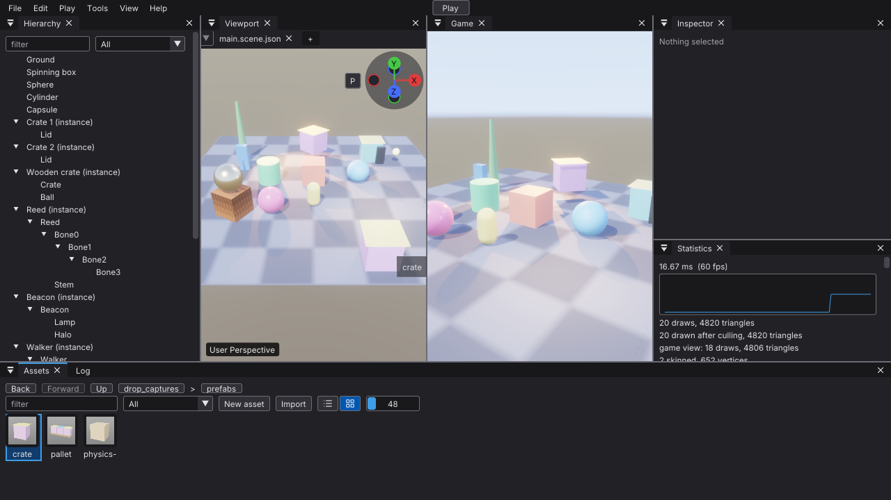
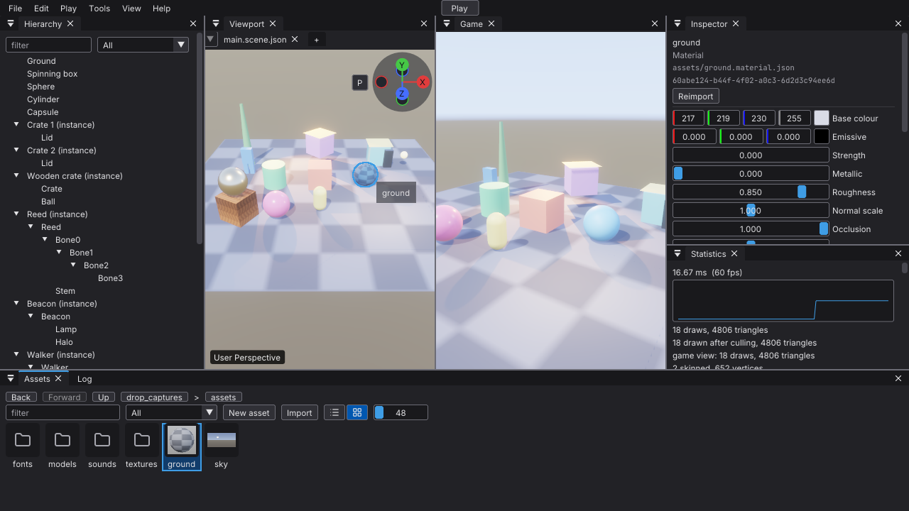
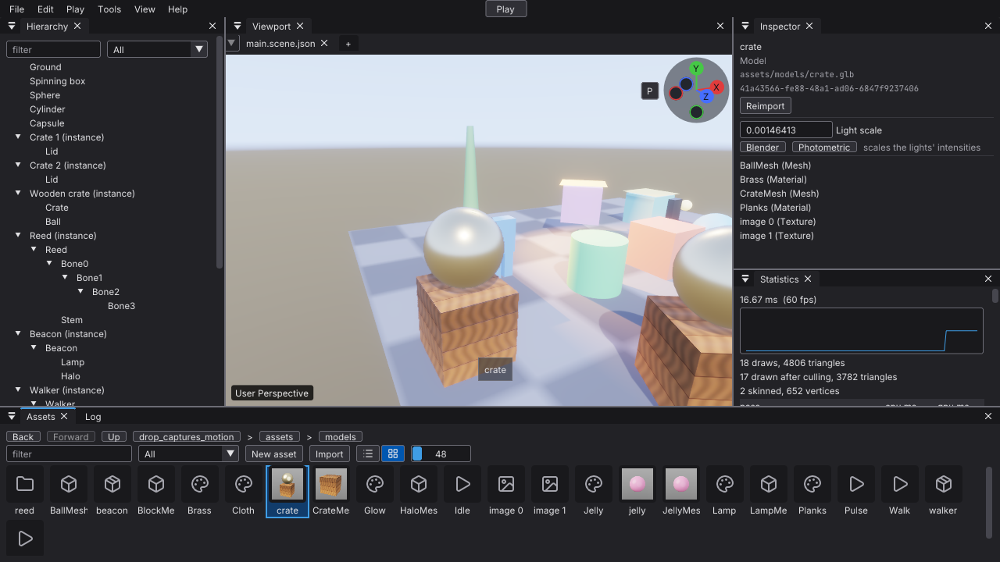
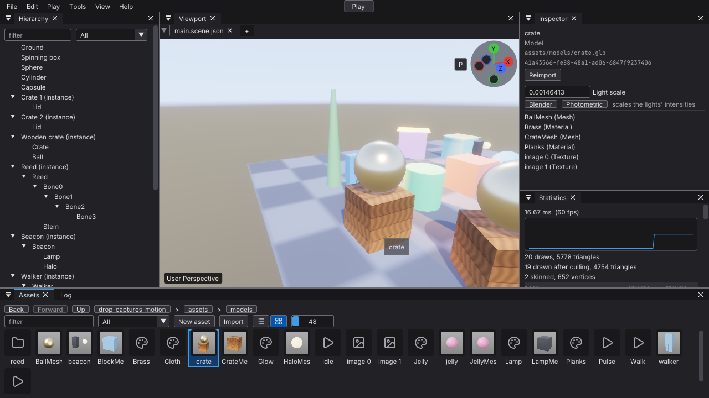
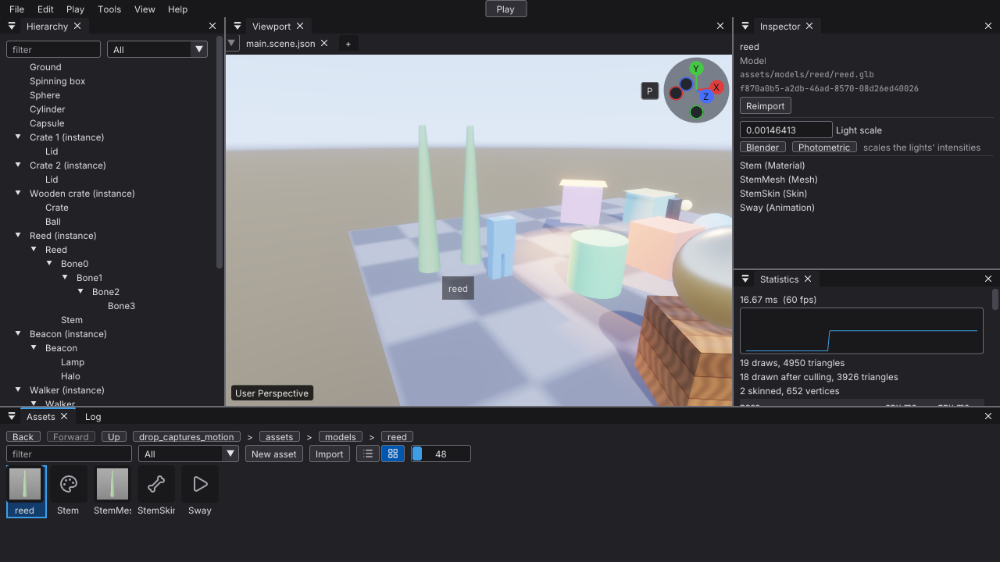
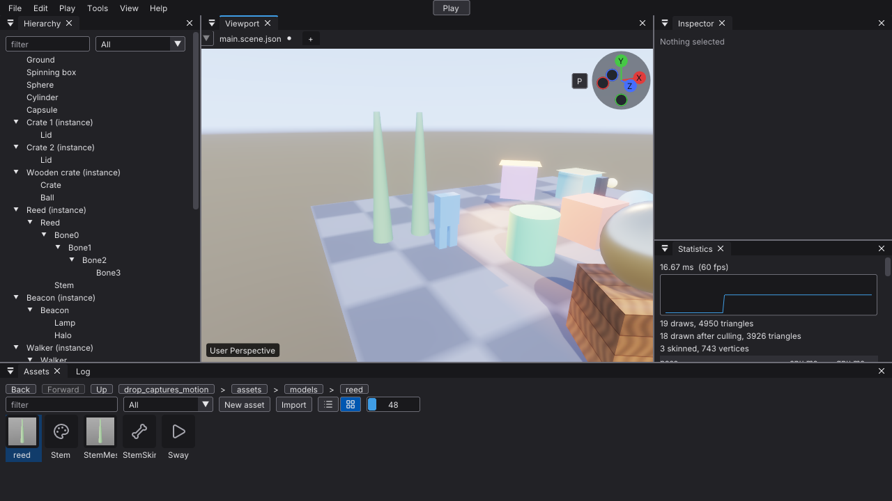

# Viewport asset drop verification

Issue [#449](https://github.com/Pacheco95/sonnet/issues/449), part of
[#441](https://github.com/Pacheco95/sonnet/issues/441). Linux Debug, Lavapipe,
Vulkan validation enabled. These are the editor's own window captures, taken
mid-drag by the headless ImGui test on a temporary copy of the Basic sample
([Dropping assets on the viewport](../editor.md#dropping-assets-on-the-viewport)).
The run ended with no validation message.

## Crate prefab, snapped



The crate prefab is held over the ground with Ctrl held, which turns Snap to
grid on. Its preview stands on the floor at a whole-metre landing point, its
bounds resting on the surface rather than sinking into it. The Game view does not
show it: the viewport counts 20 draws and the Game view 18, the crate's two
meshes. The release adds `instantiate Crate`, which the test then undoes.

## Ground material on the sphere



The ground material is held over the sphere. The sphere is drawn with the
material's checker and outlined in the accent colour; the Game view still shows
it with its own material. The release adds `set material of Sphere`.

## Under TAA, and a skinned model

Issue [#461](https://github.com/Pacheco95/sonnet/issues/461). The same setup, with
TAA on (the default; the case checks it) and the camera low over the left of the
ground. Nothing in the drop preview needed a change.

### First frame of the preview



The wooden crate model, picked up in the Assets panel, is moved onto the viewport
and captured on the frame its preview first appears. That frame has no previous
placement, so its draws leave `previousTransform` unset, which the renderer reads
as "did not move" (previous equals current), not as the identity. The crate is
drawn whole at the cursor, with no streak towards the world origin or towards
where the cursor came from.

### Moving preview



The crate is then swept right and back, 0.3 m (about 20 pixels) a frame, and
captured mid-sweep. Each frame's draws get last frame's placement as
`previousTransform`, and the resolve used the history on every frame of the sweep
(`temporalHistoryUsed`). The planks stay sharp and nothing trails behind the
crate. The viewport image of this frame differs from the same crate held still at
that point for 30 frames in 275 of 291,600 pixels by more than 15 levels, at most
52, along its edges.

The comparison does not tell much apart: with the preview's motion vectors
removed (`previousTransform` left unset), the same moving frame differs from the
still one in 311 pixels, at most 58. TAA's neighbourhood clamp hides most of a
wrong motion vector at this speed on this scene. The motion vectors are therefore
checked by reading the code (`Editor.cpp`, and `Renderer.cpp`, which falls back
to the current transform when `previousTransform` is unset). The captures show
that the preview has no visible smear or ghost.

### Skinned model in its bind pose





The Reed model, whose stem is skinned to four bones (the Walker animates
unskinned parts), is held 1 m to the left of the scene's Reed, then dropped there.
A prefab is not posed by the animation system, so the preview draws the stem's
mesh as it is, in its bind pose (`jointCount` 0, `skinInstance` 0), at the drop
point. The skinning pass still deforms only the scene's two instances, the Reed
and the Jelly (`skinnedInstanceCount` is 2 while held and 3 once dropped). The
viewport image of the held preview and of the dropped instance, skinned in its
rest pose, differ in 4 pixels by more than 15 levels, outside the reeds. The
scene's Reed is the same in the image before the drag, while held, and after the
drop (no pixel more than 9 levels apart). This model's rest pose is its bind
pose, so the capture does not separate a bind-pose preview from a posed one.

## Reproduce

```sh
SONNET_KEEP_TEST_TMPDIR=1 VK_DRIVER_FILES=/usr/share/vulkan/icd.d/lvp_icd.json \
  ./build/linux-debug/modules/editor/editor_tests '[.drop-captures]'
```

The test process points the temporary directory at one of its own and removes it
on exit ([Build](../build.md)). `SONNET_KEEP_TEST_TMPDIR=1` keeps it, and the
last line on stderr names it, so the images are in
`/tmp/sonnet-editor_tests-<pid>/sonnet-drop-captures`. The tag runs two cases;
the second (#461) also writes each picture's viewport image, prefixed
`viewport-`, and `crate-still.png` and `scene-before.png` for the comparisons
above. The `[editor][drop]`
tests drive the same drags and check the placement, the snapping, the material
and script targets, and that nothing changes before the release. This
verification does not cover other desktop platforms or a physical mouse run.
