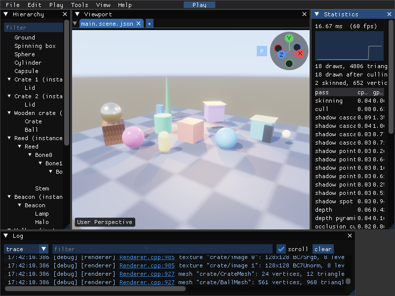
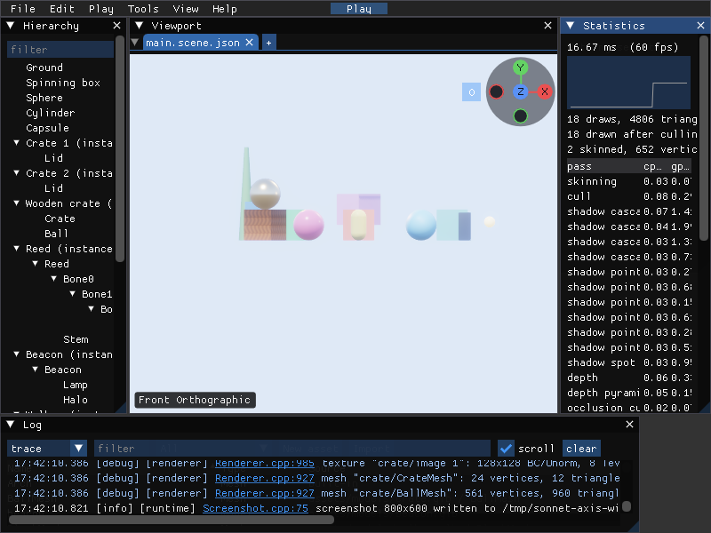
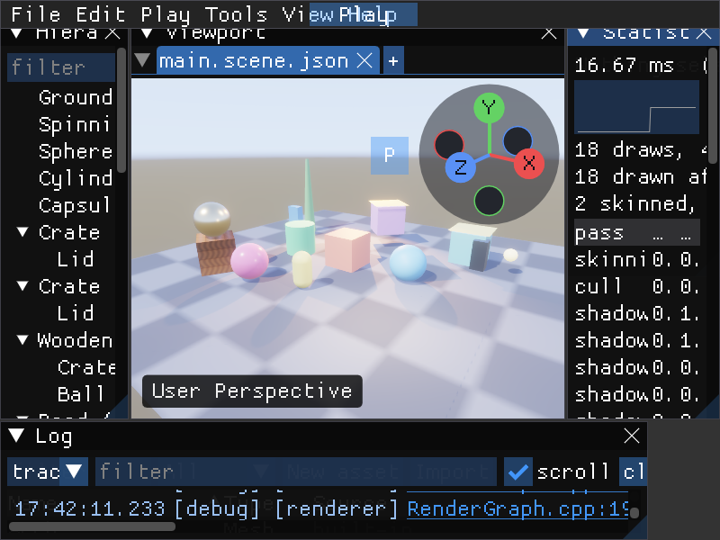
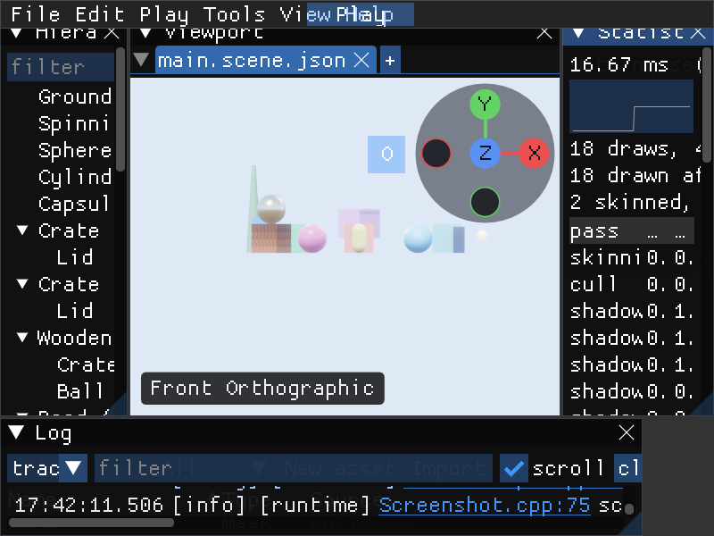

# Viewport axis widget verification

Issue [#294](https://github.com/Pacheco95/sonnet/issues/294). Linux Debug,
Lavapipe, Vulkan validation enabled. These are the editor's own window captures
of a temporary copy of the Basic sample.

## Perspective



## Front orthographic



## UI scaling

The controls and their hit regions follow the font size.





## Reproduce

```sh
VK_DRIVER_FILES=/usr/share/vulkan/icd.d/lvp_icd.json \
  ./build/linux-debug/modules/editor/editor_tests '[.axis-widget-captures]'
```

Images land in `/tmp/sonnet-axis-widget-captures`. The `[axis-widget]` headless
ImGui test clicks all six ends, flips each current axis to its opposite and back,
toggles projection, and drags across and outside the widget while checking the
pivot distance and selection. Pointer presses and holds are withheld from the
viewport's picking and gizmo input. This verification does not cover other desktop
platforms or a physical mouse run.
