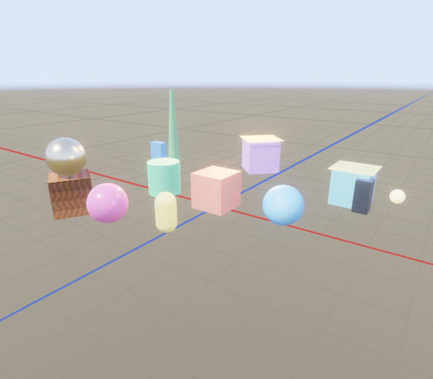
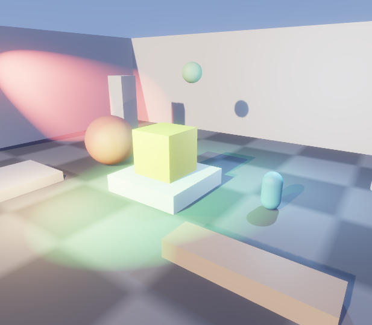
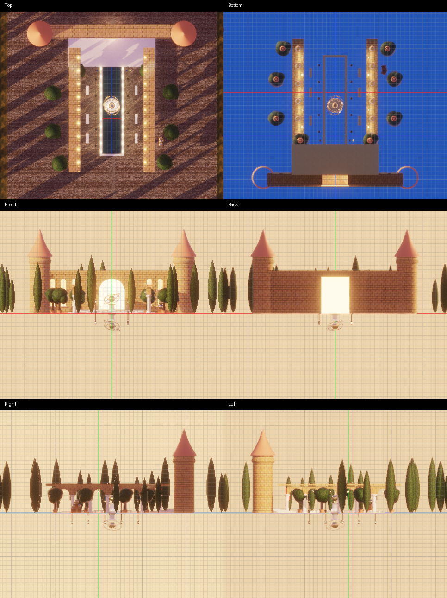

# Viewport floor grid verification

Issue [#295](https://github.com/Pacheco95/sonnet/issues/295). Linux Debug, RTX 4090 captures with TAA enabled. The images are the editor's own viewport captures, not desktop screenshots.

## Visible grid

The basic sample with its `Ground` entity removed in a temporary copy of `scenes/main.scene.json`: metre lines, coarser levels, red X and blue Z axes. The scene objects occlude the grid.



```sh
./build/linux-debug/apps/editor/sonnet_editor apps/samples/basic \
  --scene /tmp/sonnet-grid.scene.json --grid on --screenshot /tmp/sonnet-grid-visible.png
```

The temporary scene uses the same sample assets; only the entity named `Ground` is removed. No sample files are modified.

## Lit ground

The lighting sample with the grid requested. Its ground and objects hide the grid.



```sh
./build/linux-debug/apps/editor/sonnet_editor apps/samples/basic \
  --scene scenes/lighting.scene.json --grid on --screenshot /tmp/sonnet-grid-lit.png
```

## Automated coverage

The renderer's `[grid]` GPU tests compare images across the eight TAA jitter phases, compare an orbiting grid with unjittered rendering, and compare a tilted ground with and without the grid. Editor tests cover preference persistence, capture opt-in without changing the saved setting, and snapping an off-grid cube to the default metre spacing. The shader also passes the desktop SPIR-V rewrite check for Adreno; this is not a phone render test.

## Orthographic axis views

The six axis views of the showcase, captured on Linux with Lavapipe by
`editor_tests "[.orthographic-showcase]"`. Each uses its view plane through the
origin, with X red, Y green and Z blue. The courtyard floor hides the Top grid;
from Bottom the origin plane is in front of the floor. Front/Back use XY and
Right/Left use YZ. Scene geometry in front of the plane occludes it.



The renderer GPU tests check both directions of all three planes, the two expected
axis colours, identical pixels at different camera distances, changed spacing at
different orthographic heights, and a coplanar surface hiding the grid. The editor
orthographic drag test holds Ctrl and drags 1.2 m, checking the cube snaps to 1 m.
Move step stays fixed when zooming, as described in [Floor grid](../editor.md#floor-grid).
