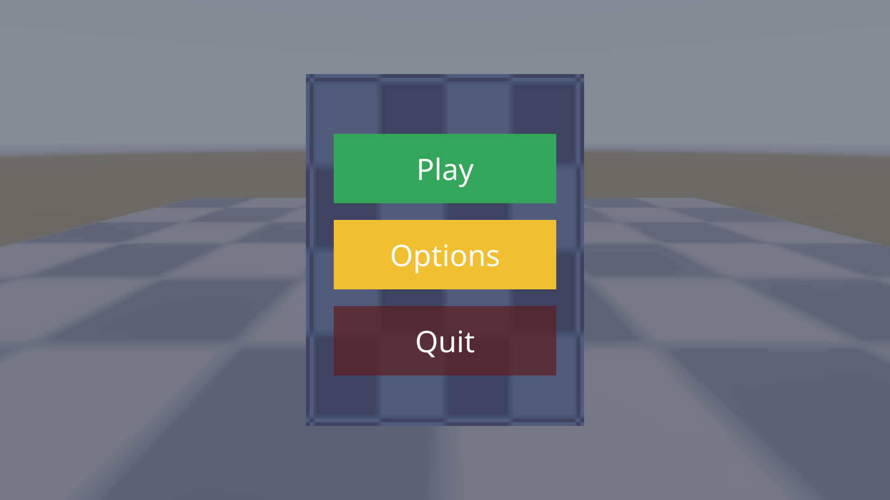
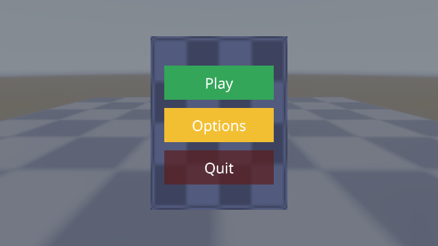

# Windows text and font GUI validation

Verified [issue 194](https://github.com/Pacheco95/sonnet/issues/194) against
PR [#192](https://github.com/Pacheco95/sonnet/pull/192) (`feat/gui-text`) at
commit `1bf3cdb4161493f6dc46a0623ad7fa4f9df84ef6`, on 2026-10-12. Report only;
no engine or sample change was needed, and PR #192 was not merged.

## Setup

Windows 11 Pro, build 10.0.26200.9457; NVIDIA GeForce RTX 4090, driver
NVIDIA 596.49; Vulkan 1.4.329 device, loader 1.4.357, validation on
(Core Checks, Synchronization, Stateless Parameter, Object lifetime,
Thread Safety, Handle Wrapping).

```sh
cmake --preset windows-debug
cmake --build --preset windows-debug
ctest --preset windows-debug --output-on-failure
```

via `vcvars64.bat` (MSVC, Visual Studio 18 Community). Build clean, no
errors or warnings. The four suites the issue names most were also run
standalone for exact counts.

## Correctness

| Binary | Cases | Assertions | Result |
|---|---:|---:|---|
| `gui_tests` | 40/40 | 82,584 | all pass |
| `renderer_tests` | 95/95 | 34,922 | all pass |
| `assets_tests` | 55/55 | 1,443 | all pass |
| `runtime_tests` | 8 passed / 1 failed / 16 skipped | 160/161 | see below |

The one `runtime_tests` failure (`GameTests.cpp:562`, "a bundle cooked for a
phone is refused on a device without ASTC") is pre-existing and unrelated to
this PR: a Windows `remove_all` file-lock error during temp-directory cleanup
in a mobile/ASTC bundle test whose code this PR's diff does not touch; it
fails standalone the same way with no other change. The 16 skips are all
`SKIP("headless surfaces are not supported here")`: this Windows/NVIDIA
combination has no `VK_EXT_headless_surface`, so the test harness's offscreen
SDL driver cannot create a Vulkan surface — an environment limitation, not a
regression. That skip set includes the automated same-frame text-update case,
verified manually instead, below.

## Menu capture

`sonnet_player apps/samples/basic --scene scenes/menu.scene.json
--render-size <WxH> --settle-frames 6 --screenshot ...` at 1920x1080 and
640x360:




Play, Options and Quit render as crisp white text, centered in each button,
at both scales, with no solid blocks, no missing glyphs and no flicker
between the two captures. SDF glyph edges stay smooth at the lower scale; no
VUID or validation-layer error appears in either capture's log, with the
layers above enabled throughout.

Overlay pass, from each capture's frame-times line:

| render size | overlay GPU | GPU total | CPU a frame |
|---|---:|---:|---:|
| 1920x1080 | 0.009 ms | 0.235 ms | 1.78 ms |
| 640x360 | 0.003 ms | 0.115 ms | 1.76 ms |

## Same-frame text update

The automated case (`GameTests.cpp:999`, "a script that sets a label's text
changes the next captured frame") is one of the 16 skipped above. Its
`labelProject` fixture was rebuilt as a throwaway project — one label, the
sample's Noto Sans font, a script that sets `GuiText.text` to "Score 12" on
its twelfth fixed update — and driven with `sonnet_player --play <seconds>
--screenshot`, which opens a real window surface rather than the headless one
the skip applies to:


The second capture's glyphs for '1' and '2' — absent from "Score 0" and so
never rasterized before that update — draw fully formed in the same frame
the script sets the text, with no placeholder block and no stale frame.

## Result

`gui_tests`, `renderer_tests` and `assets_tests` pass in full on this
Windows/MSVC/RTX 4090 configuration; the one `runtime_tests` failure is
pre-existing and outside this PR's diff. Rendering, edge smoothness,
validation-layer cleanliness and the same-frame text update all pass by the
issue's steps.

## Not verified

- iPad and iPhone hardware (unavailable here).
- The pre-existing `remove_all` file-lock failure's root cause (outside this
  issue's scope).

Raw log excerpts are in [`windows-gui-text-captures/evidence.txt`](windows-gui-text-captures/evidence.txt).
